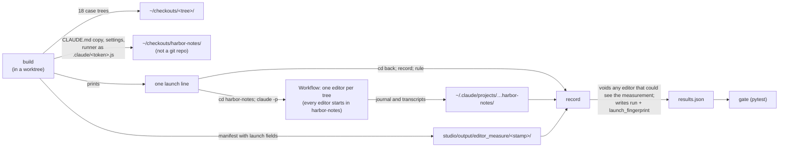

# Blind Measurement — Architecture Spec

## In Plain Language

Studio measures how well the `/forge` editor catches bugs by running it on 18 prepared copies of
past commits (`specs/judged-rules.md`). A measurement only means something if the editor reviews
those copies the way it reviews real work. An editor that can tell it is being tested may behave
differently.

The first baseline (PR #275) leaked. Every editor inherits the folder the measuring session started
in, and that folder told them. Each editor saw the branch `measure/editor-baseline`, an untracked
`studio/evals/forge_editor/results.json`, and commit titles like "Make the editor benchmark's cases
hold up to an audit". Each was also loaded with the owner's auto-memory index, which says Studio
"measures the /forge editor". One editor also ran a command against the measuring checkout itself.

This feature starts each measurement from a plain folder that says nothing about measuring. It then
makes `record` check every editor's transcript and refuse any case where the editor could have seen
the measurement. Each run also records the conditions it was launched under. A run launched this
way cannot be judged against a mark set under the old, leaky conditions, so the gate goes red until
two clean baseline runs re-set the mark.

## Architecture at a Glance



`build` still builds and proves the 18 trees. It now also writes the launch folder and prints one
line. The owner pastes that line. It changes into the launch folder and starts a headless Claude
session there, which runs the runner. Every editor the runner starts inherits that plain folder as
its starting point. The line then changes back into the worktree and runs `record` and `rule`.
`record` reads each editor's transcript and voids the case if anything in the editor's starting
context, or anything it did, shows the measurement. The gate then reads `results.json` as before,
with one new rule about launch conditions.

## How It Works (Technical)

### Components

| Component | Change | Responsibility |
|---|---|---|
| `studio/editor_measure.py` | edit | `build` writes the launch folder, refuses a bad one, and prints the launch line. `TELLTALE_WORDS` gains experiment, rubric, score, compare, benchmark, candidate and arena (Lauren Tan's eval playbook list, of which eval, test and judge are already in). |
| `studio/editor_results.py` | edit | `publish_build` writes the launch fields into the manifest and the runner into the launch folder. `collect_journal` applies the launch checks to each case. `record` writes `launch_fingerprint` and `claude_code_version` on the run. |
| `studio/evals/forge_editor/measure-runner.js` | edit | `meta.name` becomes a per-build token that `build` substitutes. Its description and return keys become neutral (for example `'Run one review in each checkout.'` and `{ done, count }`). |
| `studio/tests/test_editor_measurement.py` | edit | The gate refuses to judge a run that carries a launch fingerprint against a mark whose runs carry none. |
| `.claude/commands/measure-editor.md` | delete | A session started in the launch folder cannot load the worktree's commands, and copying the file in would put a file named "measure" where editors can list it. The printed line replaces it. |
| Docs | edit | README, `CLAUDE_CODE_USAGE.md`, `ARCHITECTURE.md`, `IMPLEMENTATION_LOOP_SPEC.md`, and in `specs/judged-rules.md` the tells table, the measuring loop, the void-case paragraph, "Not covered" and the failure table. |

### The launch folder

`build` writes it after every tree has built and proved. It recreates `<root>/harbor-notes/` from
empty, the same way it treats a tree, so nothing an earlier editor left there survives:

- `CLAUDE.md`, a byte copy of the source checkout's (decision 1: editors work under the same repo
  rules as a real `/forge` run).
- `.claude/settings.json`, exactly `{"autoMemoryEnabled": false}`.
- `.claude/<runner_token>.js`, the built runner. The token is random per build and holds no telltale
  word. It also becomes the runner's `meta.name`, so it is on the file's first line. The Workflow
  tool refuses a `scriptPath` outside the session's working directory, so the runner has to live
  here. No second copy goes under `studio/output/`.

The folder is not a git repository, so the session gets no git status. Verified on Claude Code
2.1.332: a headless session in such a folder under `~/checkouts`, with that settings file and a
copied `CLAUDE.md`, loads exactly two instruction files (`~/.claude/CLAUDE.md` and the copy). It
also gets no git status and no auto-memory file. The global file loads because the folder is under
the home directory. A real `/forge` editor gets it too, so it stays (decision 4).

`build` refuses, with exit 2 and the reason, before building anything, when the root sits inside a
git work tree or when the launch folder's path fails `explain_bad_location` (a telltale word, or a
character it cannot quote).

### The manifest's launch fields

| Field | Value |
|---|---|
| `launch_folder` | the folder's absolute path |
| `runner_token` | the random token |
| `instruction_files` | `<config dir>/CLAUDE.md` when it exists at build time, then the copy's path. The config dir is `CLAUDE_CONFIG_DIR` or `~/.claude`, the rule `record` already uses for `projects`. |
| `forbidden_paths` | the source checkout; the main checkout (the parent of `git rev-parse --path-format=absolute --git-common-dir`), whose path prefixes every sibling worktree; and `<config dir>/projects/`. Each is listed in its absolute form and, when under the home directory, its `~/` form. |
| `launch_fingerprint` | SHA-256 over the folder's absolute path, a NUL, then for each of the copied `CLAUDE.md`, `.claude/settings.json` and the global `CLAUDE.md` when present: its path, a NUL, its bytes, a NUL. The runner is left out; the prompt and cases fingerprints already cover it. |

### The launch line

`build` prints it last, with every path shell-quoted:

```
cd <root>/harbor-notes && claude -p --setting-sources project,local --strict-mcp-config --permission-mode auto --allowedTools Workflow -- 'Run the Workflow tool with scriptPath <root>/harbor-notes/.claude/<token>.js and no args, and wait for it to finish.' && cd <source checkout> && python studio/editor_measure.py record && python studio/editor_measure.py rule
```

The owner's routine per measurement is two steps. They run `python studio/editor_measure.py build`
in a fresh worktree of the measured branch, then paste the printed line. Rulings come afterwards in
any session, with `rule --run <id> --case <tree> --outcome caught|missed --note "…"`. A void run
means a fresh build and a fresh paste.

### What `record` checks

All of today's voids stay: no result, an `mcp__` tool, a prompt mismatch, a start before
`built_at`, a relayed request, the wrong model, a moved HEAD. For each case's transcript
`agent-<id>.jsonl`, `record` reads three parts:

- **context**: the raw text of every line before the first row whose `type` is `assistant`. This
  holds everything Claude Code assembled for the model.
- **actions**: the JSON text of the `input` of every `tool_use` block in `assistant` rows.
- **results**: the text of every `tool_result` block.

A case is void when any of these holds:

| Rule | Condition | What it catches |
|---|---|---|
| Started elsewhere | context does not contain `Primary working directory: ` + `launch_folder` followed directly by the end of that line | another starting folder, one whose path merely begins with the launch folder's, or a Claude Code release that stops rendering the line (fails closed) |
| Unexpected instructions | the paths matched by `Contents of (\S+) \(` in context are not exactly `instruction_files` | the auto-memory index, a stray `CLAUDE.md`, a missing copy, or changed rendering (an empty set fails closed) |
| Saw git status | context contains `Current branch:` | the measuring repo's branch, status and commit titles |
| Touched the measurement | context or actions contain a `forbidden_paths` entry, after normalizing `..` segments. The launch session's own `tool-results/` folder is exempt; it is the journal path's `parents[2] / "tool-results"`, where editors read their own long tool output. | the measuring checkout (willow's command in #275), other sessions' transcripts, auto memory |
| Saw the runner | `runner_token` appears in actions or results | an editor that listed, searched or opened the runner, which holds all 18 prompts and shows the trees are paired copies |

Results are searched only for the token, because tree files legitimately mention the main
checkout's path (20 of them do). A random per-build token appears in no tree.

Void messages say what happened in plain words and name the case, for example `willow: a tool input
names the main checkout ~/Repos/_TheGameStudio`. A run with any void case writes nothing, as today.

Banned words are not searched in context, actions or results. Under the measurement's control they
can appear only in the root and folder names, which `build` refuses. Elsewhere they are ordinary
text: the copied `CLAUDE.md` says "test" throughout, and the global one says "measure" about website
load times.

**Written on each run:** `launch_fingerprint` from the manifest, and `claude_code_version`, the
sorted distinct `version` values across the case transcripts joined with `, `, or null when no row
carries one. No path goes into the tracked file.

### Launch conditions and the gate

`launch_fingerprint` is recorded on every new run and compared nowhere, with one exception. If the
run the gate reads carries a launch fingerprint, both of the mark's baseline runs must carry one.
Otherwise the gate fails with: "The mark was set from runs with no recorded launch. Record two
baseline runs and set the mark again."

What that means for #275 (mark: 7 missed, 1 false alarm):

1. Its runs stay in `results.json` as history, and it merges green on its own.
2. The first clean run recorded on the current fingerprints becomes the run the gate reads. The
   gate is then red until the second clean run is recorded and the mark is re-set from the pair, in
   one measuring PR. That is decision 2, enforced by the gate instead of left to memory.

## Key Decisions

- **Start from a plain folder, not a plain checkout.** A Workflow `agent()` call has no working
  directory option, so every editor inherits the session's. A checkout always brings git status
  (branch, status, recent commit titles), and commit titles are history nobody can keep clean. A
  folder that is not a git repository gets none of it.
- **Copy `CLAUDE.md` into the folder** (owner, decision 1). Real `/forge` editors auto-load the
  repo's instructions, and several baseline editors acted on them. Loading nothing would be blinder
  but would measure a different editor.
- **Re-measure the baseline, and make the gate enforce it** (owner, decision 2). The #275 mark was
  set under leaky conditions, and nothing in the fingerprints recorded those conditions.
- **Keep the global `~/.claude/CLAUDE.md`.** It loads for any folder under the home directory and
  for real `/forge` editors too. Moving the root out of the home directory was weighed and rejected.
- **The runner lives in the launch folder, under `.claude/` with a random name, and any sighting
  voids.** Tested: the Workflow tool refuses a `scriptPath` outside the session's folder. `--add-dir`
  was rejected, because it writes the runner folder's path into every editor's context and points
  all 18 at it. An inline script was rejected, because the runner is about 159 KB. In #275, none of
  36 editors listed or searched the folder it started in (405 Bash calls, 0 Glob, 0 Grep).
- **Check strings in three parts of the transcript, not attachment fields.** The contrarian showed
  that field-by-field checks tie Studio to Claude Code's undocumented attachment format. The string
  checks fail closed: if a release stops rendering a needle, the run voids and the message names
  what is missing.
- **Record the launch fingerprint, compare it almost nowhere.** Comparing it between baseline runs
  or for spread would cost a re-run whenever the owner edits their global instructions. Its one job
  is to force the re-baseline.
- **Delete `/measure-editor`.** A session in the launch folder cannot load it, and the printed line
  does the same job.

## Non-Goals / Cut Scope

- **Not a check of how an editor reaches the measuring checkout by a relative path or `$HOME`.**
  Only absolute and `~/` forms are matched. The judged-rules transcript audit is the backstop.
- **Not a hand-bumped launch version.** Cut by the contrarian; it drifts the first time someone
  forgets it.
- **No hash of the skill listing**, and no gating on the Claude Code version (recorded only).
- **No gate failure when `CLAUDE.md` drifts.** It changed in 6 commits in 30 days, and each re-run
  costs 25 to 31 million tokens.
- **No ancestor-`CLAUDE.md` pre-scan in `build`.** It would guess at Claude Code's loading rules;
  the exact-set check catches the same thing from evidence.
- **Not an editor-prompt change.** Making the editor prove findings with a run is #277, measured on
  top of this.

## Risks & Open Questions

- **The first live run is the only real check of the launch.** Every criterion below is checkable
  from code and tests, and none of them can show that Claude Code accepts the launch or renders the
  needles as recorded. The first clean baseline run is that check. A failure is loud: it either
  refuses before any editor starts, or voids every case with a message naming the missing needle.
- **A Claude Code release can change the rendered lines** that the started-elsewhere and
  unexpected-instructions rules look for. That voids every case once, at the cost of one run, and
  `claude_code_version` shows what changed.
- **An editor can read the runner without naming it,** for example with `sed -n` from the middle of
  a listing that never prints the token. That is residual.
- **Whether Claude Code's Grep tool skips dot-folders by default is unverified.** If it doesn't,
  `.claude/` hides less, but the saw-the-runner rule still catches any listing or search that shows
  the token.
- **One editor can write into the shared launch folder mid-run,** and another could see it. The same
  risk existed with the shared worktree, and the next build wipes the folder.
- **`ls ..` still shows the sibling tree names,** as before.
- **Fidelity:** compared with a real `/forge` editor, a case editor loses the repo's skill listing,
  its project hooks and a git-repo starting directory. It no longer has the case files and patches
  in its starting directory, which closes the "answer key" tell in `specs/judged-rules.md`.
- **Corrected claim.** The depth pass said the touched-the-measurement rule would flag only willow
  in #275. Without the `tool-results/` exemption it would flag 5 and 6 editors, all reading their own
  long tool output. With the exemption, only willow.

## Build Plan

### 1. `blind_launch_folder` — `build` prepares a plain launch folder and prints the one line that launches from it and records

After this unit a blind run can be launched, and today's `record` accepts it.

**Acceptance criteria:**
- [ ] After a successful build, `<root>/harbor-notes/` holds exactly a byte copy of the source checkout's `CLAUDE.md`, a `.claude/settings.json` equal to `{"autoMemoryEnabled": false}`, and `.claude/<runner_token>.js` whose `meta.name` is the manifest's `runner_token`; a file left there by an earlier build is gone, and no runner is written under `studio/output/`.
- [ ] The manifest holds `launch_folder`, `runner_token`, `instruction_files` (the config dir's `CLAUDE.md` first when it exists, then the copy), `forbidden_paths` (source checkout, main checkout and `<config dir>/projects/`, each also in `~/` form when under the home directory) and `launch_fingerprint`, which is identical across two builds of the same inputs and changes when the copy, the settings, the global `CLAUDE.md` or the root changes.
- [ ] The build exits 2 and names the reason for a root inside a git work tree, and for a root holding experiment, rubric, score, compare, benchmark, candidate or arena; the runner template's text holds no telltale word.
- [ ] The build's last printed line, split at `&&` and each part read with `shlex.split`, is: a `cd` into the launch folder; `claude -p --setting-sources project,local --strict-mcp-config --permission-mode auto --allowedTools Workflow --` with a prompt whose `scriptPath` is `<launch_folder>/.claude/<runner_token>.js`; a `cd` into the source checkout; `python studio/editor_measure.py record`; `python studio/editor_measure.py rule`.
- [ ] `.claude/commands/measure-editor.md` is deleted, the install test fails for any unregistered command file, `git grep measure-editor` finds only the relayed-request test data, and the gate's messages, README, `CLAUDE_CODE_USAGE.md`, `ARCHITECTURE.md`, `IMPLEMENTATION_LOOP_SPEC.md` and the judged-rules measuring-loop and tells text describe building and then pasting the printed line.

**Out of scope:** the transcript checks in `record`, and the gate's launch rule.

### 2. `record_proves_blind_launch` — `record` voids a case whose editor could see the measurement, and every run says how it was launched

Depends on unit 1's manifest fields.

**Acceptance criteria:**
- [ ] A replayed run records when its editors' context rows keep the exact rendering of the recorded clean session `04e25678`, showing `Primary working directory: <launch_folder>` and exactly the manifest's instruction files. Only paths and personal details are replaced; that session holds the owner's email and home path, which must not enter the public repository. The run carries `launch_fingerprint` and `claude_code_version`, which is null when no row carries a `version`.
- [ ] `record` writes nothing and names the void case and what it saw, in plain words, for each of these: another starting folder, one whose path only begins with the launch folder's, no starting-folder line, an extra or missing instruction file, no instruction lines, `Current branch:` in the context, a forbidden path in the context, a forbidden path in a tool input in absolute or `~/` form, a read of the session's `subagents/` folder, a `tool-results/../` path into it, and the runner token in a tool input or a tool result.
- [ ] A tool result containing the main checkout's path does not void the case, and neither does a read of the launch session's own `tool-results/` file.
- [ ] With a mark whose baseline runs carry no launch fingerprint, the gate passes while the run it reads carries none, and fails with "The mark was set from runs with no recorded launch. Record two baseline runs and set the mark again." once that run carries one; `check_mark` and spread still compare exactly the prompt and cases fingerprints.
- [ ] The judged-rules void-case paragraph, its "Not covered" line ("the instruction files and the Claude Code version are recorded per run and compared nowhere") and its failure table describe the five launch checks in plain words.

**Out of scope:** the two clean baseline runs and the new mark. Those are the owner's, recorded in one measuring PR after this merges (decision 2), and their transcripts are what the judged-rules Verification audits.
