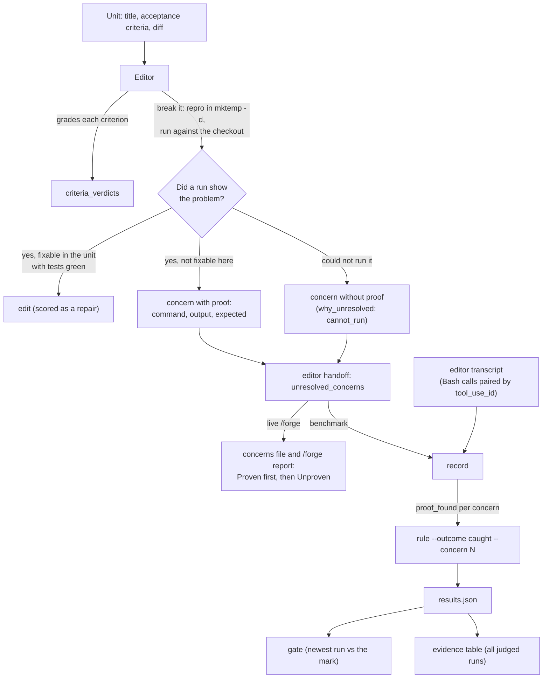

# Editor Proves Findings — Architecture Spec

## In Plain Language

The `/forge` editor is the fresh agent that reviews each unit a writer builds. Studio measures it on
18 prepared copies of past commits (`specs/judged-rules.md`). Six of those cases hold a defect that
a person once had to fix by hand after review. In the first baseline (PR #275), each of the two runs
caught one of the six, alder, and only by the owner's ruling. Neither run caught any of the four
defects that no acceptance criterion states. The editor's brief points it at the criteria, so a bug
no criterion names goes unseen.

This change gives the editor a second job and a bar for it. After grading the criteria, the editor
tries to break the unit with real runs, on inputs no criterion names. Each problem it reports must
come with a proof: the exact command it ran, the output that shows the failure, and the output the
unit should have produced. A proven problem the editor can fix inside the unit becomes an edit. The
rest are recorded as concerns. A concern it could not run stays in the list, marked unproven, and is
never dropped. The brief is adapted from the `/interrogate` skill in Lauren Tan's pstack (MIT,
copyright 2026 Lauren Tan).

On the benchmark, `record` checks every proof against the editor's own transcript, so a ruling of
"caught" can rest on a run that really happened. The change is measured after blind measurement
(spec PR #278) is built and two clean baseline runs have re-set the mark, the miss and false-alarm
limits a new run must stay within. It passes only if it catches a historical defect that both
baseline runs missed, in both of its own runs.

The fleet's PR reviewers and responders are not covered here. They get their own spec in the
review fleet's own repository (decision 1).

## Architecture at a Glance

The unit the editor reviews is unchanged: its title, its criteria and the diff. The editor grades
the criteria as before, then tries to break the unit with runs. Each run that shows a problem leads
to one of two outcomes. If the editor can fix it inside the unit and keep the tests green, the fix is
an edit. Otherwise it is recorded as a concern carrying its proof. A problem the editor could not
run is still recorded, without a proof. In live `/forge` those concerns reach a person through the
concerns file and the report, with proven concerns listed first. On the benchmark, `record` reads
the editor's transcript and marks each proof as found or not. A ruling can then name the concern a
catch rests on. The gate still compares the newest run with the mark. The evidence table covers
every run the criterion judges.

## How It Works (Technical)

### Where the code lives

`.claude/workflows/implementation-loop.js` is generated from `studio/forge_loop.mjs` by
`studio/generate_forge.py`, and `test_portable_forge.py` asserts the two match. Every loop edit is
made in `studio/forge_loop.mjs` and then regenerated. The benchmark changes live in
`studio/editor_results.py`.

### Brief changes (`editorMandate`, `editorPrompt`)

Five edits. The wording below is final, and the tests compare whitespace-flattened text, so line
breaks in the source are free. Everything else in the editor prompt stays byte-for-byte, and the
writer prompt does not change.

1. **`editorMandate()` drops its second half.** It returns the first 10 lines of
   `CONTRARIAN_MANDATE`, the ones before `**Findings must earn their place — quote first, then
   rate.**`. The last line kept is the `**Cut concepts, not clarity.**` bullet, and the trailing
   blank line goes. Gone with the rest: "Quote before you claim", the confidence ratings, and "drop
   one entirely unless ... fatal". That last rule contradicts decision 2, and a run replaces the
   quote as the bar. The comment above the function names the new cut point and the reason.
   `studio/scopes.py` does not change, and debates keep all 23 lines.
2. **The "Finding code" paragraph's last sentence** becomes:
   > A quote taken from a summary rather than the file is not a quote.

   The mandate rule it pointed at is gone. The requirement to quote stays in the concern schema
   ("the specific problem, quoting the thing it is about").
3. **A new paragraph goes between the hard bounds and the Reviewer Concerns paragraph:**
   > Break it. The unit's intent is its title, its acceptance criteria and the diff. Once you have
   > read the diff, try to break that intent with runs against the real code in this checkout, on
   > inputs and situations no criterion names: a failing test, a repro script, or a command whose
   > output shows the wrong behavior. Put any repro file in a directory made with `mktemp -d`,
   > never in this checkout, and run it from here. No findings is a valid result.
   >
   > Prove each finding with a run. A finding is the problem, quoting the code it is about; the
   > exact command you ran; one contiguous block of the lines it printed, copied verbatim, that
   > shows the failure; and the output the intent requires. If the output is what the intent
   > requires, there is no finding. Fix a proven finding when you can do it inside this unit with
   > the tests green: that is an edit. Otherwise record it as a Reviewer Concern with its proof.
   > Style, naming and structure are cuts you make or leave, not findings.
4. **The Reviewer Concerns paragraph** changes in three places. Its record sentence becomes:
   > Record it in unresolved_concerns: the concern (quote the thing it's about), why_unresolved
   > (breaks_green | load_bearing | out_of_unit_scope | cannot_run), its proof when a run showed it,
   > and the smallest suggested_followup that would resolve it. A problem you could not run still
   > goes in the list, without a proof and with why_unresolved cannot_run. If you could run it, run
   > it.

   Its checklist sentence becomes:
   > If it is non-empty, also write it as a readable checklist (one item per section: concern, why,
   > follow-up): put concerns with a proof first, under `## Proven`, each with its command, output
   > and expected output; the rest go under `## Unproven`.

   The `mkdir -p` and path instruction that follows is unchanged.
5. **The rationale line** gains one sentence:
   > Keep your edits rationale under ${u.output_budget || 400} words. When it cites a rule or
   > principle, name the cut or change that rule drove; leave out a rule that changed nothing.

### Handoff schema (`EDITOR_HANDOFF.unresolved_concerns.items`)

- **A new optional `proof`**: an object with `required: ['command', 'output', 'expected']` and
  `additionalProperties: false`, described as "present only when a run showed the problem". Its
  fields: `command`, "the exact command you ran"; `output`, "one contiguous block of the lines it
  printed, copied verbatim, that shows the failure"; `expected`, "the output the unit's intent
  requires". The `output` description carries the same contiguous-block wording as the brief.
- **`why_unresolved` gains `cannot_run`.** Its description becomes "why it could not be fixed in
  this pass; cannot_run when proving it needs something this pass cannot run, such as a browser, a
  game engine or the network".
- **Unchanged:** the item's `required: ['concern', 'why_unresolved']`, the top-level `required`, and
  `criteria_verdicts`.

### Exit gate: unchanged

`unconfirmedCriteria`, `passesExitGate` and `collectReviewerConcerns` keep their source. A proven
concern does not flag the unit. The gate functions are hashed into the prompt fingerprint, so
changing them would change what "flagged" means in the very runs being compared.

### Tests and docs that move with the brief

| File | Change |
|---|---|
| `.claude/workflows/tests/workflow-shells.test.mjs`, the mandate equality test | `contrarianMandateBeforeFindingBlocks` cuts at the first line containing `Findings must earn their place` and strips trailing blank lines. The length guard goes from 18 to 10. The test name and its section comment say "up to its 'Findings must earn their place' section". |
| `.claude/workflows/tests/workflow-shells.test.mjs`, the "Finding code" assertion | Becomes `/A quote taken from a summary rather than the file is not a quote/`. The comment saying the consequence already exists in the mandate goes. |
| `.claude/workflows/tests/fixtures/prompts-no-work-dir.json` | `editor_prompt` is regenerated. `writer_prompt` must not move. |
| `studio/tests/test_portable_forge.py` | The pinned `prompt_fingerprint` (`655f2fc2…`) is repinned to the value `python studio/editor_measure.py fingerprint` prints for the new prompt, **in the same commit as the prompt edit**. This test is not the measurement gate, and no other test may be left red for the builder to guess about. |
| `studio/tests/test_workflow_shells.py` | `TestAcceptanceCriteriaWiring` gains the schema checks. `"Reviewer Concern"` and `TEST OUTPUT PRISTINE` stay asserted. |
| `studio/forge_host.mjs` | The portable host writes the concerns file in two groups, `## Proven` (each concern with its command, output and expected) and `## Unproven`. Each concern's heading moves down one level to sit under its group. |
| `studio/docs/IMPLEMENTATION_LOOP_SPEC.md` | The handoff paragraph, the editor mandate bullet ("lines before its FINDING-block format" becomes "before its 'Findings must earn their place' section", plus the break-it brief), Reviewer Concerns (the proof and `cannot_run`), and References (credit to pstack `/interrogate`, MIT, Lauren Tan). |
| `specs/judged-rules.md` | "The editor's prompt and model": 18 lines becomes 10, at the new cut point. Rewording the debate contrarian's first 10 lines still forces a measurement; the rest no longer does. Its unit 2 criteria, "`editorPrompt` prints the 18 mandate lines in full" and "the lines of `CONTRARIAN_MANDATE` … that come before its first line mentioning a FINDING block", change to match. Spec PR #278 edits other sections of this file. |
| `studio/docs/CLAUDE_CODE_USAGE.md`, `.claude/commands/forge.md` | The `/forge` report lists proven concerns first, each with its command and output, and marks the rest unproven. |
| `CHANGELOG.md` | One entry. |

After these edits `cd studio && python -m pytest tests/ -q` is green except the editor measurement
gate, which stays red until the two measured runs are recorded.

### The proof check in `record`

`collect_journal` already reads each case's transcript, `agent-<id>.jsonl`, to find the model. In
the same loop it computes `proof_found` for each concern from those rows, and returns it alongside
the editor results. The editor's own result is stored untouched. The check pairs calls itself: a
Bash `tool_use` block in an `assistant` row, and the `tool_result` block in a `user` row with the
same `tool_use_id`. It does not use the flattened transcript texts #278 adds for its launch checks,
so the two share an edit site and no code.

For each concern, `proof_found` is:
- `null` when the concern is not an object or has no `proof`;
- `true` when one paired call meets both conditions: its `input.command` contains `proof.command`,
  and its `tool_result` contains `proof.output`;
- `false` otherwise, including a blank `command` or `output`.

Both sides are whitespace-collapsed before matching. A `tool_result` whose content is a list of text
blocks is joined first. Containment rather than equality, because editors prefix their commands
with `cd X &&`. Pairing by `tool_use_id` matters: without it, an output from any call would vouch for
any command.

`proof_found` is stored on the scored row as a list parallel to `editor.unresolved_concerns`. A
`false` never voids or blocks the run; the check only reports. `outcome()` does not change: a
concern, proven or not, still sends a defect row to a ruling.

### Rulings and the report

`rule --outcome caught` takes an optional `--concern N`, the 1-based concern a catch rests on,
stored as `concern` on the row. `rule` refuses, writing nothing, an `N` out of range or `--concern`
with `--outcome missed`. The unruled listing prints each row's `proof_found` beside the editor JSON.

The report prints one line per run: concerns with a proof found, with a proof claimed but not found,
and without a proof, split by defect and clean cases. That is the proven-against-unproven comparison
decision 2 asks for.

## Key Decisions

- **Two specs** (owner, decision 1). This one covers the `/forge` editor and is measured on Studio's
  benchmark. The fleet reviewers and responders get their own in the review fleet's own repository.
- **Break it and prove it ship together, as one variable.** A proof bar alone only filters a list;
  break-it is what fills it. The proof still earns its place, because it is what makes a ruling
  checkable. In the source they are one paragraph.
- **One concern list with an optional `proof`, not a second `findings` list.** Advocate 1 proposed a
  separate required-field list. Rejected: `outcome()` already routes any concern to a ruling, so a
  second list forces a scorer change for no added enforcement, and it would have made
  `unresolved_concerns` mean "not run", which none of its `why_unresolved` values says. The schema
  enforces the three proof fields just as hard inside `proof`. Decision 2's "listed separately" is
  met where people read the list: the concerns file, the `/forge` report and `record`'s counts.
- **Unproven concerns are never dropped** (owner, decision 2). That forces the mandate cut: the
  mandate said to drop a low-confidence finding unless fatal. A concern still has to quote the thing
  it is about; the schema already requires that.
- **Add `cannot_run`.** The three existing values each say why a problem could not be fixed. Under
  "fix what you proved", an in-scope problem the editor could not run fits none of them. The only
  cost is a possible `cannot_run` beside a proof, and `record` judges by the proof alone.
- **The exit gate stays as it is.** Flagging a unit on a proven concern would change what "flagged"
  means in the runs being compared, and the #275 runs logged concerns on clean cases (birch, rowan,
  sycamore) while the mark tolerates one false alarm. Revisit after the measurement with one number:
  how often clean cases carry a proof found in the transcript.
- **No `fail` to `unverifiable` demotion.** Advocate 1 proposed demoting a `fail` verdict with no
  run. Cut: the gate treats the two alike, and the scorer counts only `fail` as a catch, so the rule
  would only lose automatic catches and add rulings. It is also a second variable.
- **No zero-comments rule.** Cut from the first proposal. The implementation loop already blocks
  delivery on a new or edited code comment.
- **The intent is the title, the criteria and the diff.** The editor never receives the writer's
  instructions, and benchmark titles are slugs. Keeping it that way keeps the change to one variable.
- **Repros go in a `mktemp -d` folder.** pstack keeps them in its own worktree. A repro inside the
  case tree is worse: the full suite would collect it, go red and force a revert. A temporary folder
  is also none of #278's forbidden paths.
- **Proofs are checked in `record`, as code, not by a hand grep.** `results.json` keeps
  `proof_found` after transcripts rotate away, so the evidence stays checkable.
- **Live `/forge` proofs stay self-reported.** pstack's Verify phase, which reruns each command, is
  not carried over. Only the benchmark checks proofs.
- **The strict pass criterion** (owner, decision 4). Advocate 1 proposed "one more catch among the
  10 no-criterion or real-history defects than the baseline pair". Rejected: the pool is 6 distinct
  cases, not 10, because all four no-criterion defects are also review fixes; and one extra catch
  across two runs is the size of the mark pair's spread of 2, which one ruling could supply.
- **Condition 1 of the criterion uses ordinary rulings.** The baseline runs could not carry proofs,
  so requiring them in condition 1 would judge the new runs by a stricter rule than the mark. The
  proof clause guards condition 2, the catch that decides the result.
- **The judged runs are pinned.** Every recorded run must count, or a failing run could be outvoted
  by recording another, and the gate would follow the newest one.
- **The prompt edit is made by hand, not under `/forge`.** `/forge`'s test command is the whole
  suite, the suite stays red until the measurement is recorded, and only a command the owner types
  can measure (`specs/judged-rules.md`).
- **On failure, the `record` half does not merge.** Code that does nothing in main is dead code. A
  later attempt rebuilds it from this spec.

## Non-Goals / Cut Scope

- Fleet PR reviewers and responders.
- Flagging a unit on a proven concern.
- Rerunning proofs in live `/forge`.
- Checking `proof.expected` or whether a proof is about the defect it is ruled against. A person does
  that, in the evidence table.
- Following a `<persisted-output>` pointer to a saved long output.
- A counter of repros left inside a case tree. Nothing could compute it: `record` checks only HEAD
  ancestry, and untracked files are invisible to it. The visible symptom, a revert or a red suite, is
  already in the editor's result.
- Any change to the writer prompt, `outcome()`, the gate functions or `studio/scopes.py`.

## Risks & Open Questions

- **`proof_found` shows that a command ran, not what it is about.** An owner could rule `caught` on a
  proven concern about something else on the same case. The evidence table puts the defect text
  beside each counted proof so a second reader can see it.
- **A long output never matches.** Claude Code saves it to a `tool-results` file and leaves a
  preview of about 2 KB in the transcript, so `proof_found` is `false`. The brief asks for the few
  lines that show the failure, and the claimed-but-not-found count shows how often this happens.
- **Stitched excerpts fail the check.** Two non-adjacent lines copied together are not contained in
  any one result. The contiguous-block wording is the fix. Check it against the first runs'
  claimed-but-not-found count.
- **A short command can match an unrelated call** (`pytest`). The output must also be in that same
  call's result. What is left, the owner reads when ruling.
- **Break-it may "repair" a clean case and stay green.** A clean case then scores `passed`, and
  neither condition can see the damage. Open for the owner: add a column to the evidence table with
  `editor.committed` and a diffstat for each clean case in all four runs. It needs no code; lean yes.
- **The concerns-file grouping is optional weight.** The contrarian would cut the `## Proven` /
  `## Unproven` split (a prompt sentence, a heading-level change in `forge_host.mjs`, one criterion
  and one test), since `record`'s counts already serve decision 2. Kept because people skim that
  file; the owner may cut it.
- **Break-it costs more.** A run already costs 25 to 31 million tokens. Tokens per run are recorded
  against the baseline pair.
- **More exploration may trip #278's voids,** by listing `.claude/` in the launch folder (the runner
  token) or naming the measuring checkout. Each void costs a relaunch (unverified).
- **Live proofs can be fabricated,** and a person reading one would take it as proven. Stated limit.
- **Only the first 10 lines of the debate mandate now force an editor measurement.** The equality
  test names the cut, so a reword there still turns the suite red.
- **Ordering.** Spec PR #278 is still a draft and #275 is unmerged. This change depends on both, and
  on the re-set mark, before anything here can be measured.

## Verification

This feature is prompt-shaped: no test shows that the editor tries to break anything, or that its
proofs are honest.

- **Pass criterion.** This change works **if and only if** both conditions hold for the judged runs:
  the first two non-void runs recorded on the prompt fingerprint that merges, under #278's launch
  conditions, with no unruled row. Every non-void run recorded on that fingerprint appears in the
  evidence table, and none may be dropped or replaced.
  1. Each judged run has missed ≤ `max_missed` and false alarms ≤ `max_false_alarms` of the re-set
     mark. Condition 1 uses ordinary rulings, as the baseline did.
  2. At least one of the six historical defect cases (alder, aspen, beech, cedar, cypress, poplar)
     that **both** re-set baseline runs failed to catch is caught or repaired in **both** judged
     runs. A catch by ruling counts only if the ruling names a `--concern` whose `proof_found` is
     `true`. Catches by a `fail` verdict or by repair count as scored.
- **Baseline.** The two clean runs that re-set the mark after #278, which do not exist yet. For
  reference, #275's mark pair (`wf_bedbc1e0-022`, `wf_eb4aaf92-736`; mark 7 missed, 1 false alarm)
  caught 1 of the 6 per run, alder by ruling, and none of the 4 that no criterion states. If the
  re-set pair leaves no historical case missed by both runs, the criterion cannot be met: stop and
  tell the owner rather than rewording it.
- **Evidence table.** The gate checks only the newest run against the mark, so the evidence file
  carries a table of the six cases across the two baseline runs and every non-void run on the merged
  fingerprint, with run ids and each outcome. For each ruled catch counted toward condition 2, it
  shows the case's `defect` text beside the concern, its `proof.command`, `proof.output` and
  `proof.expected`, and `proof_found`. Anyone can recheck it against `results.json`.
- **Also recorded, not part of the criterion.** The proof counts by defect and clean cases. How many
  claimed proofs were not found in the transcript. Tokens per run against the baseline pair. The
  spread.
- **Where the evidence goes.** `specs/editor-proves-findings-eval-results.md`, created from the
  skeleton when this spec is approved, with `verification_due` 30 days later.
- **Stop condition.** If the criterion fails, the prompt and schema edits are reverted before the
  merge, and only `results.json` and the evidence file merge, saying why; unit 2 does not merge.
  While the evidence file still says `FILL_ME`, nobody may call this change working, and this spec
  stays `status: approved`.

## Build Plan

Merge order: #275, then spec PR #278 and its build, then the PR that records two clean baseline runs
and re-sets the mark, then this. Both units ship in one PR, merged with its two judged runs. Unit 2
does not depend on unit 1's code, so build it first, under `/forge`, while the suite is still green.
Unit 1 is edited by hand, since the suite goes red with it until the runs are recorded.

### 1. `editor_proves_findings` — the editor tries to break the unit and proves each finding with a run

After this unit, a live `/forge` editor runs repros, fixes the findings it proves, and lists the
rest with or without a proof. Built in `studio/forge_loop.mjs` (then regenerated), `forge_host.mjs`,
the tests and docs in the table above.

**Acceptance criteria:**
- [ ] The rendered editor prompt, whitespace-flattened, contains the Break it and Prove each finding paragraphs, the Reviewer Concerns record and checklist sentences, and the rationale sentence exactly as worded in this spec, and its "Finding code" paragraph ends "A quote taken from a summary rather than the file is not a quote."; the no-work-dir fixture's `writer_prompt` is byte-identical and its `editor_prompt` is regenerated.
- [ ] `editorMandate()` equals the 10 lines of `CONTRARIAN_MANDATE` before "Findings must earn their place", the equality test asserts 10, `CONTRARIAN_MANDATE` is unchanged, and no rendered editor prompt contains "Quote before you claim", "drop one entirely" or "`(unverified)`".
- [ ] `EDITOR_HANDOFF` concern items accept an optional `proof` whose `command`, `output` and `expected` are all required, a payload whose `proof` lacks `expected` fails the schema, and `why_unresolved` includes `cannot_run`; the top-level `required`, `unconfirmedCriteria`, `passesExitGate` and `collectReviewerConcerns` are byte-identical to the merge base.
- [ ] The portable host's concerns file puts concerns with a proof under `## Proven`, each with its command, output and expected, and the rest under `## Unproven`.
- [ ] `test_portable_forge.py` pins the `prompt_fingerprint` that `editor_measure.py fingerprint` prints for the new prompt, changed in the same commit as the prompt edit, and `cd studio && python -m pytest tests/ -q` fails only in the editor measurement gate.
- [ ] `git grep` finds `cannot_run` and `Findings must earn their place` and `Lauren Tan` in `studio/docs/IMPLEMENTATION_LOOP_SPEC.md`, `Proven` in `.claude/commands/forge.md`, and `Findings must earn their place` in `specs/judged-rules.md`, which no longer contains "prints the 18 mandate lines" or "first line mentioning a FINDING block".

**Out of scope:** the proof check in `record`; flagging a unit on a proven concern; rerunning proofs
in live `/forge`; the writer prompt.

### 2. `record_checks_proofs` — the benchmark sees which concerns were actually run

After this unit, `record` marks each concern proven, claimed or unproven from the editor's own
transcript, and a ruled catch can name the concern it rests on. Built in `studio/editor_results.py`,
with replay tests in `studio/tests/test_editor_recording.py` that drive `record` and `rule`.

**Acceptance criteria:**
- [ ] `record` stores on each scored row a `proof_found` list parallel to its concerns, computed in `collect_journal` from the case transcript rows it already reads: `true` only when a Bash `tool_use` in an `assistant` row has an `input.command` containing `proof.command` and the `tool_result` with the same `tool_use_id` in a `user` row contains `proof.output`, both whitespace-collapsed and non-blank, with list-of-blocks content joined; `null` for a plain-string concern or one without a `proof`; `false` otherwise.
- [ ] A replayed run whose proof output appears only in a different call's result records `false` (dropping the `tool_use_id` pairing turns that test red), a `false` never voids or blocks the run, and the editor's own result is stored unchanged.
- [ ] `rule --outcome caught --concern N` stores `concern: N`; an out-of-range `N`, or `--concern` with `--outcome missed`, exits 1 and leaves `results.json` byte-identical.
- [ ] The report prints, per run, the counts of concerns with a proof found, with a proof claimed but not found, and without a proof, split by defect and clean cases, and the unruled listing shows each row's `proof_found`.

**Out of scope for both units:** the two judged runs and the evidence file, which are the owner's
work; rerunning proofs in live `/forge`; fleet reviewers and responders, which get their own spec in
the review fleet's own repository (decision 1).
