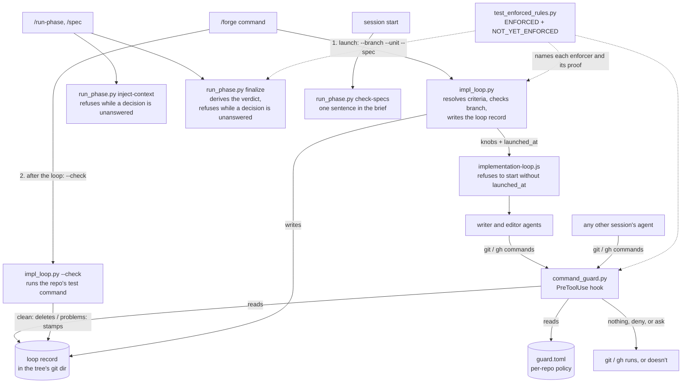

# Enforcement Layer — Architecture Spec

## In Plain Language

Studio is mostly instructions. Its slash commands tell an agent what to do, step by step, and most
of those steps are only words: if the agent skips one, nothing happens. A count on 2026-11-21 found
163 hard rules across the twelve commands and `CLAUDE.md`. Code stops 29 of them, code notices 16
more without stopping anything, and nothing checks the other 118. In a repository that installed
Studio only about 17 are stopped, because some of the checks live in Studio's own test suite and
never ship. Two of the unchecked rules have already cost real work: a `/forge` run whose commits
landed on another pull request's branch, and pull requests stacked on each other and then orphaned.

This spec moves the steps that have one right answer out of the commands' prose and into code that
refuses the wrong answer. When code takes over a step, the sentence that used to ask for it is
deleted, so the commands get shorter as Studio gets stricter. Steps that need judgment stay as
prose; making those enforceable is separate work.

Four things do the refusing. Studio's command-line tools refuse to continue when a step was skipped
or done wrong. A **guard** runs before every `git` and `gh` command an agent types and can stop it
or make it wait for a person's yes. The rules about specs, which today only Studio's own tests
check, ship as a command every installed repository can run. And one test file lists every rule
that code enforces, beside a short list of rules that could be enforced and aren't yet; that second
list is only allowed to shrink.

## Architecture at a Glance



A `/forge` run now starts and ends in code. The launch resolves the unit's criteria from the spec,
checks the branch and the working tree, and leaves a small record in the tree's git directory. The
loop script will not start an agent without the stamp the launch printed. While the record is live,
the guard keeps other sessions from switching that tree's branch and keeps commits off any other
branch. After the loop, a check runs the repository's own test command and either closes the record
or stamps it with what it found. Until that check has run, the guard holds pushes of the unit's
branch; if it found problems, a push waits for a person's yes.

Debates get two refusals of their own: a run cannot brief its next agent or be finalized while a
decision an agent raised has no answer from the user, and `finalize` records the verdict the debate
actually reached, not one typed on the command line.

## How It Works (Technical)

### Components

| File | Change | Single responsibility |
|---|---|---|
| `studio/tests/test_enforced_rules.py` | new | The enforced-rules table and its ratchet. |
| `studio/spec_rules.py` | new, in `SOURCE_FILES` | Every way one spec breaks the convention, and the criteria of one unit. Pure: text in, sentences out. |
| `studio/tests/test_spec_verification.py` | rule code moves out | Stays the proof: imports the moved functions and runs its existing cases. |
| `studio/run_phase.py` | `check-specs`, `install-guard`, one more sentence in the session brief, the two `finalize` rules, the `inject-context` refusal | CLI wiring only. |
| `studio/verdict.py` | `extract_verdict` returns the last verdict line | The verdict a file ends with. |
| `studio/decision_points.py` | add `unanswered_decisions` | Which raised decisions have no answer from the user. |
| `studio/impl_loop.py` | `--spec`, `--unit`, the loop record, `--check` | Everything `/forge` decides before and after the loop. |
| `.claude/workflows/implementation-loop.js` | refuses to start without `launched_at` | Unchanged otherwise. |
| `studio/command_guard.py` | new; copied on install, kept out of the manifest | The hook: read one command, print a decision or nothing. No Studio imports. |
| `studio/install.py` | registers the guard; `_merge_hook_entry` takes a matcher and a list of handlers | Writes the hook entry. |
| `studio/.studio/guard.toml` | new, committed (one more `.gitignore` exception) | Studio's own repository turns both policy rules on. |
| `.claude/commands/forge.md`, `run-phase.md`, `run-studio-phase.md`, `spec.md` | prose deleted | See "Prose that gets deleted". |

`spec_rules.py` is a new file rather than an addition to `obligations.py` because the rules need
names from `stats.py` at runtime, and `stats.py` already imports `obligations` at module top: the
reverse import is a cycle.

### The guard

**What it is.** A Claude Code `PreToolUse` hook on the Bash tool. It reads the hook's JSON from
stdin (`tool_input.command`, `cwd`, `permission_mode`), and either prints nothing or prints one
decision: `{"hookSpecificOutput": {"hookEventName": "PreToolUse", "permissionDecision": "deny" |
"ask", "permissionDecisionReason": "<message>"}}`. It never prints `allow`, which would skip the
user's own permission prompt. Hooks fire for the main session, for subagents, and for the agents
inside a Workflow script, so the guard sees `/forge`'s writer and editor too.

**How its command finds the script.** The installer bakes two absolute paths into the hook's
command: the interpreter (`sys.executable`, as the other two hooks do) and the script in the **main
checkout**: `<target>/.studio/source/command_guard.py`, or `<target>/studio/command_guard.py` when
the target is a Studio source checkout. Nothing is resolved through `$CLAUDE_PROJECT_DIR`. That
variable points at the worktree when a session starts in one, and a worktree of a repository that
gitignores `.studio/` has no script there. The main checkout's `settings.local.json` does load in
nested and sibling worktrees, so one entry and one script serve every tree of the repository.

**Registration.** `_install_command_guard_hook(target, *, enabled)` runs where the other two hooks
are refreshed, in `install_studio` and `update_studio`. It writes nothing when the script is absent.
It writes one group into `<target>/.claude/settings.local.json`:

```json
{"matcher": "Bash", "hooks": [
  {"type": "command", "command": "<cmd>", "if": "Bash(git *)", "timeout": 10, "onFailure": "block"},
  {"type": "command", "command": "<cmd>", "if": "Bash(gh *)", "timeout": 10, "onFailure": "block"}
]}
```

`_merge_hook_entry` appends `{"hooks": [entry]}` today, with no matcher and one handler. Its `entry`
parameter becomes `handlers` (a list) and it gains an optional `matcher`; the two existing callers
pass a one-item list. The marker is `command_guard.py`. The file has that name rather than
`guard.py` because the marker is a substring match and would otherwise remove a user's own
`guard.py` hook. The script is copied by the helper that copies `finish_check.py` and stays out of
`MANIFEST.json`, so an update blocked by local edits still refreshes it.

Studio's own repository has no install step, so `run_phase.py install-guard --target <repo>` calls
the same function and prints the script it registered, or exits 1 when it finds none. The guard has
no off switch.

**A guard that cannot run refuses.** A missing script, a crash, a timeout and unreadable input all
stop the command. Three layers do this:

1. The command string turns any failure into a refusal:
   `[ -x <python> ] && [ -f <script> ] || { echo <missing message> >&2; exit 2; }; <python> <script> || { echo <failed message> >&2; exit 2; }`.
   The script only ever exits 0, so any other exit is a failure. Both paths go through `shlex.quote`.
2. The script sets its own deadline below the hook's: `signal.alarm(8)` as its first statement, no
   handler, guarded by `hasattr(signal, "SIGALRM")`. When it fires the process dies and layer 1
   prints the failed message. A git call that returns non-zero only means the rule does not apply;
   only a hang refuses.
3. `"onFailure": "block"` on both handlers covers Claude Code killing the hook before layer 2 fires.

The missing message names the missing path, says the command was stopped instead of going through
unchecked, and gives the repair (re-run Studio's update) and the removal (the user deletes the
entries naming `command_guard.py` from the settings file). The failed message says the guard itself
failed, that the error is above, and gives the same two ways out. The script decides "no rule names
this verb" before any file read, subprocess or TOML import, so the common path has nothing to fail.

**How it stays cheap.** The two `if` patterns name only the command (`git`, `gh`), so the process
starts on those commands and nothing else. A narrower pattern would miss `git -C <dir> commit`,
which is how the loop's agents commit. The guard exits at once for every verb no rule names. Only a
matching verb costs git calls and one small file read. No network call.

**How it finds a command in the text.** A command is found only where a shell would start one: at
the start of the text, or after a newline, `;`, `&&`, `||`, `|` or `(`, past any leading
`VAR=value` words. Text inside quotes or a heredoc body is never a command. The guard tokenizes with
`shlex` (`punctuation_chars="();<>|&\n"`, newline removed from `whitespace`). When the text cannot
be tokenized, it applies the same rule line by line, using only the words before the first quote
character on each line. There is no whole-text search.

**Which tree a command acts on.** For `git`: its `-C <dir>` if present, else the directory of the
last `cd <dir>` earlier in the same command text, else the payload's `cwd`. For `gh`: the last `cd`,
else `cwd`.

**Rules.**

| Rule | On | Matches | When | Decision |
|---|---|---|---|---|
| `forge-branch-lock` | everywhere | `git switch`; `git checkout` when git itself would switch | the tree has a live record | deny |
| `forge-commit-branch` | everywhere | `git commit` | the tree has a live record and is on a different branch | deny |
| `forge-check-before-push` | everywhere | `git push`, `gh pr create` | the tree has a record, and is on the record's branch or the command names it | never checked: deny. Checked with problems, or unreadable: ask |
| `worktree-artifacts` | everywhere | `git worktree remove <path>`, forced or not | a file git does not track under `<path>/.studio/output/`, `<path>/studio/output/` or `<path>/reviewer-concerns/` has no file at the same relative path in the main checkout | deny |
| `ask-before-merge` | opt-in | `gh pr merge` | `ask_before_merge = true`, and the command's tree belongs to the guard's repository | ask |
| `pr-base` | opt-in | `gh pr create` or `gh pr edit` with `--base X`, `--base=X` or `-B X` | `pr_base` is set, `X` differs, and the command's tree belongs to the guard's repository | deny |

- **"Live"** means the record exists, has never been checked, and started less than four hours ago.
- **`git checkout` is a switch** when it carries `-b`, `-B`, `--detach` or `--orphan`, or when it has
  exactly one positional argument before any `--` and that argument is `-` or resolves to a commit
  (`git rev-parse --verify --quiet "<arg>^{commit}"`). Anything else restores files and passes.
- **Untracked files** for `worktree-artifacts` come from
  `git -C <path> ls-files --others -- <the three directories>`, which lists ignored files too.
- **"Belongs to the guard's repository"** means the tree's `--git-common-dir` equals the `.git` of
  the checkout the script sits in. A command aimed at another repository gets no policy from this one.
- **Where the guard would ask**, it returns `ask` only in `default`, `plan`, `acceptEdits` and
  `auto`. In every other permission mode it returns `deny`, because nobody can be shown to answer.

**The per-repository policy file.** `<repo>/.studio/guard.toml` when installed,
`<repo>/studio/.studio/guard.toml` in a Studio source checkout: read from beside the guard's own
script, so a worktree with no `.studio/` gets the main checkout's policy.

```toml
ask_before_merge = true
pr_base = "main"
```

There is no shipped default. A missing file or key means the rule is off. A file that exists and
cannot be parsed denies the two matched commands and names the file. TOML is parsed with `tomllib`,
falling back to `tomli`, imported only when the file exists. When neither can be imported, the file
counts as one that cannot be parsed: the same two commands are denied, naming the file and the
missing parser.

**Messages.** Each begins `Studio guard (<rule>):` so decisions can be counted per rule from
transcripts.

| Rule | What the agent reads |
|---|---|
| `forge-branch-lock` | A `/forge` loop for `<unit>` has been running in `<tree>` on `<branch>` since `<time>`. Switching branches here would land its commits on the wrong branch. If you are that loop's own agent: restore files with `git restore <path>`, and never switch. Otherwise work in another worktree. The lock lifts at `<time>`, or sooner when the user runs this unit's check. |
| `forge-commit-branch` | `<tree>` is running `/forge` for `<unit>` on `<branch>` but is now on `<current>`. Do not commit here and do not switch it back yourself. Stop and tell the user: something moved this checkout mid-run. |
| `forge-check-before-push` (deny) | `/forge` built `<unit>` in `<tree>` and nothing has checked it. Run `<check command>` first; it runs this repository's test command itself. |
| `forge-check-before-push` (ask) | The check on `<unit>` found: `<problems>`. Push anyway? |
| `worktree-artifacts` | `<path>` holds run artifacts that exist nowhere else and that `git worktree remove` would delete: `<up to five paths>`. Copy them first with `<cp -R line>`, then remove the worktree. |
| `ask-before-merge` | This repository asks a person to approve every merge. Merge `<arguments>`? |
| `pr-base` | Pull requests in this repository target `<pr_base>`; this one targets `<X>`. A fix to an open pull request is a commit on that pull request's branch, not a second pull request aimed at it. |

`<check command>` is the exact command, built from the guard's own location:
`"<python>" "<dir>/impl_loop.py" --check --work-dir "<tree>"`.

**What it does not catch.** Matching is on command text and is best-effort. It is not a security
boundary.

- Commands reached through a wrapper: `bash -c "git push"`, `xargs git`, an alias, a script.
- Other ways to move a branch or merge: `git reset --hard <branch>`, `git rebase`, `gh api`, the web UI.
- A guarded command on a line that cannot be tokenized, past that line's first quote character.
- A push of the loop's branch from a different tree, or after the worktree and its record are gone.
- `rm -rf` on a worktree.
- A run artifact whose path also exists in the main checkout with different content. The rule
  compares paths, not contents, so that file is still deleted. Same-named files are likelier under
  `reviewer-concerns/` than under the timestamped run directories.
- Launching and checking a trivial unit to replace a stamped record. That is a forged step, not a
  skipped one, and forged steps are out of scope throughout.
- A machine where the installer never ran: the entry lives in `settings.local.json`, which is per
  machine.
- The user's own shell. The guard only sees commands an agent runs.

### The loop record

**Path.** `studio-forge.json` in the tree's own git directory, as
`git rev-parse --absolute-git-dir` reports it: `<repo>/.git/` for the main checkout,
`<repo>/.git/worktrees/<name>/` for a linked worktree. One per tree. It is not in the working
directory on purpose: the launch refuses a dirty tree, the writer commits with `git add -A`, and the
loop recovers with `git reset --hard`. The git directory is never tracked, exists in every worktree,
and goes away with the worktree.

**Fields.**

| Field | Meaning |
|---|---|
| `unit_id` | The unit being built |
| `branch` | The branch the launch just accepted |
| `tree` | Absolute path of the working tree, for messages |
| `base_sha` | `HEAD` at launch |
| `test_command` | This repository's `[gate] test_command`, as loaded at launch |
| `started_at` | UTC ISO timestamp |
| `checked_at` | `null` until a check runs and finds problems |
| `problems` | What that check found, as plain sentences |

**Lifecycle.** Only `impl_loop.py` writes it, in the one invocation that carries `--branch`, after
every other launch check has passed and immediately before it prints the JSON. The write is a temp
file plus `os.replace`. A check that finds no problems deletes it. A check that finds problems keeps
it, with `checked_at` and `problems` filled in. A stamped record can be checked again, and passing
deletes it. The branch lock and `forge-commit-branch` apply only while `checked_at` is `null` and
`started_at` is less than four hours old (`BRANCH_LOCK_HOURS`). Expiry never frees the push. Running
`--check` early is how the user lifts the lock sooner: it either deletes the record or stamps it, and
both end the lock. The lock messages name the check but do not print its command, so the loop's own
agents are not handed a way to close their record mid-run.

**What each reader does.**

| Reader | Missing | Live | Expired, never checked | Stamped with problems | Unreadable |
|---|---|---|---|---|---|
| Guard: branch switch, wrong-branch commit | nothing | deny | nothing | nothing | nothing |
| Guard: push, `gh pr create` of the record's branch | nothing | deny | deny | ask | ask, naming the file |
| `--check` | exit 2, "nothing to check" | checks | checks | checks again | exit 2, names the file |
| Launch | writes one | refuses `unchecked-loop` | refuses `unchecked-loop` | replaces it | refuses `unreadable-record` |

### The launch and the post-loop check

**Launch.** `impl_loop.py --branch <b> --unit <id> [--spec <slug-or-path>] [--work-dir <tree>]`.
`--branch` now needs a unit id: `--unit`, or a `--spec` whose plan has exactly one unit. Without one
it exits with a usage error that adds "if `/forge` sent this, the session is running an older copy
of the command: restart it". Over a record that was never checked it exits 1 with `unchecked-loop`,
naming the record's unit, branch and start time and printing the exact `<check command>` for the
tree, so a crashed loop's user knows what to run before relaunching. Over a record it cannot read it
exits 1 with `unreadable-record`, naming the file. On success the JSON gains `launched_at`. `/forge` passes it through
with the other knobs, and `implementation-loop.js` returns `{ delivered: false, reason:
'not_launched' }` before spawning any agent when its args carry none. The command file and the loop
script both ship through the manifest, so they cannot fall out of step with `impl_loop.py`.

**Check.** `impl_loop.py --check [--work-dir <tree>]`. `/forge` runs it as the first thing in its
report step. It does not read anything the agents wrote.

| Problem | Raised when |
|---|---|
| `wrong-branch` | the tree is not on the record's `branch` |
| `no-writer-commit` | no commit whose subject starts with `writer: <unit_id>` lies between the record's `base_sha` and `HEAD` |
| `tests-failed` | the record's `test_command` exits non-zero when the check runs it |

The two git checks run first, and the test command runs only when both pass, so a launch whose loop
never ran closes without a suite run. The test command is the repository's configured gate command,
run through the shell from the tree's root with its output sent to stderr. A per-unit `--test`
still shapes what the writer runs but never reaches the check. A stuck writer's `writer(stuck):`
commit does not satisfy `no-writer-commit`, so partial work needs a person's yes before it is pushed.

It prints one JSON object on stdout: `{"clean": true|false, "unit_id", "branch", "tests":
{"command", "exit_code"}, "problems": [{"name", "detail"}]}`. Exit 0: clean, record removed. Exit 1:
not clean, record stamped, each problem printed as a sentence on stderr. Exit 2: could not check (no
record, unreadable record, not a git tree, bad arguments); no test is run.

### Spec rules that ship

**Where the code moves.** From `tests/test_spec_verification.py` into `studio/spec_rules.py`: the
unit-entry reader, the Build Plan shape rule, repo-wide id uniqueness, the evidence-skeleton reader,
and `_violations`. Names lose their underscore where another module calls them. The test's private
copies of `parse_due`, the results suffix and the placeholder are deleted in favour of the ones
`obligations.py` ships. Two things change in passing:

- Messages name the spec by a path that opens from the project root, because an installed
  repository keeps specs under `.studio/specs/`.
- `violations` takes the evidence skeleton's printed lines as an argument. `check-specs` reads them
  from `<project root>/.claude/commands/spec.md`; when that file is absent the one check that needs
  it is skipped and every other rule still fires.

**`check-specs`.** `python <run_phase.py> check-specs [--target <repo>]` reads every spec in the
target's specs directory, prints each problem as the paragraph the test suite prints today, grouped
by spec, then a count. Exit 0 with no problems or no specs directory, 1 with problems.

**What `/forge --spec` refuses on.** `impl_loop.py --spec <slug-or-path> [--unit <id>]` finds the
file the way `forge.md` does today and calls `spec_rules.unit_criteria`. It exits 1 on exactly these:

| Reason | Meaning |
|---|---|
| `missing-file` | nothing at the path tried, which the message prints |
| `no-build-plan` | no `## Build Plan` heading; a near-miss heading is named if there is one |
| `unknown-unit` | no entry carries that id |
| `ambiguous-unit` | the id appears twice, or the plan has several units and no `--unit` |
| `no-criteria` | the entry has no `- [ ]` bullet |
| `no-grader` | criteria resolved and `[editor] mandate` is off, so nobody would grade them |

Every refusal that got as far as a plan lists the unit ids it found. Nothing about heading form,
snake_case, titles, status or evidence refuses a run: the reader accepts entries that open as
numbered list items and any backticked id, because many approved specs in installed repositories
predate the heading shape. A criterion is the text after the checkbox plus any following lines
indented deeper than its dash that do not start a list item, joined with single spaces. On success
the JSON gains `unit_id`, `acceptance_criteria`, `spec_file` and `spec_status`. A spec that is not
`approved` still resolves; whether to build against it stays the user's answer to the pause
`forge.md` already raises.

**What the session-start brief reports.** `_do_check_updates` gains a third block in its own `try`.
When `check-specs` would find anything, it adds one sentence: the number of problems, the number of
specs, the first spec's path, and the command. Never a list.

In Studio's own repository the existing test still fails the suite. In an installed repository only
the six refusals above block; everything else is reported.

### The finalize verdict

`extract_verdict` changes to return the last verdict line in a text. All of its callers want the
verdict a file ends with, and a contrarian that quotes an earlier verdict before its own is misread
today. `finalize_run` then works out the debate's verdict before it writes anything: from the last
contrarian file in a single-discipline run, from `integrator.md` in a studio run.

1. `--status stopped`: nothing is compared.
2. No `--verdict` passed: the derived verdict is recorded when there is one.
3. `--verdict` passed and it differs from a derived `APPROVED` or `REJECTED`: finalize exits
   non-zero before `run.json`, the index, the run log or the notification are touched, and the
   message names both values and the file.
4. No verdict line found: the passed value is recorded as it is today, with the existing warning.

### Decisions pause the run

`decision_points.unanswered_decisions(run_dir)` returns every decision block raised in an advocate
or contrarian file that has no released answer. A decision is released when a recorded entry has the
same question text, an answer, and `answered_by` other than `assumption`. P0, P1 and P2 are held
alike. Blocks inside a fenced code example are not raised decisions.

It refuses in two places: `inject-context`, before it writes the context file, and `finalize`,
before `run.json` is touched. Not with `--status stopped`, and not in a question-mode run. Each
refusal names every held decision by its source file and prints them as a JSON list in the shape
`record-decisions --decisions-file` already reads, with `answer` empty, so the cheapest move for the
orchestrator is to fill in the answers it was given and record that list.

Matching is by exact question text. An answer recorded under changed wording does not release its
decision; the next refusal prints the raised question again, word for word.

### The enforced-rules table

One file, `studio/tests/test_enforced_rules.py`, holding two lists and the tests over them.

**`ENFORCED`**: one row per rule that code refuses.

| Field | Holds |
|---|---|
| `rule` | The rule in one plain sentence |
| `stated_in` | The command file or doc that states it |
| `enforcer` | The function or script that refuses, as `file::name` |
| `proof` | The test that shows the refusal, as `file::name` |
| `retired_prose` | Optional: a phrase from the prose step this row replaced |

**`NOT_YET_ENFORCED`**: plain sentences, rules with one right answer that nothing refuses yet, with
`NOT_YET_ENFORCED_COUNT` beside it and the comment "this number only goes down".

**What the test asserts.**

1. Every row's `enforcer` and `proof` file exists and contains the name after `::`.
2. Every `retired_prose` is absent from its `stated_in` file. This is the check on "the prose step
   is deleted".
3. `len(NOT_YET_ENFORCED) == NOT_YET_ENFORCED_COUNT`. Adding a rule to the list fails until someone
   raises the number, a one-line change a reviewer sees going the wrong way. Removing one fails
   until the number comes down.

It cannot stop someone raising the number. It makes doing so a deliberate, visible edit.

**Starting `ENFORCED` rows.** One row each:

1. A `--work-dir` with nothing at that path is refused.
2. A `--work-dir` that is not inside a git worktree is refused.
3. A `--work-dir` that belongs to another repository is refused.
4. A `--work-dir` holding a character the loop cannot safely quote is refused.
5. `/forge` does not start on `main` or `master`.
6. `/forge` does not start when the tree is off the planned branch.
7. `/forge` does not start with uncommitted work in the tree.
8. `/forge` does not start without a test command in the repository's config.
9. A bare legacy static-check name in the config is refused.
10. `record-decisions` refuses an entry with no priority, question or answer.
11. `finalize` refuses a run with no advocate file or no contrarian file.
12. `finalize` refuses a run with no `summary.md`.
13. `finalize` refuses a studio run with no `integrator.md`.
14. `finalize` refuses a studio run in which no role completed both stances.
15. `update` does not overwrite local edits without `--force`.
16. `update` reports a source checkout that is behind its remote with a non-zero exit.
17. `setup` refuses an unknown role pack or role-override field.
18. `setup` refuses a persona key in the wrong place.
19. `setup` never overwrites an existing `implementation_loop.toml`.
20. Studio's code imports only the standard library, plus `tomli` on Python 3.10.
21. A spec's `status` is one of draft, approved, shipped.
22. An approved spec with a Verification section has an evidence file.
23. An approved spec with a Verification section has a `verification_due` date that has not passed.
24. A shipped spec's evidence file is filled in.
25. A shipped spec has `shipped_impact` and `shipped_changed`.
26. An approved spec's Build Plan has the heading shape and at least one criterion per unit.
27. A `unit_id` is unique across the repository's specs.

Rows 5 to 7 cite the branch check from pull request #249, which must be merged before unit 1 is built.

**Starting `NOT_YET_ENFORCED` entries**, 20 of them. Each later unit moves its rules across.

1. A push to a branch whose pull request already merged.
2. A run is not finalized, and a scoped run does not brief its next agent, while a raised decision is unanswered. *(moved by `decisions_pause_the_run`)*
3. An unscoped run pauses before its next agent while a raised decision is unanswered.
4. A `/spec` run commits only the spec and opens its pull request at `status: draft`.
5. A `unit_id` is not renamed after approval.
6. A unit carries three to six criteria.
7. `/offload --apply` and `--verify` do what they say.
8. `/message-draft` runs its linter before handing over a draft.
9. `/studio-update` never passes `--force` on its own.
10. Each debate iteration has one advocate file and one contrarian file.
11. `integrator.md` carries its three sections.
12. The criteria the editor graded are the spec's own words.
13. A unit's criteria come from its spec, or the run stops. *(moved by `forge_resolves_spec_criteria`)*
14. Criteria with the editor switched off stop the run. *(moved by `forge_resolves_spec_criteria`)*
15. The finalize verdict is the debate's own. *(moved by `finalize_derives_the_verdict`)*
16. A unit is called clean only if Studio ran the tests itself. *(moved by `forge_post_loop_check`)*
17. `/forge`'s commits land on its branch. *(moved by `guard_holds_forge_tree`)*
18. No worktree removal deletes run artifacts that exist nowhere else. *(moved by `guard_stops_worktree_artifact_loss`)*
19. An agent asks before merging. *(moved by `guard_repo_policy_rules`)*
20. Pull requests target the main branch. *(moved by `guard_repo_policy_rules`)*

When the last unit lands the count is 11.

Judgment rules are in neither list. The file's docstring says so and names the follow-up; a later
list for them can sit beside these two without changing either.

### Prose that gets deleted

| File | Deleted | Replaced by |
|---|---|---|
| `forge.md` Step 1 | Finding the spec file, finding the unit's criteria, the copy-verbatim paragraph, the five named reasons and the instructions around them | One command (`impl_loop.py --spec ... [--unit ...]`) and "if it exits non-zero, stop and print what it said". The draft-status pause stays and reads `spec_status` |
| `forge.md` Step 2 | The `acceptance_criteria` bullet's verbatim rules; the `unit_id` rule for `--spec` | "Take both from Step 1's JSON, unchanged" |
| `forge.md` Step 4 | The "anti-hallucination anchor" paragraph | The echo stays as display |
| `forge.md` Step 5 | The paragraph that stops when criteria meet a disabled editor | The `no-grader` refusal. The command gains `--unit` and `--spec`, passes `launched_at` on, and the refusal list gains `unchecked-loop` and `unreadable-record` |
| `forge.md` Step 6 | "final test status (`editor.tests` / `writer.tests`)" | "Run `--check` first and lead with its `clean` and its problems". The closing sentence about `flagged` stays: the check says whether the tests pass and the commits are where planned, `flagged` says what the editor concluded |
| `run-phase.md`, `run-studio-phase.md`, `spec.md` finalize steps | `--verdict {APPROVED\|REJECTED}` on the completed path | Nothing; finalize derives it. `spec.md` keeps `--status stopped --verdict N/A` |
| `run_phase.py` generated instructions | `--verdict <APPROVED\|REJECTED\|N/A>` in the finalize snippet; "For P1s, state your assumption and proceed but flag it for override. Log P2s only."; "Log it for completeness but do not pause" | Every raised decision is asked |
| `CLAUDE_CODE_USAGE.md` | "human can override later" for P1, and the P2 "logged only" behaviour | Every raised decision is asked |

The text given to the agent writing a file ("state your assumption and continue") stays, because
that agent cannot pause. What changes is what the orchestrator does next. The principles in
`CLAUDE.md` ("every pull request targets the main branch", "merging is the human's step") stay too.
They say why; the guard is the step.

### Failure modes

| Component | What goes wrong | What the user sees |
|---|---|---|
| Guard | Script or interpreter missing | Every agent `git`/`gh` command refused with the repair sentence, until update is re-run or the entry removed |
| Guard | Its own bug, a hang, or input it cannot read | The same: every agent `git`/`gh` command in that repository refused, `git status` and `git diff` included, until it is fixed from the user's shell or by re-running update |
| Guard | The pinned interpreter is uninstalled | Agent git refused in every repository whose entry points at it, until update is re-run in each |
| Guard | A rule refuses something legitimate | The message naming the rule; the user runs the command themselves. Counted later from transcripts by rule name |
| Guard | `guard.toml` unparseable, or no TOML parser importable | `gh pr merge` and `gh pr create` denied, naming the file |
| Guard | Installer never ran on this machine, or the session started before the entry was written | No guard, silently |
| Record | Loop crashed | Branch switching refused for up to four hours; pushes of that branch refused until the check runs |
| Record | Launch succeeded, the loop never ran | The check reports `no-writer-commit` without running the tests; pushes of that branch ask |
| Record | Worktree removed with an open record | The record goes with it; a push from another tree is not held |
| Check | Test command red for reasons older than the unit | `tests-failed`; pushes ask the user, who can approve |
| Check | The suite outlasts the Bash tool's limit | The agent runs it in the background; nothing here imposes a timeout |
| `--spec` resolver | A spec has plain bullets instead of `- [ ]` | `no-criteria` and the ids found. The command stopped on this before too |
| `check-specs` and the brief | Many old specs break the shape rule | One sentence per session with a count, until they are fixed |
| Finalize | Wrong `--verdict` | Refused; nothing written; the message says what to pass |
| Decisions | A run already in flight on update day has unanswered decisions | Refused at finalize until they are recorded; the refusal prints the list to fill in |
| Decisions | An answer was recorded under reworded question text | Still held; one more round trip, and a duplicate row in `decisions.md` |
| Ratchet | Someone raises the count | The diff shows it |

Studio's own repository runs the guard from the main checkout's working copy. Edit and build the
guard in a worktree, never in the main checkout.

### Dependencies

Python 3.10+ and the standard library only, plus `tomli` on Python 3.10, the same allowance the
rest of Studio has. Claude Code's hook contract: the `PreToolUse` event,
the `if` field, `permissionDecision`, `permission_mode` on stdin, and `onFailure` (Claude Code
2.1.295 and later). `git` on the path. Pull request #249 (`impl_loop.py --branch`) is assumed merged.

## Key Decisions

**The user's rulings.** Each was a question raised during the debate and answered before the next
pass.

- **Rules that are right anywhere are on everywhere; repository policy is opt-in.** Keeping
  `/forge` on its branch and protecting run artifacts ship switched on. Asking before a merge and
  holding pull requests to one base branch are off until a repository turns them on, because some
  repositories legitimately merge into other branches.
- **A merge asks; it is not refused.** The standing rule is that an agent merges only when asked.
  Where nobody can answer, the same rule refuses.
- **The check that runs the tests is in scope**, and it always runs the repository's gate command.
  A per-unit command cannot soften it. One extra suite run per unit is accepted.
- **A failed check makes pushes ask.** `/forge` has always delivered a failed unit flagged, not
  blocked, and that call belongs to a person.
- **A guard that cannot run refuses**: missing, crashed, timed out, or handed input it cannot read.
  A guard that silently switches itself off is the failure this spec exists to remove. The cost is
  in the failure modes above.
- **`/forge --spec` refuses only on what it needs to read the requested unit.** Updating Studio must
  not stop `/forge` on specs that were buildable the day before.
- **Every raised decision pauses the run**, whatever its priority, and only an answer attributed to
  the user releases it. Priority is context, not permission to skip.
- **The table lists only rules with one right answer.** Judgment rules are a separate piece of work.
- **The push hold covers the unit's branch, not the whole checkout**, so a record cannot outlive
  the work it describes.

**Choices the debate settled.**

- **Enforcement means the next step consumes the output, or the harness invokes the check.** A
  refusal an agent can choose not to run is still prose. So the loop will not start without the
  launch's stamp, and the guard holds the push until the check has run.
- **The launch is forced by the loop script, not by the guard.** A guard rule refusing unlaunched
  `/forge` commits was cut: the guard updates even when an update is blocked on local edits, so it
  would have refused every `/forge` commit beside an older `impl_loop.py`.
- **The check reads git, not the agents' files.** Comparing the editor's persisted verdicts with
  the spec's criteria was cut. That file is typed by the agent; of 172 on the machine the debate
  measured, 19 did not hold the criterion text at all, and about one graded unit in six would have
  failed for punctuation.
- **The guard's rules were tested against the commands agents actually run.** Measured over 396
  loop-agent transcripts, a bare `git checkout <file>` is common, so the lock uses git's own test
  for a switch. `worktree-artifacts` tests whether removal would lose something, not whether files
  exist, because some repositories commit their run output.
- **No whole-text search for commands.** A commit message or heredoc that mentions `git push` is
  not a push.
- **One verdict reader.** `extract_verdict` becomes last-match instead of gaining a sibling that
  could disagree with it.
- **The table is the data of one test file**, not a document someone has to keep in step by hand.

**Where the direction comes from.** Lauren Tan's talk "All Code Is Slop (Except Mine)" and the
`/correct` skill in her pstack plugin (MIT): when you correct an agent, turn the correction into a
check, at the highest level that works, and write prose last.

## Non-Goals / Cut Scope

- **Judgment rules.** Making them enforceable is a named follow-up, not part of this spec.
- **Debates as a workflow script**, a per-repository verify skill and feature map, and evals for
  Studio's own skills. Each is its own later spec.
- **A push to a branch whose pull request already merged.** It needs a network call on every push;
  the first guard keeps to what it can check locally. It heads the not-yet-enforced list.
- **Comparing the criteria the editor graded with the spec's.** Counted from transcripts first.
- **The pause between agents in an unscoped run**, which never calls `inject-context`. Finalize is
  the backstop there.
- **Decision ids or fuzzy matching** of reworded questions. If the evidence shows rewording is
  common, ids are the follow-up.
- **Personal, machine-level rules** such as a private list of names. Those belong in one person's
  settings, not in what Studio ships.
- **An off switch for the guard**, and a setup-wizard step for `guard.toml`.
- **Telling sessions apart.** The guard cannot know which session a command came from.
- **Forged steps.** Code here stops a skipped step. It does not stop an agent that types a stamp or
  marks its own guess as the user's answer.
- **Cut by the review:** the `forge-launch-record` rule, the `criteria` and `spec_file` record
  fields, the `history-moved` and `commits-elsewhere` problems, a second `closing_verdict` reader,
  per-subprocess timeouts, the forced-removal condition on `worktree-artifacts`, and the check
  command in the two lock messages.

## Risks & Open Questions

- **A guard defect stops agent git in a repository.** That is the price of refusing on failure. The
  script's common path is ordered so it has nothing to fail, three tests pin the failure behaviour,
  and the user's own shell and Studio's update command are always available.
- **New friction in every installed repository on update day.** The always-on rules fire around
  `/forge` runs and worktree removal; the session brief gains a sentence wherever specs break a
  rule, which is most repositories at first. The message prefix makes a noisy rule countable.
- **Runs in flight on update day** are refused at finalize until their decisions are recorded.
- **Not yet seen live:** whether an `ask` raised inside a background Workflow agent reaches the
  user (if it is auto-denied the outcome is still safe: no merge, no push); what `"onFailure":
  "block"` does on the installed Claude Code, and whether a version older than 2.1.295 ignores the
  key or rejects the settings file; `ask` under `bypassPermissions`, which the guard avoids by
  returning `deny` there. The first two are probes recorded in the evidence file.
- **A push of the unit's branch from a different tree is not held.** A worktree per unit with the
  session in the main checkout is a common shape, so this gap is wider than it sounds.
- **Noticed, not built:** a unit id typed for a run with no spec is interpolated into the loop's
  shell commands unchecked, the same class of problem `--work-dir` got an allow-list for. Worth its
  own issue.

## Verification

Part of this feature is prompt-shaped. No test shows that an agent told "run the check first" does
so, or that a refusal is obeyed rather than worked around.

- **Pass criterion.** This feature works if and only if, across the first ten `/forge` runs after
  `guard_holds_forge_tree` ships, in any repository, every run's transcript shows a launch with
  `--branch` and `--unit`, a `--check` before its first `git push` or `gh pr create`, and no commit
  with a `writer:` subject on a branch other than its record's.
- **Baseline.** The ten `/forge` runs immediately before `forge_post_loop_check` lands, read from
  the same transcripts: how many re-ran a test command after the loop returned and before the first
  push, and how many had a `writer:` commit on a branch other than the one in the plan echo. If the
  baseline already shows ten of ten re-running the tests with no stray commit, there is nothing
  here to improve on; stop and surface that.
- **Also recorded, not part of the criterion:** guard decisions tallied by rule name; every refusal
  the user had to work around; how often the criteria in a run's Workflow args differ from the
  launch's JSON; the `onFailure` probe (a guard made to sleep past its timeout refuses the command,
  and the other hooks in the same file still load), run before `guard_stops_worktree_artifact_loss`
  merges; and what happened the first time an `ask` was raised inside a Workflow agent.
- **Where the evidence goes.** `specs/enforcement-layer-eval-results.md`, created from the skeleton
  when this spec is approved.
- **Stop condition.** While that file still says `FILL_ME`, nobody may call this feature working and
  this spec stays `status: approved`.

## Build Plan

Document order is dependency order. The first six units need no hook.

### 1. `enforced_rules_ratchet` — Studio's suite names every rule code refuses and fails when the unenforced list grows

What gets built: `studio/tests/test_enforced_rules.py` with the two lists, the count, and the three
assertions, seeded from the numbered lists above. Pull request #249 must be merged first.

**Acceptance criteria:**
- [ ] Every `ENFORCED` row names a rule, where it is stated, an enforcer and a proving test, and the suite fails when a row's enforcer or proof file is missing or no longer contains the name it cites.
- [ ] The suite fails when `NOT_YET_ENFORCED` has more or fewer entries than `NOT_YET_ENFORCED_COUNT`.
- [ ] A row that names `retired_prose` fails the suite while that text is still in the file named by `stated_in`.
- [ ] `ENFORCED` has one row for each entry in this spec's numbered starting list, and `NOT_YET_ENFORCED` holds the 20 starting entries.

**Out of scope:** judgment rules; any check that the proving test asserts the right thing; shipping
the table to installed repositories.

### 2. `check_specs_ships` — any repository that installed Studio can check its specs and hears about problems at session start

What gets built: `spec_rules.py` with the moved rule code, its line in `SOURCE_FILES`, the
`check-specs` subcommand, the brief's third block, the docs that list subcommands and modules, and
`ENFORCED` rows 21 to 27 re-pointed at the moved functions' new names in `spec_rules.py`, so the
ratchet stays green when the code leaves the test file.

**Acceptance criteria:**
- [ ] `spec_rules.py` is in `SOURCE_FILES` and imports neither pytest nor anything under `tests/`, and `test_spec_verification.py` runs its existing cases against the moved functions with no rule logic left in the test file.
- [ ] `check-specs` exits 1 and prints each problem for a spec that breaks a rule, and exits 0 for a clean specs directory and for a repository with none, in both the `specs/` and `.studio/specs/` layouts.
- [ ] Every printed problem names the spec by a path that opens from the project root in the layout it was found in.
- [ ] The session-start brief adds one sentence, with the count and the first spec, only when `check-specs` would report something, and a spec that cannot be read does not remove the update notice or the unfinished-work sentence.
- [ ] With `.claude/commands/spec.md` absent, every rule except the skeleton-lines check still reports.

**Out of scope:** making any of these rules block in an installed repository; fixing the specs it
reports; a `--json` output.

### 3. `forge_resolves_spec_criteria` — /forge gets a unit's criteria from code that refuses, not from an agent reading the spec

What gets built: `spec_rules.unit_criteria`, the `--spec` and `--unit` arguments on `impl_loop.py`,
the six refusals, the `forge.md` Step 1, 2, 4 and 5 deletions, and the rows that move in the table.

**Acceptance criteria:**
- [ ] `impl_loop.py --spec <slug-or-path> [--unit <id>]` prints `unit_id`, `acceptance_criteria`, `spec_file` and `spec_status` with the knobs, each criterion being the spec's own text in the spec's order with wrapped lines joined.
- [ ] It exits 1 naming exactly one of `missing-file`, `no-build-plan`, `unknown-unit`, `ambiguous-unit` or `no-criteria`, and lists the unit ids found whenever a plan was readable.
- [ ] An approved spec whose entries open as numbered list items, or whose unit id is not snake_case, resolves; no Build Plan shape rule refuses a run.
- [ ] Criteria together with `[editor] mandate = "off"` exit 1 with `no-grader`, naming the config file.
- [ ] `forge.md` no longer tells the agent to read the Build Plan or copy criteria, and the table rows for these rules carry `retired_prose` for the removed steps.

**Out of scope:** the loop record; any change to `implementation-loop.js`; validating the
characters of a unit id.

### 4. `finalize_derives_the_verdict` — a finalized run carries the debate's own verdict and cannot be given a different one

What gets built: `extract_verdict` returning the last match, the rule in `finalize_run`, and the
`--verdict` deletions in three command files and the generated instructions.

**Acceptance criteria:**
- [ ] Finalizing without `--verdict` records the verdict the last contrarian file ends with, or `integrator.md` in a studio run.
- [ ] Finalizing with a `--verdict` that differs from that verdict exits non-zero and leaves `run.json`, the index and the run log as they were.
- [ ] `extract_verdict` returns the last verdict line in a text, so a contrarian file that quotes an earlier verdict before its own closing line is read by its closing line, and `test_verdict.py` pins that.
- [ ] `--status stopped` finalizes with any verdict, and a run whose debate has no verdict line finalizes as it does today.
- [ ] The three command files and the generated `instructions.md` no longer pass `--verdict` on the completed path.

**Out of scope:** unanswered decisions; pairing of advocate and contrarian files.

### 5. `decisions_pause_the_run` — a run cannot brief its next agent, or be finalized, while a decision an agent raised has no answer from the user

What gets built: `decision_points.unanswered_decisions`, the refusal in `inject_context` and
`finalize_run`, and the prose changes.

**Acceptance criteria:**
- [ ] `inject-context` exits non-zero and writes no context file while a decision block in any advocate or contrarian file of the run has no recorded answer under the same question text, or has only one recorded with `answered_by` set to `assumption`; P0, P1 and P2 are held alike.
- [ ] `finalize` refuses on the same condition before `run.json`, the index or the run log change, and does not refuse with `--status stopped` or in a question-mode run.
- [ ] Each refusal names every held decision by its source file and prints them as a JSON list in the shape `record-decisions --decisions-file` reads, with `answer` empty; recording that list with the answers filled in lets both commands proceed.
- [ ] An answer recorded under different wording does not release the decision, and the next refusal still prints the raised question word for word.
- [ ] A run whose agent files raise no decision, a recorded decision with no agent file behind it, and a decision block inside a fenced code example hold nothing.
- [ ] The generated instructions and `CLAUDE_CODE_USAGE.md` no longer contain "Log P2s only", "do not pause" or "human can override later", `run-phase.md` and `run-studio-phase.md` say every raised decision is asked, and the table rows carry those phrases as `retired_prose`.

**Out of scope:** matching reworded questions; decision ids; the pause between agents in an
unscoped run; decisions raised in `integrator.md`; telling a typed "user" from a real one.

### 6. `forge_post_loop_check` — after a /forge run, one command re-runs the repository's tests itself and says whether the unit is clean

What gets built: the record writer and its refusals in the `--branch` invocation, `launched_at`,
the refusal in `implementation-loop.js`, `--check`, the `forge.md` Step 5 and 6 changes, and the
loop-spec and usage docs.

**Acceptance criteria:**
- [ ] `impl_loop.py --branch <b> --unit <id>` writes the record, with the eight fields listed under "The loop record", into the tree's git directory and prints `launched_at` with the knobs; `--branch` without a unit id exits non-zero; no other invocation writes a record.
- [ ] Launching in a tree whose record was never checked exits 1 with `unchecked-loop` and prints the exact `--check` command for that tree; over a record that cannot be read it exits 1 with `unreadable-record`, naming the file; over a record that was checked and kept its problems, the launch replaces it.
- [ ] `--check` exits 0 and removes the record only when the tree is on the recorded branch, a commit whose subject starts with `writer: <unit_id>` lies between the recorded base and `HEAD`, and the recorded test command passes when `--check` runs it.
- [ ] Each failure exits 1 under its own name (`wrong-branch`, `no-writer-commit`, `tests-failed`) and leaves the record stamped; the test command is not run when either git check fails; `--check` on a stamped record checks again.
- [ ] `--check` exits 2 without running the tests when there is no record or it cannot be read.
- [ ] `implementation-loop.js` spawns no agent and returns `delivered: false` with reason `not_launched` when its args carry no `launched_at`, and the workflow shell tests cover both branches.

**Out of scope:** anything that forces the check to run (unit 8); a way to close a record without
checking; running the mutation or static checks again; reading the agents' handoff files.

### 7. `guard_stops_worktree_artifact_loss` — an agent cannot remove a worktree that holds run artifacts that exist nowhere else

What gets built: `command_guard.py` with its command finder and the `worktree-artifacts` rule, the
installer registration and `_merge_hook_entry` change, `install-guard`, and the docs. The
`onFailure` probe from the Verification section is run and recorded before this unit merges.

**Acceptance criteria:**
- [ ] Install and update copy `command_guard.py` into `.studio/source/` outside `MANIFEST.json` and write one `PreToolUse` group (matcher `Bash`; handlers for `Bash(git *)` and `Bash(gh *)`, each with `"timeout": 10` and `"onFailure": "block"`) into `settings.local.json`; a second run changes nothing, other hooks are untouched, nothing is written when the source has no script, and updating an otherwise current install restores a deleted script.
- [ ] `install-guard --target <repo>` registers `studio/command_guard.py` in a Studio source checkout and exits 1 where it finds no script.
- [ ] The registered command, run through `sh`, exits 2 naming the missing path, the update command and the settings entry when the interpreter or the script is missing, and exits 2 with the failed message when the script raises, has a syntax error, is killed by its own deadline, or is given input that is not the expected JSON.
- [ ] Given `git worktree remove <path>`, with or without `--force`, where a file git does not track under `<path>/.studio/output/`, `<path>/studio/output/` or `<path>/reviewer-concerns/` has no file at the same relative path in the main checkout, the guard prints a deny naming up to five of them; it prints nothing when every such file has a copy there, when the only files there are tracked, and for a worktree with none.
- [ ] The same refusal is printed through `git -C <dir>`, a leading `cd <dir> &&`, and `cd <dir>` on the line before; nothing is printed for a `git commit` whose heredoc message names that removal (with balanced quotes and with one unbalanced `"`), for an `echo` of it, or for `git log --grep` of it.
- [ ] Every decision's message begins `Studio guard (<rule>):`, and a command that names no guarded verb prints nothing and starts no git subprocess.

**Out of scope:** the record rules; the opt-in rules; `rm -rf` on a worktree; an off switch.

### 8. `guard_holds_forge_tree` — a running /forge keeps its branch, and its unit cannot be pushed unchecked

What gets built: the three record rules in `command_guard.py`, their messages, and the table rows.

**Acceptance criteria:**
- [ ] With a live record, `git switch <x>`, `git checkout <branch>`, `git checkout -b <new>`, `git checkout --detach` and `git checkout -` are denied, while `git checkout <file>`, `git checkout <ref> <file>`, `git checkout -- <path>`, `git checkout .` and `git restore` are not; with an expired or stamped record none is denied.
- [ ] With a live record and the tree on another branch `git commit` is denied; on the recorded branch it is not.
- [ ] With a record and the tree on its branch, or the command naming that branch: a never-checked record of any age denies `git push` and `gh pr create` and prints the exact `--check` command; a stamped record returns `ask` in `default`, `plan`, `acceptEdits` and `auto` and `deny` in every other mode; with the tree on another branch and the branch not named, and with no record, nothing is printed.
- [ ] With a record that cannot be read, a push asks and names the file, and the two lock rules print nothing.
- [ ] The two lock messages tell the loop's own agents to restore files with `git restore` and never switch, and do not print the check command.
- [ ] The guard tests read a record written by `impl_loop`'s own writer function.

**Out of scope:** telling sessions apart; pushes from another tree; any network call.

### 9. `guard_repo_policy_rules` — a repository can make agents ask before merging and keep pull requests aimed at its main branch

What gets built: `guard.toml` reading, the two opt-in rules, Studio's own
`studio/.studio/guard.toml` and its `.gitignore` exception, and the docs.

**Acceptance criteria:**
- [ ] With no `guard.toml`, `gh pr merge` and `gh pr create --base other` print nothing.
- [ ] With `ask_before_merge = true`, `gh pr merge` returns `ask` in `default`, `plan`, `acceptEdits` and `auto` and `deny` in every other mode.
- [ ] With `pr_base = "main"`, `gh pr create` and `gh pr edit` with `--base X`, `--base=X` or `-B X` naming another branch are denied, and the same commands with no base or with `main` print nothing.
- [ ] The file is read from beside the guard's own script and applies only to a command whose tree belongs to that repository: a worktree with no `.studio/` gets the main checkout's policy, `gh pr create --base develop` run in another repository prints nothing, and a file that exists but cannot be parsed, or cannot be read because no TOML parser imports, denies both commands and names it.
- [ ] Studio's own repository commits `studio/.studio/guard.toml` with both rules on.

**Out of scope:** the merged-pull-request rule; merges made any way other than `gh pr merge`; a
setup-wizard step.
