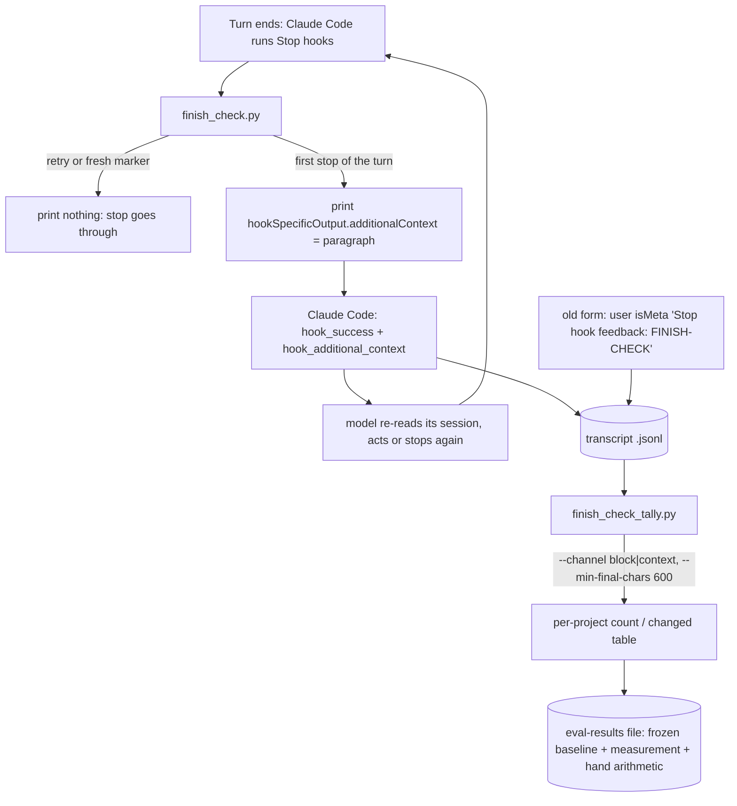

# Finish-Check Without the Error Notice — Architecture Spec

## In Plain Language

The finish-check is the hook that, when a turn ends, asks the assistant once to re-read its own
message for work it left undone. It does that by refusing the first stop. Claude Code now shows every
refused stop as **"stop hook reported a problem"**, so every session shows an error on most turns
even though nothing is wrong.

Claude Code has a second way for a hook to keep a turn going: instead of refusing, the hook hands the
assistant a note ("additional context") and the turn continues. Claude Code treats that as a normal,
successful hook and shows no error. This feature moves the finish-check onto that channel. The
paragraph, the once-per-turn guard and every fail-open rule stay exactly as they are.

The one real risk is that the assistant takes a note less seriously than a refusal. Nothing but the
transcripts can tell us, so the tally script learns to tell the two channels apart, and the spec
says up front what result counts as "it still works".

## Architecture at a Glance

On the first stop of a turn the hook now prints a context note instead of a refusal. Claude Code
continues the turn, the model re-reads, and its next stop arrives marked as a retry, which the hook
lets through as before. Both the old and the new form land in Claude Code's transcripts. The tally
reads them, labels each check by its form, and prints the per-project table that the results file
compares by hand.

## How It Works (Technical)

**Verified facts this design rests on** (Claude Code 2.1.327, 2026-11-18):
- In the installed Claude Code, a Stop hook's `blockingError` is pushed onto an error list. When that
  list is non-empty on a non-retry stop, the UI shows "stop hook reported a problem · ctrl+o to see".
  `additionalContexts` go to a separate list, set the continue flag, and never touch the error list.
- A headless session whose Stop hook printed
  `{"hookSpecificOutput":{"hookEventName":"Stop","additionalContext":"..."}}` continued, the model
  acted on the text, and the second Stop payload carried `stop_hook_active: true`.
- Transcript records per check:
  - **Block (old):** `{"type":"user","isMeta":true,"message":{"content":"Stop hook feedback:\nFINISH-CHECK ..."}}`
    plus a `hook_blocking_error` attachment.
  - **Context (new):** four records. A `hook_success` attachment whose `stdout` holds the JSON, a
    `hook_additional_context` attachment (`hookEvent: "Stop"`, `content: ["FINISH-CHECK ..."]`), a
    `stop_hook_summary` system record, and an `api-request-blob` holding the system-reminder copy.
    Only the `hook_additional_context` attachment is counted.

**Components**

- `studio/finish_check.py`. `block_stop` prints
  `{"hookSpecificOutput": {"hookEventName": "Stop", "additionalContext": reason_text()}}` instead of
  `{"decision": "block", "reason": ...}`. Nothing else changes in behavior. The marker is still
  written before the print, both loop guards stay, `DEFAULT_REASON` stays byte-identical, and every
  path still exits 0 with empty stderr. The docstring is reworded: the turn is *held open* rather
  than *refused*, the error notice is why, and an older Claude Code that ignores the field ends the
  turn unchecked (fail-open).
- `studio/finish_check_tally.py`.
  - `channel_of(record) -> "block" | "context" | None` replaces `is_block`. It returns `"block"` for
    the isMeta user record starting with `BLOCK_TEXT`. It returns `"context"` for an `attachment`
    whose `attachment.type == "hook_additional_context"`, whose `hookEvent == "Stop"`, and which has
    an entry starting with `FINISH-CHECK` anywhere in its `content` list. SessionStart and
    UserPromptSubmit hooks write the same attachment type, hence the event check. Every sibling
    record returns `None`, so no check is counted twice.
  - `final_message_chars(records, index) -> int` returns the text length of the **nearest** earlier
    `assistant` record only. Claude Code writes each content block as its own record, so a nearest
    record with no text means the turn ended without text. Reading further back would measure an
    earlier message. No text, or no assistant record at all, returns 0.
  - `blocks_in` adds `channel` and `final_chars` to each graded check.
  - `scan(..., min_final_chars=0, channel=None)` and the flags `--min-final-chars N` and
    `--channel block|context` filter checks next to the existing `--since` filter. The report names
    the active filters on one line. With neither flag the output is unchanged.

**Interfaces & contracts.** The hook's stdout contract is the one line above. The tally keeps its
existing plain-text report, and the per-project `(count, changed)` table is the input to the hand
comparison.

**Data model.** No new state. The tally reads `~/.claude/projects/*/*.jsonl` and writes nothing.

**Dependencies.** A Claude Code that honors `additionalContext` on Stop (2.1.327 does). Stdlib only.

## Key Decisions

- **Change the channel, not the paragraph.** The wording stays byte-identical so the channel is the
  only variable in the comparison.
- **Measured against a block baseline on comparable turns.** The finish-check skips stops whose final
  message is under 600 characters (PR #244). Only checks whose final message is at least 600
  characters are compared, on both sides.
- **Baseline weighted by project.** On those checks since 2026-11-01, the block channel's change rate
  runs from 0.15 to 0.47 by project against 0.346 pooled (645 checks, re-run by hand on 2026-11-18).
  A pooled baseline would let the project mix decide the result.
- **At least 150 context checks.** At 30 an equally good channel fails about 21% of the time.
  Qualifying checks arrive at about 46 a day, so 150 take a few days after a full sweep.
- **The baseline is frozen into the results file, not re-read from disk.** Claude Code deletes a
  transcript 30 days after its last write. The earliest surviving block is 2026-11-04, so the block
  records start vanishing around 2026-12-04.
- **The comparison is done by hand in the results file, not in code.** An in-code verdict
  (`channel_comparison`, its constants, a report section and five tests) was designed and cut: it
  would compute from a disk that is losing the baseline. A `--channel` filter plus the existing
  per-project table gives every number the arithmetic needs.
- **The shipped finish-check spec gets a dated note at its top, not a rewrite.** Its criteria and its
  "3 in 10" evidence were measured on the block channel. Rewriting them would make that evidence
  appear to verify a hook it never measured.
- **Context checks from a project with no block baseline are left out of the comparison**, and the
  count is stated.

## Non-Goals / Cut Scope

- No change to `DEFAULT_REASON`, the override file, the guards, the marker, or the installer's
  registration.
- No detection of the Claude Code version. An older one fails open.
- No in-code pass verdict, as described above.
- No renaming of `block_stop` or of test names that say "blocked". That would be churn with no
  behavior change.
- No change to `specs/obligation-queue.md`'s passing mention of refusal. It is shipped history.

## Risks & Open Questions

- **Adherence may drop.** A system-reminder note may be acted on less than a refused stop. That is
  exactly what the Verification section measures, and a fail means switching back.
- **Silent loss on an old Claude Code.** On a version that ignores the field, the check is simply off,
  with nothing shown. Every install on this machine runs 2.1.327.
- **The freeze has a deadline.** If the baseline table is not copied into the results file by
  2026-12-03, the comparison loses its baseline.
- **Merge order with #244.** Both PRs edit `finish_check.py`'s docstring and the same doc paragraphs.
  #244's new README text says "refuses the first stop", which the hook unit's doc grep forbids.
  Whichever PR lands second rebases and must still pass that grep.

## Verification

This feature is partly prompt-shaped. Tests can prove the hook prints the new line. Only transcripts
can show whether the model still acts on it.

- **Pass criterion.** This feature works if and only if, over at least 150 context-channel
  finish-checks whose final message was at least 600 characters (from projects that also have a
  frozen block baseline), the share followed by a concrete change is at least 0.80 times the
  block-channel rate weighted by each project's share of those context checks.
- **Baseline.** The block channel on comparable turns. Before the consumer sweep, and no later than
  2026-12-03, run
  `python studio/finish_check_tally.py --since 2026-11-01 --channel block --min-final-chars 600`
  and paste its per-project `(count, changed)` table, with the run date, into the results file. The
  disk is never read for the baseline again.
- **Measurement.** Re-vendor every consumer the same day. Once 150 context checks exist, run
  `... --since <sweep date> --channel context --min-final-chars 600` and paste that table.
- **Comparison, by hand in the results file.** Weighted baseline =
  Σ(context countₚ × block changedₚ / block countₚ) ÷ kept context count, over projects with a
  baseline row. State the left-out count, then the pass/fail line, so anyone can recompute it from
  the page.
- **Where the evidence goes.** `specs/finish-check-context-channel-eval-results.md`, created from the
  skeleton when this spec is approved.
- **Stop condition.** While that file still says `FILL_ME`, nobody may call this feature working, and
  this spec stays `status: approved`.

## Build Plan

Two units in one PR, tally first. The baseline freeze needs `--channel` and `--min-final-chars`, so
the instrument has to exist before the hook changes what gets written.

### 1. `tally_counts_both_channels` — the tally tells refused stops from context notes and filters on final-message length

Files: `studio/finish_check_tally.py`, `studio/tests/test_finish_check_tally.py`,
`studio/docs/ARCHITECTURE.md` (tally row). Test fixtures follow the real record shapes listed above.

**Acceptance criteria:**
- [ ] `channel_of` returns `"context"` for a Stop `hook_additional_context` attachment with a `FINISH-CHECK` entry anywhere in its content list, and `"block"` for the isMeta user record. It returns `None` for `hook_blocking_error`, `hook_success`, `stop_hook_summary`, `api-request-blob`, a SessionStart `hook_additional_context`, and a Stop context list with no `FINISH-CHECK` entry. `is_block` no longer exists.
- [ ] Every graded check carries `channel` and `final_chars`. `final_chars` is the text length of the nearest earlier `assistant` record. A thinking-only final record measures 0 even when earlier text exists, and so does a check with no assistant record before it.
- [ ] Through `main`, on a temporary transcript holding one check of each form: `--min-final-chars 600` keeps a 600-character final and drops a 599-character one, `--channel context` and `--channel block` each keep only their own form, and the report names the active filters on one line.
- [ ] With neither flag, the existing report tests pass with no assertion in them edited.
- [ ] The module docstring and the ARCHITECTURE.md tally row name both record forms and both flags.

**Out of scope:** any pass/fail computation, and the hook.

### 2. `hook_returns_context` — the finish-check holds the turn open without Claude Code's error notice

Files: `studio/finish_check.py`, `studio/tests/test_finish_check.py`, `README.md`,
`studio/docs/CLAUDE_CODE_USAGE.md`, `studio/docs/API.md`, `studio/docs/ARCHITECTURE.md` (hook row),
`studio/run_phase.py` (the two `--no-finish-check` help strings), `studio/install.py` (one comment),
`.claude/hooks/README.md`, `specs/shipped-finish-check.md` (top note only).

**Acceptance criteria:**
- [ ] On a first stop the hook prints exactly one line, `{"hookSpecificOutput": {"hookEventName": "Stop", "additionalContext": DEFAULT_REASON}}`, exits 0, and leaves stderr empty. The second stop, whether caused by `stop_hook_active` or by a fresh marker, prints nothing. `grep -n '"decision"' studio/finish_check.py studio/tests/test_finish_check.py` is empty.
- [ ] The override tests read the paragraph from `hookSpecificOutput.additionalContext` and pass, and the `DEFAULT_REASON` line does not appear in `git diff main -- studio/finish_check.py`.
- [ ] The module docstring says the turn is held open with `additionalContext`, names the "stop hook reported a problem" notice as the reason, and says an older Claude Code fails open.
- [ ] `git grep -n -i -E "refuses (the|your) first|refusing (the stop|is the whole)" -- README.md studio/docs studio/run_phase.py studio/install.py studio/finish_check.py .claude/hooks/README.md` is empty, and `specs/shipped-finish-check.md` differs from main only by a dated note at its top pointing here.
- [ ] `cd studio && python -m pytest tests/ -q` is green.

**Out of scope:** the paragraph's wording, the installer's registration, and #244's short-message skip.
