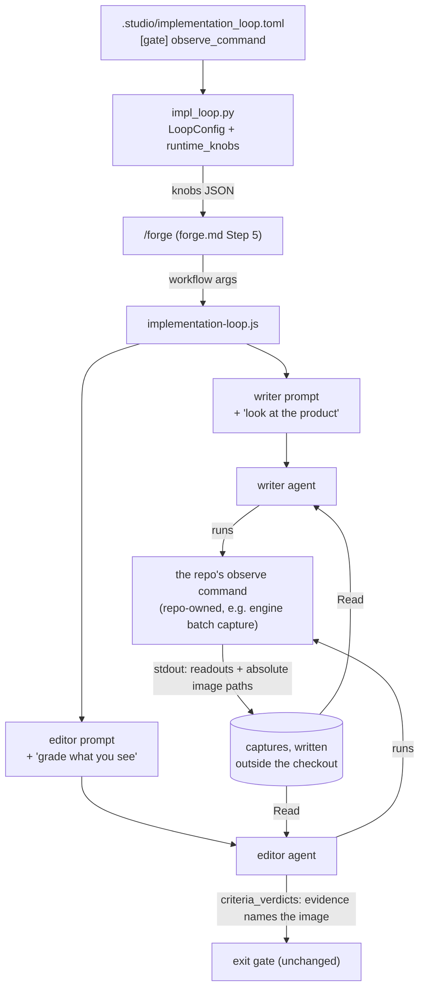

# /forge Can Look at the Running Product — Architecture Spec

## In Plain Language

`/forge` builds a unit with two agents. A writer builds it, and an editor checks it against the
spec's acceptance criteria, one by one. The editor judges from the code and the test results. Its
instructions say so outright: it has no browser and no Play mode. For a web service that is mostly
enough. For a game it is not, because much of what a game promises is something a player *sees*:
what is drawn, what it looks like, whether it stutters.

The first game to use `/forge` shows the gap. Roughly 60 of its 257 graded criteria describe
something on screen, and only about five of the 257 cite anything from the running game. The rest
were passed on the strength of a test standing in for the picture. The one criterion the editor
admitted it could not check was "the plant still renders exactly as it did before, wherever it sits
inside the target shape". A before-and-after picture would have answered that in seconds.

This feature lets a repository tell `/forge` how to look at its product. The repository supplies one
command that captures the running thing, say a screenshot of a named scene or a timing readout, and
both agents are told to run it: the writer while it builds, and the editor while it grades. Studio
never writes capture code and never compares images. It passes the command along and tells the
agents to open what it produces, exactly as it already does with the test command.

## Architecture at a Glance

The command's text travels the same road `mutation_command` already travels: config file, loader,
knobs, `/forge`'s workflow arguments, and finally a sentence in each prompt. Everything after the
prompt happens in the agents' own shells. They run the repository's command, read the image files
it lists, and the editor names those files in its evidence. The gate that decides whether a unit
ships is not touched. It already requires each criterion to come back `pass` with evidence, so an
observed pass counts the same way a tested pass does.

## How It Works (Technical)

### The observe command contract

Studio stores the command as a string and places it in the prompts. It never runs it or parses its
output. The repository owns everything below except the config key.

- **Config.** `[gate] observe_command = "<cmd>"` in the repository's own
  `.studio/implementation_loop.toml`. Empty or absent means off. An empty value never makes
  `/forge` refuse to start, unlike a blank `test_command`.
- **Arguments.** The agent appends free-form arguments (`<cmd> <args>`) chosen from the
  repository's own docs, usually its `CLAUDE.md`: which scene or saved state to load, what to
  capture. Studio defines no argument syntax.
- **Which code it observes.** The checkout in its current working directory. Under `--work-dir`
  the prompt's existing `cd` (`workDirPreamble`) makes that the tree under build. The command must
  take its project path from the working directory and never hard-code one.
- **Output.** Text on stdout. A line that is an absolute path to a file, in the host's own form (a
  drive-letter path counts on Windows), is evidence the agent must open with Read. Every other line
  is a readout, such as a frame time or a log excerpt.
- **Where captures go.** Outside the checkout, and nowhere else. The writer commits with
  `git add -A`, so anything written inside the tree lands on the unit's branch, and a capture inside
  a worktree is deleted when the worktree is removed, leaving evidence that points at nothing.
- **Exit code.** 0 means it observed. Non-zero means it did not, and stderr says why.

### Components and changes

| File | Change |
|---|---|
| `studio/impl_loop.py` | `LoopConfig.observe_command: str = ""` after `mutation_command`, a string check in `__post_init__` naming the key, one line in `load_loop_config`, one key in `runtime_knobs`. `_require_gate_commands` is unchanged: the key is optional. |
| `.claude/workflows/implementation-loop.js` | A helper `observeCommand(u)` modelled on `unitCriteria`: the trimmed string, or `''` for anything malformed. Writer and editor prompt additions, below. `DEFAULT_UNIT` is unchanged; an absent key already means off. |
| `.claude/commands/forge.md` | Step 5 passes `observe_command` from the knobs JSON, and the paragraph on how each knob is used gains one clause. Step 2 is unchanged: the key has no token to substitute. |
| `.claude/commands/spec.md` | The Build Plan criteria rule: a player-visible criterion is allowed when the repository sets `observe_command`, and it must name the scene or state to observe and what must be visible there. Without the key, such a criterion still belongs to `/smoke`. |

**Writer prompt,** when the command is set, after the test-run line:
"See the product: run `<cmd>` with the arguments this repo's docs give, Read every file path it
prints, and fix what you see. Note `git status --porcelain` before you run it and compare afterwards;
before committing, `git status` must show nothing the command wrote."

**Editor prompt,** when the command is set:
- Before grading: run `<cmd> <args>` here, after your last edit, and Read every image it prints
  before grading anything a player sees. If you `reset --hard` after a capture, capture again
  before citing it: an image taken before the reset shows a tree that will not ship.
- A pass from a capture names the image's absolute path and the commit it was taken at.
- Nothing the command wrote may be committed. Your commit is `commit -am`, which stages every
  tracked file the command modified, such as a lock file or an engine settings file. Note
  `git status --porcelain`, and `git diff` of any file already changed, before you run the command,
  and compare afterwards: that is how you tell what it wrote from your own edits. Before you commit
  or finish, restore each tracked file it changed and remove each new untracked file that
  `git status` shows. Leave ignored files alone: an engine cache such as Unity's `Library/` is
  ignored, and deleting it makes the next capture pay the cold import. `git status` must then show
  nothing the command wrote.
- A criterion that compares against "before this unit" needs a capture at `<writer_sha>^` as well.
  Never take it by moving this checkout: no `checkout`, `switch`, `stash` or `reset` to the parent
  here, because the commits and resets that follow would then run against the wrong place. Use the
  repository's documented method, or add a separate worktree at `<writer_sha>^` outside this
  checkout, capture there, and remove it. If neither is possible, grade the criterion
  `unverifiable`.
- If the command fails, decide why. A failure the unit caused (a compile error, an exception from a
  touched file, a scene that no longer loads) is `fail`. A command that could not run for reasons
  outside the unit (a missing tool, a licence, a timeout) is `unverifiable`, with the error quoted.
- The criteria clause's "you have no browser and no Play mode" becomes "or from what the observe
  command shows".

When the command is absent, empty, whitespace or not a string, both prompts render exactly as they
do today.

### Data model

One new optional string in the `[gate]` table and in the knobs dict. The editor's handoff schema,
`criteria_verdicts`, is unchanged: `evidence` is already free text, and the gate in
`unconfirmedCriteria` already accepts only a `pass` with non-empty evidence.

### Dependencies

Agents that can open image files with Read, which the models `/forge` runs on can. A repository
command that can capture the product without a human at the screen. For the first adopter, a Unity
game, the batch-mode test run already starts a Metal graphics device, so rendering to an image
without a window is likely to work. Nobody has proved it yet.

## Key Decisions

- **A look can pass a criterion** (user decision). The editor may grade `pass` from an image alone,
  provided the evidence names the file so a person can open the same picture. The alternatives
  were "an image can only fail" and "a pass needs a match against an approved reference image".
  The first would leave most visual criteria ungraded, as they are today. The second is a whole
  reference-image feature of its own.
- **Both agents get the command** (user decision). The writer uses it to iterate (change, capture,
  look), which is where it prevents visual bugs instead of only catching them later.
- **Studio ships a key, not a capturer.** Capture is stack-specific. Studio stays stack-neutral,
  exactly as it does with `test_command`.
- **Captures live outside the checkout only.** An in-tree ignored folder was considered and cut.
  Under `--work-dir` it dies with the worktree, and a grade would then point at a file nobody can
  open.
- **No Studio-owned capture folder, no `{out}` token.** Cut by the contrarian: the command already
  prints its own paths, and a folder Studio created inside the tree would be committed by the
  writer's `add -A`.
- **No rule that the evidence must describe the picture.** Cut as unenforceable. The gate cannot
  tell a description from a guess, and the verification below measures whether the editor really
  looks.
- **A broken capture the unit caused is `fail`.** The alignment draft graded every failed command
  `unverifiable`, which would have hidden a crash the unit introduced.
- **No setup-wizard step.** The wizard's stamped template is unchanged. The usage doc's "every key
  present" sentence is narrowed to the keys the wizard writes.

## Non-Goals / Cut Scope

- Capture code, scene loading or saved-state selection of any kind in Studio.
- Image diffing, similarity scores, reference images or thresholds. A repository's command may print
  a difference score as a readout, and that is its own business.
- Performance budgets or timing thresholds. A timing readout is just another line of output.
- Building the first adopter's capture command. That work lives in that repository.
- An editor-only mode for `/forge`. The verification below renders the editor prompt directly
  instead.

## Risks & Open Questions

- **The image is never really opened.** An agent can name a file without reading it. Nothing in the
  gate can prevent that. Only the verification's sabotaged arm measures it.
- **Slow first import.** A game engine's first import in a fresh worktree can exceed the agent's
  10-minute command limit. Without a warmed cache the grade is `unverifiable`, never a silent pass.
  A worktree added at `<writer_sha>^` for a before capture always starts cold, so on a Unity
  adopter most before/after criteria will grade `unverifiable` unless the repository documents a
  cached method. The usage doc should say so next to this risk.
- **Engine project locks.** Without `--work-dir`, an editor a person has open on the same project
  can block a batch capture. The command fails and the grade is `unverifiable`. That outcome is
  honest, but it is worth saying in the usage doc.
- **Captures do not keep themselves.** A path outside the checkout is often a temporary folder on
  the agent's machine, cleaned up later. The usage doc should say that keeping captures around, so
  a person can open the picture a grade names, is the repository's job.
- **The key can go away after the spec is written.** `/spec` allows a player-visible criterion
  because the key is set at that moment. If the key is later removed or its command breaks, those
  criteria grade `unverifiable` and the unit ships flagged. That is acceptable; the usage doc should
  say so in one sentence.
- **Image cost.** Every image read costs context. The repository's arguments should capture what
  the criterion names, not the whole game.
- **Lenient grading.** 253 of the adopter's 257 graded criteria passed. A look-based pass inherits
  whatever leniency the editor already has. The sabotaged arm is there to show it does not
  rubber-stamp.

## Verification

Prompt tests can show what the prompts say. They cannot show that an agent ran the command, opened
the picture, and graded from what it saw, so this feature carries a criterion agreed before the
build.

- **Pass criterion.** This feature works if and only if, replaying one past before/after rendering
  criterion from the first adopter with the writer's commit held fixed: the editor with
  `observe_command` unset grades it `unverifiable`; the editor with it set grades it from an image
  it opened with Read, named by absolute path in the evidence, in a way a person viewing the same
  image agrees with; and the editor with it set, on a copy of that commit with one deliberate,
  visible break to the criterion's subject, grades it `fail`.
- **Baseline.** With the key unset, today's editor prompt forbids looking, so `unverifiable` is
  reproducible on demand. All three arms are editor-only. Check out the historical writer commit in
  a worktree with the engine cache warmed. Render `editorPrompt(unit, writer)` from Studio's source
  with the workflow test loader, so the vendored loop in that old commit plays no part, and spawn
  a fresh agent in the worktree with it. In every arm, move aside any engine MCP server, engine
  skill and code-index priming. Leave the adopter's own `CLAUDE.md` in place, capture docs
  included. If the baseline editor captures anyway, the key adds nothing over the repository's own
  docs: stop and say so.
- **Precondition.** The adopter's command must exist and be able to capture at `<writer_sha>^`. A
  second worktree at the parent satisfies the working-directory contract. If that has not landed by
  the middle of the window, move `verification_due` visibly rather than let it lapse.
- **Where the evidence goes.** `specs/forge-observe-command-eval-results.md`, created from the
  skeleton when this spec is approved. This repository is public. The adopter's name, unit id,
  commits and criterion text stay in the adopter's repository. The results file paraphrases them.
- **Stop condition.** While that file still says `FILL_ME`, nobody may call this feature working and
  this spec stays `status: approved`. Setting it to `shipped` is the claim, made when the file is
  filled in.

## Build Plan

### 1. `forge_observe_command` — the /forge writer and editor can look at the running product when the repo declares how

What gets built: the config key through `impl_loop.py`, the knob in forge.md Step 5, the
`observeCommand` helper and both prompt additions in `implementation-loop.js`, the `/spec` criteria
rule, and the docs that move with a workflow change: `IMPLEMENTATION_LOOP_SPEC.md` (the
`unverifiable` paragraph, the §4 example and the contract above), `CLAUDE_CODE_USAGE.md`,
`README.md`'s `/forge` row, `ARCHITECTURE.md`'s `impl_loop.py` row, the knob list in `CLAUDE.md`, and
`CHANGELOG.md`. Python tests follow the `mutation_command` pattern in `test_impl_loop.py`. JavaScript
tests are relational, comparing a prompt with the key against the same prompt without it, as the
existing zero-criteria and malformed-payload tests do. No new fixture file is added, and the existing
no-work-dir fixture stays byte-unchanged.

**Acceptance criteria:**
- [ ] `observe_command` loads from `[gate]`, defaults to `""`, rejects a non-string with an error naming the key, and appears in `runtime_knobs`; an empty value never makes `/forge` refuse to start.
- [ ] An `observe_command` that is absent, empty, whitespace-only or not a string renders both prompts identically to a unit without the key, and the existing no-work-dir prompt fixture test passes with its fixture unchanged.
- [ ] With the key set, the writer prompt only adds lines to the keyless prompt: it names the command and says nothing the command wrote may be committed.
- [ ] With the key set and criteria present, the editor prompt no longer says "no browser and no Play mode", requires image evidence to name the file's absolute path, grades a failure the unit caused as `fail`, and grades a command that could not run as `unverifiable`.
- [ ] With the key set, the editor prompt says nothing the command wrote may be committed: tracked files it modified are restored and untracked files it created that `git status` shows are removed before the editor commits or finishes, ignored files are left in place, and the editor compares `git status --porcelain` from before and after the command to tell its writes from the editor's own edits.
- [ ] With the key set, the editor prompt says a capture at `<writer_sha>^` never changes the unit checkout's HEAD or working tree, and is taken by the repository's documented method or in a separate worktree outside the checkout.
- [ ] `spec.md`'s criteria rule allows a player-visible criterion, naming the scene or state to observe and what must be visible, only when `[gate] observe_command` is set; otherwise it still sends the criterion to `/smoke`.
- [ ] forge.md Step 5 passes `observe_command`, and `IMPLEMENTATION_LOOP_SPEC.md`, `CLAUDE_CODE_USAGE.md`, `README.md`, `ARCHITECTURE.md`, `CLAUDE.md` and `CHANGELOG.md` each describe the key.

**Out of scope:** any capture code, the adopter's command, the setup wizard's template, and the
verification replay.
