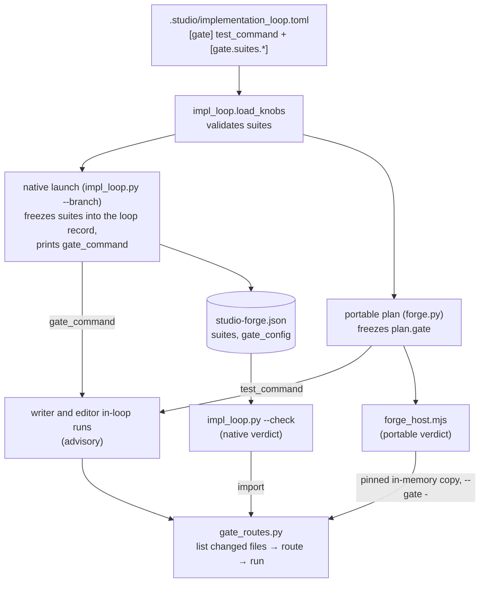

# Gate Suites — Architecture Spec

## In Plain Language

A repository tells `/forge` how to test it with one command, `[gate] test_command`. That works until
a repository holds two kinds of code. A Unity game with a web build, for instance, has a Unity test
script and a separate web check. With one command, a unit that only changed the web code is tested
with Unity. The post-loop check then reports it clean without ever running a web test. That false
"clean" is worse than no check at all.

The obvious fix is to let the person launching `/forge` pick the test command with `--test`. That
fix is unsafe, because agents launch `/forge` too, and an agent can pass `--test true`. The
enforcement layer was built on the rule that a run cannot choose its own verdict.

This feature lets a repository name its **suites**: each one is a test command plus the folders and
files it covers. Whenever Studio runs the tests itself, it looks at the files the unit actually
changed and runs every suite that covers one of them. For any changed file no suite covers, it runs
the default `test_command` as well. Nobody picks the suite, and the commands come only from the
repository's own reviewed config. A web unit gets the web check, a Unity unit gets the Unity tests, a
unit that touches both gets both, and a flag cannot make any of it softer. A repository that declares
no suites behaves the way it does today.

## Architecture at a Glance



One small file, `gate_routes.py`, does the only new work: it lists the files a unit changed since
its launch, decides which suites cover them, and runs those commands. Every place that runs tests
uses it. The native verdict (`--check`) imports it. The portable host runs a copy it loaded into
memory before any agent started, so a writer cannot edit the code that judges it. The writer and
editor run it through the launch's `gate_command`, so the in-loop result matches the verdict. The
suites are frozen when the run is launched: into the loop record natively, and into `plan.gate` in
the portable plan. A unit that edits the config therefore cannot change what judges it.

## How It Works (Technical)

### Config

```toml
[gate]
# The backstop: runs for any changed file no suite claims, and when nothing changed. Prefer a
# command that covers every stack where that is affordable; a stack-specific default under-tests
# any new top-level folder added later.
test_command = "./scripts/run-all-tests.sh"

[gate.suites.web]
command = "npm --prefix web run check"
paths = ["web/", "shared/schema.json"]

[gate.suites.unity]
command = "./scripts/run-editmode-tests.sh"
paths = ["unity/"]
```

- **The shape of a suite.** A suite is a sub-table of `[gate.suites]` with exactly two keys,
  `command` and `paths`.
- **How paths match.** A path ending in `/` covers every file under that directory. Any other path
  covers one exact file. Paths are repository-relative and literal: no globs, and case-sensitive. A
  file covered by several suites runs each of them.
- **Run order.** Suites run in the order the file lists them, and the default runs last.
- **Not a `LoopConfig` field.** `[gate.suites]` stays out of the `LoopConfig` dataclass, following
  the packs precedent (`specs/pack-mechanism.md`). `load_loop_config` already ignores tables it does
  not know. `load_knobs` adds `suites` and `gate_config` to the knobs, the way it adds the pack check.

**Validation applies only to suite tables.** It lives in `gate_routes.check_suites(table, root)`.
`load_knobs` turns a failure into a `LoopConfigError`, so every `impl_loop.py` call exits 1. Each
refusal reads `bad-suite: [gate.suites.<name>] in <file> <reason>.` and is followed by a fix line.
Nothing outside `[gate.suites]` gains a refusal.

| Reason | Example |
|---|---|
| `gate.suites is not a table` | `suites = "web"` |
| `is not a table` | `[gate] suites.web = "x"` |
| `has unknown key "<k>"; a suite takes only command and paths` | `path = [...]` |
| `has no command, or it is blank or not text` | missing, `""`, `5` |
| `has no paths, or it is empty or not a list of text` | missing, `[]`, `"web/"` |
| `path "<p>" must be repo-relative` | leading `/`, a `\`, a `..` or `.` segment, an empty segment (`web//`), leading `./`, blank |
| `path "<p>" has a glob character` | `*`, `?` or `[` |
| `path "<p>" does not exist as written` | at launch: an entry ending in `/` that is not a directory, or another entry that is not a file. When a bare entry is a directory, the message adds `write "<p>/"`. |

The last row exists because a mistyped path such as `wbe/` would otherwise send every web change to
the default, which would run green without the web check.

### `gate_routes.py`

It is a single standalone file. It uses only the standard library, with its own `tomllib`/`tomli`
import, and imports nothing from Studio, so the portable host can load it as one file. It ships
through `install.SOURCE_FILES`.

- **`changed_files(root, base_sha) -> list[str]`** takes the sorted union of
  `git diff --name-only --no-renames -z <base_sha>` (committed, staged and unstaged changes since
  the base, deletions included) and `git ls-files --others --exclude-standard -z` (untracked files
  that are not ignored).
  - `--no-renames` splits a rename into its old and new paths, so a move from `web/` to `unity/`
    runs both suites.
  - Paths under `.studio/output/impl_loop/` and `reviewer-concerns/` are dropped. Studio writes run
    records and concerns files there, and in some repositories those are tracked.
  - A failed git call raises `RoutesError`.
- **`route(suites, default, changed) -> (routes, unclaimed)`.** A suite routes when any changed file
  matches any of its paths. The default (name `None`) routes when `unclaimed` is non-empty or when
  `changed` is empty.
- **The config-edit flag.** `config_changed` is true when `gate_config` is in the changed files,
  worked out before the two prefixes above are dropped, or when the tree's copy of the config no
  longer matches `gate_config_sha256`: edited, or deleted. The hash covers a gitignored config, which
  git cannot list.
- **`run(root, routes) -> [{"suite", "command", "exit_code"}]`.** Each command runs through the
  shell from the tree's root, with its output on stderr. Every route runs, even after an earlier one
  fails.
- **Command line:** `gate_routes.py --base <sha> (--gate - | --config <toml>)`.
  - `--gate -` reads `{test_command, suites, gate_config}` as JSON on stdin.
  - `--config` reads `[gate] test_command`, `[gate.suites]` and the file's own path.
  - Either way it prints `{"runs": [...], "unclaimed": [...], "config_changed": bool}` on stdout and
    exits 0 when every run passes, 1 when any run fails, and 2 on bad input or a failed git call. A
    config edit does not change the exit code.

| Caller | Copy it runs | Why |
|---|---|---|
| `--check` | `import gate_routes`, the sibling file | same trust as the rest of `_check_record`; with `--work-dir` it is already the session checkout's copy |
| Portable host | read into memory at module load, beside the comment checker (`forge_host.mjs:12`); each verdict writes it to a temporary directory and runs it with `STUDIO_FORGE_PYTHON` | the writer cannot change what decides its verdict |
| In-loop agents | the tree's copy, through `gate_command` | advisory; the verdict re-runs it |

### Data model

**The loop record** (`<git-dir>/studio-forge.json`) grows from nine fields to twelve:

| Field | Type | Meaning | Old record without it |
|---|---|---|---|
| `suites` | `{name: {"command": str, "paths": [str]}}` | the suites as loaded at launch | read as `{}` |
| `gate_config` | `str \| null` | the config file the launch read, relative to its repository's top level; `null` when that file is outside any repository | read as `null`, which skips the config-edit check |
| `gate_config_sha256` | `str \| null` | SHA-256 of the tree's copy of that config at launch; `null` when `gate_config` is | read as `null`, so only the git listing decides |

`test_command` keeps its meaning: it is always the configured default and never `--test`, because
the native launch never passes one. `_read_record` treats both new fields as optional. If a field is
present it is shape-checked (`check_suites` minus the filesystem row), and if missing it gets its
default. A malformed `suites` makes the record `unreadable-record`.

**The portable plan** (`forge.py`) gains `gate: {test_command, suites, gate_config}`, frozen when the
plan is built. The host's verdict reads only `gate`. The top-level `test_command` becomes the in-loop
command and nothing else.

### Each caller

**`--check` (native verdict).** Inside `_check_record`'s existing "both git checks passed" branch,
the single `_run_test_command(record["test_command"])` is replaced by `changed_files` → `route` →
`run` over the record's frozen suites.
- `tests` becomes a list of `{suite, command, exit_code}` in run order, with the default as
  `suite: null`. It is `[]` when a git check failed.
- Each red run is its own `tests-failed` problem, naming the suite or "the default test command".
- **New problem: `gate-config-changed`.** When `config_changed` is true, `--check` reports
  "`<gate_config>` changed since `<base_sha>`, so the next launch on this branch would be gated by a
  config this unit wrote; a person should read that change", and the tests still run.
  - `base_sha` is fixed for the record, so a re-check cannot clear this problem. Its fix line names
    the record's path: once a person has read the change, they delete that file or relaunch.
- The pack check is unchanged.
- A `RoutesError` becomes a `CheckError` (exit 2, "No test was run").

**Portable host (portable verdict).**
- **Why the precedence flips.** Today `forge.py` loads knobs with `--test` as an override, and the
  override wins (`impl_loop.py:757`), so a frozen `gate.test_command` would equal `--test` and soften
  the verdict again. The precedence is reversed: the configured command wins, and `--test` fills in
  only when the config names none (the #294 case). The parameter is renamed from
  `test_command_override` to `test_command_fallback`, since it no longer overrides.
- **The plan's two commands.** `plan.gate.test_command` is the configured command (or the fallback),
  and `plan.test_command` is `--test` if given, else the in-loop runner command.
- **The verdict.** A new `verdict()` runs the pinned copy with `--gate - --base <base_sha>` and
  `plan.gate` on stdin. It replaces `test(unit.test_command)` at the writer verdict, the editor
  verdict and the recovery test.
  - `record.host_test` keeps every run.
  - `handoff.tests` keeps its three keys, because its schema refuses others.
  - Exit 2 or output that isn't JSON throws `Gate routing failed; preserving checkout`.
  - When `config_changed` is true, the host sets `state.gate_config_changed = true`, keeps the
    commits and exits 1.
  - The portable section of `forge.md` names `gate_config_changed` as a reason to lead the report
    with.

**Native in-loop default.**
- `impl_loop.py --branch …` prints `gate_command`: the runner with `--config <absolute config path>
  --base <base_sha>`, quoted the way `pack_check_command` quotes, and refused through
  `explain_unquotable_path` when a path cannot be quoted.
- `forge.md` Step 2 drops its marker-file inference. `test_command` becomes `--test` if given (which
  shapes only what the agents run), otherwise the launch's `gate_command`.
- The Step 4 echo says the gate comes from the launch.
- No prompt text changes: the workflow and the portable loop already render `u.test_command`.
- In-loop, the runner reads the live config, so a writer that edits the config changes only its own
  advisory run. The frozen verdict and `gate-config-changed` catch the edit.

### What `--test` does afterwards

| Path | `--test X` given | Not given |
|---|---|---|
| Native in-loop | writer and editor run X | they run `gate_command` |
| Native `--check` | never sees X | routes from the record |
| Portable in-loop | `plan.test_command = X` | the runner command |
| Portable verdict | never runs X, unless the config's `test_command` is blank; then X is the default, and the suites still route | routes from `plan.gate` |

### Dependencies

- `specs/enforcement-layer.md`: its loop record, unit 6's `--check`, and the Key Decision this
  revises.
- `specs/pack-mechanism.md`: the precedent for tables outside `LoopConfig`. The pack check is
  untouched.
- The portable host (`studio/forge.py`, `studio/forge_host.mjs`).
- `.claude/commands/forge.md`.

## Key Decisions

- **Routing by changed files, not by who launched.** A per-unit `--test` in the record was asked for
  in a consuming repository's review, and declined: it lets a run certify itself. Widening the one
  default to every stack was also rejected. It works, but every web unit then pays for a Unity boot,
  and on a machine without the engine every web unit fails. Routing keeps the enforcement layer's
  intent, that the verdict runs the repository's own commands and nothing per-unit can soften it.
  **This revises `specs/enforcement-layer.md`'s Key Decision** from "always runs the repository's
  gate command" to "always runs the repository's routed gate".
- **Everywhere, staggered** (owner, pre-flight). The post-loop check, the portable verdict and the
  in-loop default all route. Every intermediate stage of the rollout can only flag a unit, never mark
  one clean wrongly. With unit 1 in, `--check` is stricter than the loop. With unit 2 in, the
  portable verdict routes but its in-loop runs don't yet.
- **Suites are frozen at launch.** Natively they go into the record and in the portable path into
  `plan.gate`, and every edit to the config is flagged. A unit that narrows a suite cannot soften its
  own verdict. A later unit on the same branch would launch under the narrowed config, which is what
  `gate-config-changed` exists to show a person.
- **One matcher, in Python.** There is no second matcher in JS: the host runs the same file through
  Python. Only the portable host pins it. `--check` runs alongside an `impl_loop.py` that has the
  same trust, so pinning just its matcher would buy nothing.
- **Literal prefixes, not globs.** Prefixes are simpler to read, simpler to validate, and enough for
  "this folder is the web game". A path that does not exist is refused, so a typo cannot quietly drop
  a stack.
- **The in-loop default is the full routed gate.** Marker-file inference is deleted. The contrarian
  costed this at one writer run and one editor run per unit (natively about 2–3 × the suite time, in
  the Studio source repository roughly 2.5 minutes each), which is what the portable host already
  pays. `--test` is the narrow option and leaves the verdicts whole. Keeping inference for
  repositories without suites would mean a second code path, and the agent choosing the command again.
- **A config edit flags the run and does not fail it.** Failing it would make the portable path
  unable to build the one unit every adopting repository needs: the unit that adds its suite.
- **Empty diff → the default.** A unit whose writer commit changed nothing still runs the backstop.

## Non-Goals / Cut Scope

- **Globs, regex paths and per-suite exclusions** are out. Add them if a real layout needs them.
- **`/studio-setup` support** is out. Suites are hand-written TOML, documented in the loop doc.
- **A dependency graph across stacks** is out. A shared file goes under every suite that reads it.
- **An acknowledge flag for `gate-config-changed`** is out. Deleting the record after reading the
  change, or relaunching, already clears it.
- **Cut during the debate:**
  - `--gate <file>`, which has no caller;
  - a special case for submodule paths (a submodule bump falls to the default, which runs more,
    not less);
  - refusing unknown `[gate]` keys, which would break configs with extra keys and still not help old
    installs;
  - pinning `--check`'s matcher.

## Risks & Open Questions

- **An older install silently ignores `[gate.suites]`** and runs only the default for every change.
  That under-tests, and nothing in the config can detect it. The loop doc names the first release
  with suites. Repositories where old copies may still run should make `test_command` cover every
  stack, so the fallback over-tests.
- **A file shared across stacks but listed under one suite** never runs the other stack's tests.
  That is a documented rule, not a check.
- **A config outside any repository** (`gate_config: null`) cannot raise `gate-config-changed`.
- **A writer that edits `gate_routes.py` itself** changes what `--check` runs. It could already do
  the same to `impl_loop.py`, so the trust is unchanged. The portable host is closed against it.
- **Case-insensitive filesystems.** A path whose case differs falls to the default, which fails
  toward running more.
- **Slower in-loop runs** in repositories with a heavy suite, until someone passes `--test`.
- **#298 also edits `forge.md` Step 5.** Unit 3 builds on whichever version is on main.

## Build Plan

### 1. `routed_post_loop_check` — in a repository that declares suites, `--check` runs exactly the suites the unit's changes fall under, plus the default, and flags an edit to the gate config

What gets built:
- `studio/gate_routes.py` with `check_suites`, `changed_files`, `route` and `run` (no command line
  yet);
- `load_knobs` adding `suites` and `gate_config`;
- the record's two new fields;
- `_check_record` routing;
- the `gate-config-changed` problem;
- docs.

**Acceptance criteria:**
- [ ] `[gate.suites.<name>]` with `command` and `paths` loads into the knobs as `suites`; each refusal in the validation table makes `impl_loop.py` exit 1 with a message starting `bad-suite:` that names the file and the suite; a config with no `[gate.suites]` produces the same knobs as before plus `suites: {}` and `gate_config`.
- [ ] A `--branch` launch writes `suites` and `gate_config` into the record; a record without them reads as `{}` and `null`, and `--check` on it runs only the record's `test_command`.
- [ ] `--check` routes over `git diff --name-only --no-renames -z <base_sha>` plus `git ls-files --others --exclude-standard -z`, without `.studio/output/impl_loop/` and `reviewer-concerns/`: a web-only change runs web; a rename from `web/` to `unity/` runs both; a deletion under `unity/` runs unity; an untracked file outside every suite runs the default; only a concerns file changed runs the default; a file under two suites runs both.
- [ ] `tests` is a list of `{suite, command, exit_code}` in file order with the default last as `suite: null`; every routed command runs even when an earlier one fails, and each red one is its own `tests-failed` problem naming the suite.
- [ ] A diff touching the record's `gate_config` adds `gate-config-changed`, the tests still run, and the problem's fix line names the record file to delete once the change is read; the pack check behaves exactly as before.
- [ ] `gate_routes.py` imports nothing from Studio and is in `install.SOURCE_FILES`; `specs/enforcement-layer.md` (its Key Decision, record table and unit 6's field count), `studio/docs/IMPLEMENTATION_LOOP_SPEC.md`, `studio/docs/CLAUDE_CODE_USAGE.md`'s `--check` sentence, `studio/docs/ARCHITECTURE.md`'s module table and `forge.md` Step 6 describe the routed check.

**Out of scope:** the runner's command line, the portable host, and the in-loop default.

### 2. `portable_host_routed_verdict` — a portable run's verdict runs the routed suites from a matcher copy the writer cannot edit, and `--test` no longer replaces it

**Acceptance criteria:**
- [ ] `gate_routes.py --gate - --base <sha>` reads `{test_command, suites, gate_config}` from stdin, prints `{runs, unclaimed, config_changed}` on stdout with command output on stderr, and exits 0 when every run passes, 1 when any fails, and 2 on bad input or a failed git call.
- [ ] `forge --plan` prints `gate: {test_command, suites, gate_config}`; with a configured `test_command` and `--test X`, `gate.test_command` is the configured command and `test_command` is X; with a blank configured command and `--test X`, both are X; the loader's parameter is named `test_command_fallback`.
- [ ] The host reads `gate_routes.py` into memory at module load, and the writer verdict, the editor verdict and the recovery test all run that copy; a test that overwrites the tree's `gate_routes.py` after the host starts still gets a red verdict for a failing routed suite.
- [ ] A writer change under a web suite's path, with the web suite red and the default green, is not committed, and `host_test.runs` records the web suite's exit code.
- [ ] A writer change to the gate config sets `gate_config_changed: true` in the attempt record, keeps the commits and makes the host exit 1, and `forge.md`'s portable section names it as a reason to lead the report with; a runner exit 2 throws and preserves the checkout.

**Out of scope:** the in-loop command the portable agents run (unit 3).

### 3. `in_loop_routed_gate` — without `--test`, the writer and editor run the same routed gate the verdict runs, in both paths

**Acceptance criteria:**
- [ ] `gate_routes.py --config <toml> --base <sha>` reads the gate from the TOML and prints and exits exactly as `--gate -` does.
- [ ] `impl_loop.py --branch …` prints `gate_command`, the runner command for its config and `base_sha` quoted the way `pack_check_command` quotes, and refuses a path it cannot quote.
- [ ] `forge --plan` sets `test_command` to the same runner command when there is no `--test`, and to X when given `--test X`; the portable Claude role's allowed commands include it.
- [ ] `forge.md` Step 2 has no marker-file inference and reads that `test_command` is `--test` if given (shapes only what the agents run), otherwise the launch's `gate_command`; Step 4's echo, the Arguments entry, `CLAUDE_CODE_USAGE.md`'s `/forge` section and `IMPLEMENTATION_LOOP_SPEC.md` say the same.
- [ ] A rendered writer prompt with no `--test` contains ``Run the unit tests: `<gate_command>` `` in both the native workflow and the portable loop.

**Out of scope:** narrowing the in-loop default automatically.
