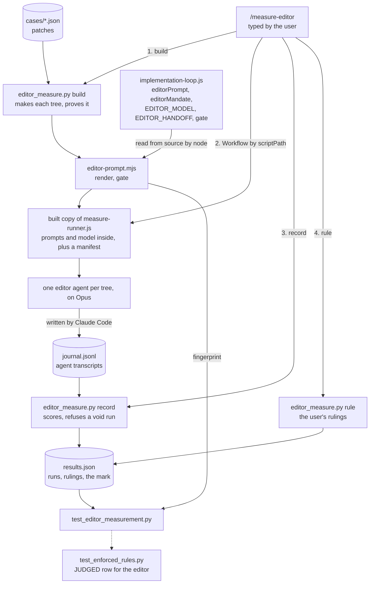

# Judged Rules — Architecture Spec

## In Plain Language

The enforcement-layer spec moves rules with one right answer into code that refuses. It leaves out,
on purpose, the rules that need judgment, and those are most of what Studio leaves unchecked.

Studio already puts a judge behind some of them. The `/forge` editor grades every unit that gets
built. It passed 628 of 642 criteria counted on 2026-11-18, and nobody can say whether that is good
writers or a rubber stamp. A judge nobody has measured is an instruction with a second agent
attached.

This spec does two things. First it sorts every unchecked rule by what could give it teeth: code
that removes the judgment, a simple check that stands in for it, a judge, or a person. Second it
measures one judge, the `/forge` editor. It builds a fixed set of past units with a known right
answer: some hold a real defect that review caught after the editor had passed the unit, some hold
a planted one, and some are clean. A command runs the editor on all of them and records how many
defects it caught and how many clean units it wrongly failed. From then on, changing the editor's
prompt turns Studio's test suite red until the editor has been measured again.

To make that measurement mean something, two things about the real editor become fixed: its whole
prompt is one piece of text in one file, and it always runs on Opus.

## Architecture at a Glance

A case is a recipe, not a copy: a past unit's commit, its criteria, and an optional patch. `build`
turns each recipe into a small standalone repository that holds nothing later than that commit, and
proves the case is what it claims. The editor's prompt for each tree is rendered by the real loop's
own code. A workflow script cannot read files, so a build step writes the rendered prompts into a
copy of a small runner script, and the user's command launches that copy. Results are read from the
files Claude Code writes for every workflow run, never from anything an agent typed.

## How It Works (Technical)

### Components

| File | Change | Single responsibility |
|---|---|---|
| `studio/tests/test_enforced_rules.py` | gains `JUDGED`, `JUDGED_WITHOUT_MEASUREMENT_COUNT`, 32 entries in `NOT_YET_ENFORCED` | The rule table. Created by the enforcement-layer spec's first unit; this spec only adds to it. |
| `.claude/workflows/implementation-loop.js` | `editorMandate()`, `EDITOR_MODEL`; `editorPrompt` prints the mandate | The loop. |
| `.claude/workflows/tests/load-from-source.mjs` | new; the loader moves here out of the test file | Read a function, a one-line constant or an object literal out of a workflow script's source. |
| `.claude/workflows/tests/editor-prompt.mjs` | new | Render the editor's prompt, print its schema and model, and evaluate the exit gate, all with the loop's own code. |
| `.claude/workflows/tests/workflow-shells.test.mjs` | imports the loader; fixture regenerated | |
| `studio/editor_measure.py` | new; not in `SOURCE_FILES` | `build`, `record`, `rule`, `fingerprint`. Does not ship to installed repositories. |
| `studio/evals/forge_editor/cases/*.json`, `patches/*.patch` | new | The case set. |
| `studio/evals/forge_editor/measure-runner.js` | new | The workflow script: one editor agent per built tree. |
| `studio/evals/forge_editor/results.json` | written by the first measurement | Every measurement, the rulings on it, and the mark. |
| `.claude/commands/measure-editor.md` | new; this repository only | The user's opt-in to run the Workflow tool. |
| `studio/tests/test_install.py` | names the one command that is never installed | |
| `studio/tests/test_editor_measure.py` | new | Tests of the module against a throwaway repository. |
| `studio/tests/test_editor_measurement.py` | new | The gate: the results file against today's prompt, model, cases and the mark. |
| `README.md`, `CLAUDE_CODE_USAGE.md`, `IMPLEMENTATION_LOOP_SPEC.md`, `ARCHITECTURE.md` | updated | |

`scopes.py`, `impl_loop.py`, `forge.md` and `install.py` do not change. The runner sits under
`studio/evals/`, not `.claude/workflows/`: everything in that directory is copied into installed
repositories, where a runner for Studio's own history is a dead file. The installer copies only the
commands named in its own list, so the measuring command needs no installer change, only one name in
the registration test.

### The sorting pass

Each of the 118 rules the 2026-11-21 audit found unchecked gets one of five labels. The audit is
gitignored scratch, so the sort is written into this spec as Appendix A, and a person approves the
labels by approving the spec.

| Label | Meaning | Goes to |
|---|---|---|
| `listed` | Already in the enforcement-layer spec's `ENFORCED` or `NOT_YET_ENFORCED` | nothing added |
| `by design` | Code can produce the output an agent produces by hand today | `NOT_YET_ENFORCED` |
| `proxy` | A deterministic check stands in for the judgment | `NOT_YET_ENFORCED` |
| `judge` | A separate agent decides, at a step the worker cannot skip | `JUDGED` |
| `person` | Only a person looking at evidence can decide | Appendix A only |

**Result.** 25 `listed`, 57 checkable, 5 `judge`, 31 `person`.

- The 57 checkable rows collapse to **32 entries** in `NOT_YET_ENFORCED`, because several rows share
  one mechanism. The count rises once, deliberately: from 20 to 52 if no enforcement-layer unit has
  moved an entry yet. An entry that code already refuses by the time this unit is built goes to
  `ENFORCED` with its enforcer instead.
- `JUDGED` gets **7 rows**: the 5, plus two rules the audit counted as detected whose detector is
  the editor: "a unit passes only when every acceptance criterion of its spec holds in the code"
  (the rule this spec measures) and "every unit ends in something usable".
- The 31 `person` rows stay in Appendix A and nowhere else. They are the starting list for the
  later verify-skill spec. A test file is no place for 31 sentences nothing reads.

**`JUDGED` row fields.**

| Field | Holds |
|---|---|
| `rule` | The rule in one plain sentence |
| `stated_in` | The command file or doc that states it |
| `judge` | The prompt that carries the rule, as `file::name` (for the editor, `.claude/workflows/implementation-loop.js::editorPrompt`) |
| `results` | The tracked results file once a measurement and a mark exist, else `None` |

`JUDGED_WITHOUT_MEASUREMENT_COUNT` sits beside it with the comment "this number only goes down". It
starts at 7 and becomes 6 when the editor's first rule has a mark.

**What the test asserts.**

1. Every row's judge file exists and contains the name after `::`.
2. The number of rows with `results` of `None` equals `JUDGED_WITHOUT_MEASUREMENT_COUNT`. Adding an
   unmeasured judge fails until someone raises the number, in a diff a reviewer sees.
3. A row that names a results file names one that exists.
4. No rule sentence appears in more than one of `ENFORCED`, `NOT_YET_ENFORCED` and `JUDGED`.

A row names a judge only when that judge really judges the rule. Two audit rows were first labelled
`judge` and are `person`: `/detest` and `/unstale` tell the orchestrating session to verify what
their audit agents found, so those agents are the thing checked, not the checker.

**The rule this spec's own debate broke.** "A factual claim a decision rests on is checked
independently before the decision is put to the user." During this run a false claim went to the
user as fact and a decision was made on it. It is a `person` row in Appendix A. The nearest judge,
the finding verifier, re-checks a contrarian's quoted findings and not a claim under a decision.
The cheaper fix is order: put an advocate's decisions to the user only after the contrarian has
read the advocate's file. That belongs to the debate's own spec.

### The editor's prompt and model

Today the editor is told to go and read a file for its mandate. In a case tree that file is the
historic one, so today's mandate would never load and the measurement would be void. After this
unit the editor's whole prompt is one string the loop script renders.

- **`editorMandate()`** in `implementation-loop.js` returns the mandate lines joined by newlines:
  the 18 lines of `CONTRARIAN_MANDATE` in `studio/scopes.py` that come before its first line about
  FINDING blocks. The last five lines tell a debate contrarian how to format findings, and the
  editor returns a structured result with nowhere to put one. It is a function, not a constant,
  because the test loader reads a function body of any length and a constant only when it is one
  line.
- **A test holds the two copies equal**, character for character. `scopes.py` does not change, and
  debates keep all 23 lines. No agent ever types the mandate. One consequence: rewording the debate
  contrarian's first 18 lines forces an editor measurement.
- **`editorPrompt`** prints the mandate in place of the three pointer lines, under one sentence
  saying to adopt it, applied to code.
- **`const EDITOR_MODEL = 'opus'`**, one line, passed as `model` on the editor's `agent()` call
  where it passes `model: unit.model` today. The writer's call is untouched and stays on the
  session's model.

### A case

**Location and format.** `studio/evals/forge_editor/cases/<tree name>.json`. The file's name is the
name of the directory the editor will work in, and the only name the editor ever sees.

| Field | Required | Holds |
|---|---|---|
| `unit_id` | yes | The unit, as its commits name it |
| `kind` | yes | `defect` or `clean` |
| `source` | yes | `review_fix` (a real pair), `plant`, or `as_built` (a past unit as its pull request left it) |
| `fix_sha` | `review_fix` | The fix commit, full id |
| `writer_sha` | yes | The real `writer:` commit, full id |
| `tree_sha` | no | A later commit whose tree replaces the writer commit's tree |
| `patch` | no | A file under `patches/`, applied on top |
| `spec_file` | yes | The spec the criteria come from |
| `acceptance_criteria` | yes, at least one | The criteria, word for word as the spec stands in the built tree |
| `test_command` | yes | A command covering the unit's own test files |
| `breaks_criterion` | `defect` | The number of the criterion the defect makes false, or `null` when no criterion states it |
| `defect` | `defect` | One sentence saying what is wrong, for the person ruling. It never reaches the editor. |
| `probe` | `defect`, and the clean twin of a `review_fix` pair; optional for other `clean` | `from_sha`, `paths`, `command`: files taken from another commit and a command that exits 0 only when the defect is absent |

**Why a tree's due dates are moved.** A real editor runs the repository's whole suite, whatever
the handoff's test command names. In a historic tree that suite fails today, because one test
checks each spec's `verification_due` against the calendar and the old deadlines have passed. A
baseline run showed it: most editors found the suite red, and the clean cases' false alarms
were that failure. So the build moves every `verification_due` in the front matter of each spec
under `specs/` forward by the days between the writer commit and the build, which makes the tree
read as if the writer committed it today: a date written "30 days from approval" is 30 days from
now. The move is made in the writer commit and in its parent alike, so the diff the editor reviews
changes only where the writer itself wrote a date. Each rewritten commit keeps its message,
author, committer and dates. The parent's own diff shows the moved dates to an editor that reads
that far back.

**Why the whole suite is proved.** An editor that finds a red test the writer did not cause is
measured on that test rather than on the unit. So the build runs the suite CI runs (`ruff`, the
pytest suite and the workflow tests) in every tree, in place, and refuses the case when it fails.
That makes any later rot, a new date-bound test or a path a test treats differently, stop the
build before an editor is paid for, instead of surfacing in their verdicts.

**How a tree is built.** `python studio/editor_measure.py build [--root <dir>]`, for each case:

1. `git init -b impl/<unit_id> <root>/<tree name>`, then `git fetch <this repository's path>
   <writer_sha> [<tree_sha>]`, then check out the writer commit on that branch. A fetch of one
   commit brings only its ancestors.
2. If `tree_sha` is set, replace the index and working tree with that commit's tree. If `patch` is
   set, apply it. Delete `reviewer-concerns/<unit_id>.md` if present. If anything changed, amend the
   commit, keeping the real writer commit's message, author, committer and both dates.
3. Move every spec's `verification_due` forward by the days since the writer commit, rewriting
   the writer commit and its parent with their own message, author, committer and dates.
4. Delete `.git/FETCH_HEAD` and `.git/logs`, then `git gc --prune=now`.
5. Prove the case, then `git reset --hard` and `git clean -fdx` so the proof leaves nothing.
6. Write `<tree>/.studio/output/impl_loop/<unit_id>/impl--<unit_id>--writer.json`, with
   `writer_sha`, `base_sha` and `files_touched` read from the built tree, and an empty
   `load_bearing` list. The historic writer's items are not in public history. A real editor may not
   edit a load-bearing item and must revert or escalate instead, so a case editor can repair a
   defect a real one could only have flagged.

**Real pairs.** A real pair comes from a unit the editor passed and review then fixed inside the
same pull request. The defect case is the tree at the writer commit. Its clean twin is:

- `writer_sha` plus the fix's own diff as a `patch`, wherever that diff applies. The pair then
  differs by the fix alone.
- `tree_sha` set to the fix commit, where it does not apply. That tree also holds the historic
  editor's own edits, so false alarms on such a twin are measured on an already-reviewed tree.

Both cases of a pair carry identical criteria, the same test command and the same probe, so the
probe is shown to fail on the defect and pass once it is fixed, as a plant's is. If a later commit
narrowed a criterion, that change goes into both trees as part of their `patch`. A person sorts the
candidate fix commits before the case set is built, and the sort is recorded as a table in the pull
request that adds the cases. Expect mostly plants: most candidates turn out not to be a defect in
the unit that precedes them, and a unit yields a pair only when it also has checkbox criteria and a
fix that touches a test.

**Plants.** A plant is valid when the build confirms all of these:

1. The patch applies and touches only files in the unit's own diff, which is the editor's read scope.
2. The case's test command still exits 0. The patch may weaken or remove the test that covered the
   behaviour, which is what a writer faking done does.
3. The probe fails on the planted tree and passes on the unplanted one.
4. It names the criterion it breaks.
5. The patch's added lines hold none of the telltale words.

**Proof, for every case.** The test command and the whole suite exit 0 in the built tree. A defect
case's probe exits non-zero. A clean case's probe, if it has one, exits 0. Each criterion appears, with whitespace
collapsed, in `spec_file` as it stands in the built tree. A `tree_sha` is refused when a merge
commit or another unit's `writer:` commit lies between it and the writer commit. A case that fails
any check stops the build and is named.

**Size.** At least 12 defect cases and 6 clean ones, asserted by a test so the set cannot be thinned
quietly. Real pairs first, plants to fill, `as_built` clean cases to fill the clean side.

**What could tell the editor it is a case, and what is done about each.**

| Tell | Handling |
|---|---|
| Location | `--root` defaults to `~/checkouts`. A root under `~/.studio` made one test that skips paths holding `.studio` find no modules, and the whole-suite proof now refuses any root a test treats differently. The build refuses a root or tree name holding any of: eval, case, plant, defect, clean, test, fixture, judge, measure, probe. The branch is the unit's real one and is not checked. The path must pass `explain_unquotable_path`. |
| History | Nothing later than the writer commit exists in the tree. An amended commit carries the real commit's message, author and dates. |
| A previous review | The build deletes the unit's `reviewer-concerns` file from every tree. |
| Handoff files | The build writes the writer handoff a real editor would find. |
| How it is launched | The prompt reaches the tree through `work_dir`, the route a real `/forge --work-dir` run uses. |
| The session's context | Every agent is shown the session's skill listing, branch and recent commits. `measure-editor.md` carries `disable-model-invocation: true` so the command stays out of that listing. The branch name and commit subjects are not hidden; the evidence file records what the baseline editors were shown. |
| The code index | A session index answers from today's code, fix included, through an MCP tool or a shell command. `/measure-editor` is run from a session started in a fresh worktree of the branch being measured, where there is no index. A case whose editor called a tool beginning `mcp__` is void. |
| The answer key | Case files and patches live in the checkout each editor's shell starts in. The prompt sends it to the tree. Nothing stops it reading elsewhere; the Verification section checks that none did. |
| The clock | Spec due dates are moved so the tree reads as if written today. Commit dates are not moved. |
| `.git` as a directory | Not hidden. |

### The measuring loop

**The command.** `/measure-editor`, typed by the user in a session started in a fresh worktree of
the branch being measured. It is the user's opt-in to run the Workflow tool, as `/forge` is. It is run
headless, `claude -p --setting-sources project,local --strict-mcp-config --permission-mode auto --allowedTools Workflow -- "/measure-editor"`: in an interactive session
Claude Code relays the launching command to every case editor, and `record` voids a case whose
editor was shown it. `--allowedTools Workflow` is needed because the built runner carries every
case's prompt, too large for the approval dialog, which then offers no way to approve it. Rulings
are answered afterwards in an ordinary session.

1. Runs `python studio/editor_measure.py build`. A non-zero exit stops the run.
2. Calls the Workflow tool by `scriptPath`, pointing at the built runner. No args.
3. When the workflow finishes, runs `python studio/editor_measure.py record`.
4. Puts each `needs_ruling` row to the user and records each answer with
   `python studio/editor_measure.py rule`, then reports the totals against the mark.

**Rendering from the same source.** `editor-prompt.mjs render` reads units and writer handoffs on
stdin, loads `editorPrompt` and everything it calls out of `implementation-loop.js`, and prints each
prompt, `EDITOR_HANDOFF` and `EDITOR_MODEL` as JSON. The loader that does this exists inside
`workflow-shells.test.mjs` today; it moves to `load-from-source.mjs` so the tests and this helper
share one copy, and gains one function for a multi-line object literal. Each case's unit is built by
Python from the case file and from `runtime_knobs(load_loop_config())`, the same call `/forge` makes.

**The workflow script.** `build` writes a copy of `measure-runner.js` to
`studio/output/editor_measure/<timestamp>/` with one line replaced: the tracked file's
`const BUILT = null` becomes the list of trees, each with its name and rendered prompt, plus the
schema and the model. A manifest beside it holds each tree's path, built commit id, kind, criteria,
probe and rendered prompt, both fingerprints, and `built_at`, the time the build finished. `build`
deletes every earlier build's directory, so only one runner exists to launch. The tracked file,
launched unbuilt, returns `{ measured: false, reason: 'not_built' }` and starts no agent. The
script's whole body: for every tree, in parallel, one `agent()` call with that tree's prompt, the
schema and the model. One agent per case and no others.

**How results reach a tracked file.** Claude Code writes a `journal.jsonl` for every workflow run.
A `result` row carries the schema-checked object the agent returned and the tools it used. `record`
reads the one manifest `build` left and finds the journal whose agent labels are exactly that
build's tree names and whose workflow id is not already in the results file.

That match does not on its own tie the journal to this build. Tree names and built commits are the
same from one build to the next, so a run launched from an earlier build and never recorded would
match a later build made after a prompt edit, and be recorded under the new prompt's fingerprint.
So each case's own transcript must also belong to this build: its first user turn is, byte for
byte, the prompt the manifest holds for that tree, and its first row is timestamped after the
manifest's `built_at`. The second check matters even when the prompt did not change: a rebuild
replaces every tree, so an editor that started before it worked on a tree that no longer exists,
and probes run now would score a tree it never touched.

`record` reads each case's model from the assistant turns of that case's own transcript. Then, for
each case, it checks the tree still descends from the built commit, asks `editor-prompt.mjs gate`
for the real `unconfirmedCriteria` and `passesExitGate` answers, runs a defect case's probe in the
tree as the editor left it, and scores the row.

**A void case** has no result; or a result row with no tool list, or one naming a tool beginning
`mcp__`; or a transcript whose first user turn differs from the manifest's prompt for that tree, or
that began before `built_at`; or a turn that ran on a model outside the pinned family; or a tree
that no longer descends from the built commit. Cases that did not all run on one model id void the
run. A run with a void case is not recorded. It is thrown away and the measurement is launched again
whole.

### Scoring

"Flagged" means the real loop would have delivered the unit flagged: the gate is evaluated with
`unconfirmedCriteria` and `passesExitGate` loaded from the loop's source.

**A defect case**, first match wins:

| Condition | Outcome |
|---|---|
| `breaks_criterion` is set and the editor gave a `fail` verdict under that criterion's exact text | `caught` |
| The probe now passes in the editor's tree, and the editor reported green tests | `repaired`, which counts as a catch |
| The gate flagged the unit for another reason, or the editor recorded at least one unresolved concern | `needs_ruling`: a person reads the editor's words and rules `caught` or `missed` |
| None of the above | `missed` |

A verdict of `unverifiable`, or a verdict filed under retyped criterion text, is not a catch. Counted
that way, a sloppier editor would score higher.

**A clean case:** the gate passes, `passed`; the gate flags the unit, `false_alarm`. No ruling.

**What a person rules on.** Only `needs_ruling` rows. `editor_measure.py rule` lists a run's unruled
rows with each case's `defect` sentence and writes `caught` or `missed` with a note to one of them,
so rulings can be finished in a later session and no agent types into the results file. Seven past
editors in ten recorded a concern, so expect about 8 of 12 defect rows to need a ruling on each
run, and about 17 for the baseline pair.

**The numbers.** `missed` and `false_alarms`, as counts. Every defect case counts toward the mark.
Catches are also reported three ways, which decide nothing but answer the question this spec began
with: defects a criterion states against defects none does; real pairs against plants; and catches
where the gate flagged the unit against catches that rest on a concern alone, which the real loop
would have shipped unflagged.

### The results file, the fingerprints and the gate

**File.** `studio/evals/forge_editor/results.json`, tracked.

| Key | Holds |
|---|---|
| `judge` | `.claude/workflows/implementation-loop.js::editorPrompt` |
| `mark` | `null`, or `max_missed`, `max_false_alarms`, `baseline_runs` (two run ids), `set_on` |
| `runs` | A list, oldest first. Nothing is removed. |

Each run: `run_id` (the workflow id), `measured_on`, `prompt_fingerprint`, `cases_fingerprint`,
`model`, and `cases`, one row per case with `case`, `outcome`, the signals that produced it and, on
a ruled row, a note. Totals are not stored; the test and the report derive them with one function.

**What is fingerprinted.**

- `prompt_fingerprint`: SHA-256 of the editor prompt rendered for one fixed reference unit, then
  `EDITOR_HANDOFF` as JSON with sorted keys, then `EDITOR_MODEL`, then the source of
  `unconfirmedCriteria`, `passesExitGate` and everything they call, as the loader reads it. It
  moves when a word of `editorPrompt` or anything it calls changes, when the mandate changes, when
  the schema changes, when the pinned model changes, when one of `read_scope`, `output_budget` and
  `observe_command` changes, or when the gate that decides what "flagged" means changes. Outside
  the two gate functions it does not move for a comment or a reformat, because it hashes what was
  rendered; inside them it does, because they are hashed as source.
- `cases_fingerprint`: SHA-256 over the bytes of every case file and patch, in name order.

Not covered: which Opus version answered, the reasoning effort the session passed down, the writer
prompt, and the prompt lines no case renders.

**The mark.** Both baseline runs are recorded as ordinary runs. `record` prints the cases whose
outcome differs between them; that count is the spread. The user then picks `max_missed` and
`max_false_alarms` with both runs and the spread in front of them. They are tolerances, not rates.

**What the gate asserts** (`test_editor_measurement.py`).

*Before a first measurement exists.* The suite passes. The editor's `JUDGED` row has no results.

*With at least one run.* The gate reads the newest run whose two fingerprints equal the ones
computed now. No such run means "not measured" and fails, naming which fingerprint moved and
`/measure-editor`. A prompt edited and then restored to a measured state finds its earlier run and
passes with no new measurement. The run it reads must have exactly one row for each case in the
set, none `needs_ruling`, a note on every ruled row, and a `model` that contains `EDITOR_MODEL`.

*With a mark.* Both baseline runs are in the file and share both fingerprints, and the run's missed
count is at most `max_missed` and its false alarms at most `max_false_alarms`. The file has a mark
if and only if the editor's `JUDGED` row names it, so setting the mark and lowering
`JUDGED_WITHOUT_MEASUREMENT_COUNT` are one commit.

The assertions that need the rendered prompt skip where node is not installed; CI has node.

**How an edit to the editor's prompt is made.** By hand, on its own branch, measured there with
`/measure-editor`, and merged with its run in `results.json`. `/forge` cannot carry such an edit in
this repository: its unit test command is the whole suite, the suite is red until the measurement is
recorded, and only a user-typed command can measure. A `/forge` writer that finds it must change
the editor's prompt stops and says so. Main cannot go red from an unmeasured edit, because main
requires the test check before a merge.

### Cost

No agent runs outside a measurement. Building trees and recording are Python, git and test commands.

Measured from the Opus editor agents on record on 2026-11-21 (transcripts rotate, so this is a
sample): a median editor takes 16 turns, about 119,000 cache-write tokens and 1.28 million
cache-read tokens. One measurement of 18 cases is an estimated 25 to 31 million tokens processed,
about 2.2 million of them cache writes, in one launch of roughly 6 to 40 minutes. The first
baseline is two of those. Beside the tokens is the person's time: about 8 rulings a run.

### Failure modes

| Component | What goes wrong | What the user sees |
|---|---|---|
| Sort | Someone adds a judge rule with no measurement | The suite fails until the count is raised, in a visible diff |
| Mandate | The loop's copy drifts from the debates' | The equality test fails |
| Build | A case's tests are not green on today's Python, or a probe does not fail on its defect | The build stops and names the case; it is fixed or dropped, which moves the cases fingerprint |
| Build | Shallow clone, or node not installed | The build exits 2 and says which is missing |
| Runner | Launched unbuilt, or by name | `not_built`, no agent |
| Runner | An agent dies, or a turn falls back to another model | The case is void; `record` writes nothing and names it; the run is launched again whole |
| Runner | An editor works in the main checkout instead of its tree | Not caught mechanically. The pinned `git -C` keeps its git commands in the tree. Checked in Verification. |
| Runner | Many test commands at once collide on something outside their trees | Unchecked. Would show as editors reporting red tests on clean cases |
| Record | A run launched before the newest build is recorded after it | Its transcripts' prompts or start times do not match the manifest; every case is void, `record` writes nothing and says why |
| Record | Claude Code changes where or how it writes the journal | `record` finds no journal matching the build and says what it looked for. Nothing can be recorded until it is fixed |
| Scoring | Many rows need a ruling | The suite stays red until they are made; `rule` lets the user finish later |
| Gate | The editor's prompt changes on a branch | The suite is red there until measured. `/forge` in this repository cannot pass its entry gate on that branch |
| Gate | A prompt edit is reverted | The gate finds the earlier run for that prompt; no new measurement |
| Gate | A newer Opus version answers | Nothing fails. The next measurement records the new id |
| Results | Two branches each measure a prompt edit | They conflict in `results.json`, and once merged the prompt is one neither measured; the gate fails until it is |

### Dependencies

Python 3.10+ and the standard library under `studio/`. Node, as the workflow tests already use it.
Claude Code's Workflow tool, the journal and transcript files it writes for each workflow run, and
the `model` option on `agent()`. The enforcement-layer spec's `enforced_rules_ratchet` unit, which
creates the table file. This repository's full git history.

## Key Decisions

**The user's rulings.**

- **Measure one judge first, the `/forge` editor.** The others follow the same pattern later.
- **Real misses first, plants to fill.** Units the editor passed and review then fixed are the cases
  that say whether its passes were earned. Planted defects top the set up.
- **A test fails until the editor is re-measured** after a prompt change, at the real cost.
- **The editor is pinned to Opus,** by its short name, in real runs and in every measurement, so the
  numbers describe the editor that actually runs. The full case set followed from the cheaper model.
- **The mandate is text in the loop script,** held equal to the debates' copy by a test. An agent
  retyping 450 words on every run would alter them.
- **Measure first, set the mark after,** from two baseline runs, so the mark's slack is the spread
  actually seen.
- **Every defect case counts,** including those no criterion states, and every concern goes to the
  user for a ruling. The load is about 8 rows a run and is revisited after the baseline.
- **A case's test command is the unit's own test files.**
- **A measurement is run from a fresh worktree,** and a case whose editor used an index tool is void.
- **An edit to the editor's prompt is made by hand on its own branch.**
- **The sort is the first unit.** The `person` rows live in this spec only.
- **Reasoning effort is left inherited** for now.

**Choices the debate settled.**

- **A case is rebuilt from public history, never copied.** Nothing private can be committed here.
- **The measurement does not go through the real loop.** The loop always runs its writer first, and
  a skip-writer switch would be a test-only door in code every install receives.
- **Results come from Claude Code's own files, not an agent's.** Of 172 editor handoff files an
  agent typed, 19 did not hold the criterion text at all.
- **A catch needs a `fail` verdict under the criterion's exact text.** Of 26 criteria that past
  editors left unconfirmed, only 9 were a `fail`.
- **The gate reads the newest run for the current prompt,** so undoing a bad edit costs nothing.
- **A void run is relaunched whole.** Resuming would re-run agents against trees their cached
  neighbours never touched.
- **No rulings file for the candidate fix commits.** A tested ledger of about 55 commits that become
  nothing was cut; the sort is a table in the pull request that adds the cases.

**Claims this debate corrected.** The first design pass said public history held no real editor
failure, and the orchestrator relayed that to the user as checked. It was false: the fixes that
follow a unit inside its pull request are public. The orchestrator also told the user a measurement
would cost about a million tokens; measured, it is 25 to 31 million. The showcase pair the design
called proven would have handed the editor its predecessor's review, failed its own test command,
and carried a criterion the code never met. The rules for twins, criteria and test commands above
come from that.

## Non-Goals / Cut Scope

- **The other judges:** the debate contrarian, the finish-check, the audit agents in `/detest` and
  `/unstale`.
- **A person with evidence in front of them.** The verify skill and feature map are a later spec.
- **Building any check the 32 new entries describe.** This spec only lists them.
- **Cases from any other repository,** and a private local case set.
- **A model comparison,** an exact-version pin, and pinning reasoning effort.
- **Measuring** whether the editor's own edits damage a clean unit, how good its cuts are, or the
  path it takes when a unit carries no criteria.
- **Enforcing the claim-checking rule** this debate broke. The fix is the order in which a debate's
  decisions reach the user, which belongs to the debate's own spec.
- **Cut by the review:** a unit and file for ruling candidate commits; the `escape` and
  `editor_raised` split; a mandate constant in `scopes.py`; a checksum in two languages and a
  refusal at loop start; an installer exemption list; `case_was_wrong`, rulings on clean rows and
  `ruled_by`; the resume hint; reading the agent meta file; a suite test that builds every case;
  the telltale-word check on the branch.

## Risks & Open Questions

- **The first real miss examined is outside every criterion.** If most are, the honest finding may
  be that the editor's passes were mostly right about the criteria and the loop's blind spot is
  everything the criteria do not say. That points the next work at the criteria, not the grading.
- **Twelve defect cases cannot see a small regression,** and six clean cases make the false-alarm
  tolerance mostly noise: at the historic flag rate, identical prompts show at least one false alarm
  in about half of all runs. The spread is recorded so this is visible.
- **The mark rests partly on rulings by the person who wants the suite green.**
- **Plants measure their author as well as the editor.** Catches are reported by source for that
  reason.
- **`record` depends on files Claude Code writes for its own purposes.** Their layout is not a
  published contract. A change stops recording, loudly, and nothing else.
- **A case tree is not exactly what a real editor sees:** a narrowed test command, a standalone
  repository, a clock months ahead of its newest commit, spec due dates moved to match that clock, a
  session that lists other commands, and a writer handoff with no load-bearing items, which can turn
  a flag into a repair.
- **Two Appendix A labels are inconsistent with their neighbours** and are the approver's call:
  `/smoke` "launch in the background" is `person` while its sibling steps are `by design`, and
  `/handoff` "re-verify on resume" is `person` while "verify before writing" is `proxy`.
- **Not checked:** that many unit test commands can run at once without colliding (the build runs
  six trees' suites at a time, which only partly checks it); that `disable-model-invocation` keeps
  the command out of an agent's skill listing on the installed Claude Code.

## Verification

The instrument is prompt-shaped. No test shows that a case editor behaves as a real one does, or
that `/measure-editor`'s steps are followed.

- **Pass criterion.** This feature works if and only if both baseline measurements are recorded
  with no void case and no unruled row, and in the transcripts of those two runs no case editor
  reads a file or runs a command outside its own tree, uses a tool or command that answers from a
  code index, was shown the measuring command in its session context, or says it may be looking at
  a test, a planted change or an evaluation.
- **Baseline.** There is no earlier measurement. The record so far is 642 criterion verdicts counted
  on 2026-11-18, of which 628 pass, with no known right answer for any of them. If both baseline
  runs catch every defect case and flag no clean one, the cases do not discriminate. Stop and
  surface that before a mark is set.
- **Also recorded, not part of the criterion.** Catches split the three ways named under Scoring.
  The spread between the two runs. Tokens used against the estimate. The model id. How many rows
  needed a ruling, against the 8 expected. How many case editors ran a wider test command and saw
  red. Index commands in the transcripts. The branch name and recent commit subjects the editors
  were shown.
- **Where the evidence goes.** `specs/judged-rules-eval-results.md`, created from the skeleton when
  this spec is approved. It is separate from `results.json`: that file is the measurement of the
  editor, re-run for good; the evidence file is the one-time check that the instrument is sound.
- **Stop condition.** While that file still says `FILL_ME`, nobody may call the editor measured, no
  mark is set, and this spec stays `status: approved`.

## Build Plan

Document order is dependency order. The whole spec waits for the enforcement-layer unit
`enforced_rules_ratchet`. Units 2 and 5 edit `implementation-loop.js` and
`workflow-shells.test.mjs`: build them when the enforcement-layer unit `forge_post_loop_check` is
not in flight. Two steps belong to a person: sorting the candidate fix commits before unit 4, and
running the two baseline measurements and setting the mark after unit 7.

### 1. `judgment_rules_sorted` — Studio's rule table accounts for every unenforced rule, and fails when a judge is added with no measurement

What gets built: `JUDGED`, `JUDGED_WITHOUT_MEASUREMENT_COUNT` and their assertions in
`studio/tests/test_enforced_rules.py`, and the 32 new `NOT_YET_ENFORCED` entries, all copied from
Appendix A.

**Acceptance criteria:**
- [ ] `JUDGED` holds one row for each of the seven rules Appendix A lists as having a judge, each with a rule, where it is stated, a judge named as `file::name`, and no results.
- [ ] The suite fails when a row's judge file is missing or no longer contains the name it cites, and when a row names a results file that does not exist.
- [ ] The suite fails when the number of rows with no results differs from `JUDGED_WITHOUT_MEASUREMENT_COUNT`, in either direction.
- [ ] Every entry Appendix A sends to the checkable list is in `NOT_YET_ENFORCED`, or in `ENFORCED` with an enforcer and a proof when code already refuses it, and `NOT_YET_ENFORCED_COUNT` matches the list.
- [ ] The suite fails when one rule sentence appears in more than one of the three lists.

**Out of scope:** building any check the new entries describe; measuring any judge; the `person`
rows, which stay in this spec.

### 2. `editor_prompt_prints_mandate` — the /forge editor's whole prompt is one string the loop script renders, and the editor always runs on Opus

What gets built, all in `.claude/workflows/implementation-loop.js`: `editorMandate()`, the new lines
in `editorPrompt`, `EDITOR_MODEL` and its use on the editor's `agent()` call. Plus the tests, the
regenerated fixture, the comment on `DEFAULT_UNIT.model`, and the docs.

**Acceptance criteria:**
- [ ] `editorPrompt` prints the 18 mandate lines in full and in order, and no prompt in the loop script names `scopes.py` or tells the editor to read a file for its mandate.
- [ ] A test fails when the lines `editorMandate` returns differ by one character from the lines of `CONTRARIAN_MANDATE` in `studio/scopes.py` that come before its first line mentioning a FINDING block; `CONTRARIAN_MANDATE` is unchanged; the test skips only where node is not installed.
- [ ] The editor's `agent()` call passes `model: EDITOR_MODEL`, a one-line constant equal to `'opus'`, and the writer's call still passes `model: unit.model`; a shell test reads both call lines from the source and fails when either changes.
- [ ] The pinned fixture's editor prompt differs from the old one only where the three pointer lines were, and its writer prompt is byte-identical.
- [ ] `IMPLEMENTATION_LOOP_SPEC.md` no longer says the editor reads `scopes.py`, and it and `CLAUDE_CODE_USAGE.md` say the editor runs on Opus whatever model the session uses.

**Out of scope:** the writer prompt and the writer's model; any change to the mandate's wording;
reasoning effort; anything that measures.

### 3. `case_tree_builder` — one command turns a case file into a tree that holds nothing past its case commit, and refuses a case that is not what it claims

What gets built: `studio/editor_measure.py` with `build` (no runner yet), the case format, the proof
and the writer handoff file, tested against a throwaway repository.

**Acceptance criteria:**
- [ ] `build` produces, under the root, a git repository whose only branch is `impl/<unit_id>` and whose newest commit is the case's writer commit, or an amended copy keeping its message, author, committer and both dates when `tree_sha` or `patch` is set, with no remote, no reflog, no `FETCH_HEAD`, no object for any later commit, and no `reviewer-concerns/<unit_id>.md`.
- [ ] Two builds of the same case give the same head commit id, and a tree left by an earlier build is replaced.
- [ ] `build` stops and names the case when the case's test command fails in the built tree, when a defect case's probe passes, when a clean case's probe fails, and when a criterion is not in the spec file as it stands in the built tree.
- [ ] `build` stops and names the case when a patch does not apply, when a `plant` case's patch touches a file outside the unit's diff, and when a merge commit or another unit's `writer:` commit lies between the writer commit and `tree_sha`.
- [ ] `build` refuses a root or tree name that holds a telltale word or a character `explain_unquotable_path` refuses, and exits 2 saying the history is missing in a clone that lacks a case's commits.
- [ ] After a successful build the proof has left no file in the tree, and the tree's run directory holds a writer handoff whose `writer_sha`, `base_sha` and `files_touched` are read from the built tree and whose `load_bearing` list is empty.

**Out of scope:** rendering a prompt; the runner; any case file for a real unit.

### 4. `editor_case_set` — the editor has a fixed set of proven cases: real review-fixed pairs first, plants to fill

What gets built: the case files and patches under `studio/evals/forge_editor/` and the tests of
their shape. The user sorts the candidate fix commits first.

**Acceptance criteria:**
- [ ] The suite fails on a case file with an unknown `kind` or `source`, no criteria, a tree name that repeats or holds a telltale word, or a defect case with no probe, no `defect` sentence or no `breaks_criterion` key.
- [ ] The set holds at least 12 defect cases and at least 6 clean ones, and the suite fails below either number.
- [ ] Every `review_fix` case names a `fix_sha`, and a defect case and a clean case that name the same one carry the same criteria, test command and probe.
- [ ] Every plant names a patch file that exists and whose added lines hold no telltale word.
- [ ] `python studio/editor_measure.py build` exits 0 for the whole set in a checkout with this repository's full history; no suite test runs it.

**Out of scope:** running any editor; a case from another repository; a case for a unit whose spec
carries no criteria.

### 5. `editor_prompt_renders_from_source` — the editor's prompt, schema, model and exit gate can be produced outside the loop from the loop's own code, with a fingerprint of the result

What gets built: `load-from-source.mjs`, `editor-prompt.mjs` with `render` and `gate`, the loader's
removal from the test file, and `editor_measure.py fingerprint`. Depends on unit 2.

**Acceptance criteria:**
- [ ] Given the pinned fixture's unit and writer, `editor-prompt.mjs render` prints exactly the fixture's editor prompt, prints `EDITOR_HANDOFF` as JSON whose top-level type is `object`, and prints the loop script's `EDITOR_MODEL`.
- [ ] `editor-prompt.mjs gate` returns, for a set of editor results, the unconfirmed criteria and exit-gate answer that `unconfirmedCriteria` and `passesExitGate` give for the same inputs.
- [ ] `workflow-shells.test.mjs` imports its loader from `load-from-source.mjs` and holds no second copy of it.
- [ ] Against a copy of the loop script, `fingerprint` changes when a word of the rendered editor prompt, the mandate text, the schema, `EDITOR_MODEL`, one of `read_scope`, `output_budget` and `observe_command`, or the code of `unconfirmedCriteria` or `passesExitGate` changes, and stays the same when only a comment outside those two functions changes.

**Out of scope:** the writer prompt; running any agent; the results file.

### 6. `measure_editor_command` — the user runs /measure-editor and gets one scored measurement of the editor in a tracked file

What gets built: `measure-runner.js`, the runner and manifest step of `build`, `record` and `rule`
with the scoring, `measure-editor.md`, the one name in `test_install.py`, and the README and usage
docs. Depends on units 3, 4 and 5.

**Acceptance criteria:**
- [ ] `build` writes a copy of `measure-runner.js` with every tree's name and rendered prompt, the schema and the editor's model filled in, and a manifest beside it holding each tree's prompt and `built_at`, under `studio/output/editor_measure/`, and deletes every earlier build's directory; the copy's bytes are the same for the same cases and root; the tracked file returns `measured: false` with reason `not_built` and spawns no agent.
- [ ] `record` uses the journal whose agent labels are exactly the build's tree names and whose workflow id is not already in the results file, and in which every case's transcript opens with the manifest's prompt for that tree, byte for byte, and begins after `built_at`, and appends one run with one row per case, the two fingerprints, and the model read from the assistant turns of each case's own transcript; given a finished journal from one build that was never recorded, `record` after a rebuild writes nothing and names every case as void, both when the editor's prompt changed between the builds and when only a case file did.
- [ ] `record` writes nothing and names each void case when a case has no result, when its result row carries no list of tools or the list names one beginning `mcp__`, when any of its turns ran on a model outside the pinned family or the cases did not all run on one model id, and when a tree's head no longer descends from the built commit.
- [ ] Each row's outcome follows the scoring tables, with `caught` only on a `fail` verdict under the target criterion's exact text and a flagged clean case scored `false_alarm`: tests with made-up journals and trees cover `caught`, `repaired`, `needs_ruling` and `missed` for a defect case, and `passed` and `false_alarm` for a clean one.
- [ ] `rule` lists a run's unruled rows with each case's `defect` sentence, writes `caught` or `missed` with a note to one of them, and refuses any other word, an empty note, and a row that does not need a ruling.
- [ ] `measure-editor.md` is not in `SLASH_COMMANDS`, the registration test names it as the one command that is never installed and still fails for any other unregistered command file, its frontmatter carries `disable-model-invocation: true`, it tells the session to start from a fresh worktree, build, launch the built runner by `scriptPath`, record, and put each `needs_ruling` row to the user through `rule`, and the README and `CLAUDE_CODE_USAGE.md` name the command.

**Out of scope:** the suite's gate; setting a mark; resuming a void run; any judge other than the
editor.

### 7. `editor_measurement_gate` — the suite goes red when the editor's prompt, model or cases changed since they were last measured, or when that measurement is worse than the mark

What gets built: `studio/tests/test_editor_measurement.py`, tested against made-up results files,
and the sentences in the loop spec saying how an editor-prompt edit is made. Depends on units 1
and 6.

**Acceptance criteria:**
- [ ] With no results file the suite passes, and it fails if the editor's `JUDGED` row names results that do not exist.
- [ ] With at least one run, the suite fails when no run carries both fingerprints computed now; the message says which one moved since the newest run and names `/measure-editor`; a prompt edited and then restored to a measured state passes again with no new run.
- [ ] The run the gate reads, the newest with both current fingerprints, fails the suite when it has a `needs_ruling` row, a ruled row with no note, a case in the set with no row, a row for a case not in the set, or a `model` that does not contain the loop script's `EDITOR_MODEL`.
- [ ] With a mark, the suite fails when either baseline run is missing from the file or the two differ in a fingerprint, and when that run's missed count exceeds `max_missed` or its false alarms exceed `max_false_alarms`; the message prints the run's numbers and the mark.
- [ ] The suite fails when the results file has a mark and the editor's `JUDGED` row names no results, and when the row names results and the file has no mark.
- [ ] Where node is not installed only the assertions that need the rendered prompt skip.

**Out of scope:** running a measurement; choosing the mark's numbers; any judge other than the
editor.

## Appendix A: the sort

Every rule the 2026-11-21 audit found unchecked, with its label and where it goes. Rule sentences
are the audit's, shortened. `N` plus a number is a new `NOT_YET_ENFORCED` entry, listed below the
tables. `E` and `NYE` plus a number are entries already in the enforcement-layer spec's `ENFORCED`
and `NOT_YET_ENFORCED` lists. A dash means the rule stays in this appendix only. Each label is a
proposal that a person approves with this spec. The `forge.md` and `spec.md` rows were checked
against the command files, and the review checked seventeen more across ten files; the rest were
sorted from the audit's one-line summaries.

Totals: 25 listed, 57 checkable, 5 with a judge, 31 for a person; 118 in all.

**forge.md (11)**

| Rule | Label | Goes to |
|---|---|---|
| A `--spec` that cannot produce criteria stops the run | listed | NYE 13 |
| Criteria copied verbatim, in order | listed | NYE 12 |
| A non-approved spec raises a decision and waits | by design | N1 |
| Substitute `{paths}`; drop the command rather than lint everything | by design | N2 |
| Branch: on main create `impl/<unit_id>`, else use the current one | listed | E 5, 6 |
| Dirty working tree means stop | listed | E 7 |
| Echo the plan with every criterion; `--plan` stops | by design | N3 |
| Launch the work tree's script; compare before using the main copy | by design | N4 |
| Don't re-run or poll the workflow | person | — |
| No Workflow tool means stop; never play writer and editor yourself | person | — |
| Report honestly; never round `unverifiable` up | by design | N5 |

**spec.md (20)**

| Rule | Label | Goes to |
|---|---|---|
| Ask once for the ticket | person | — |
| Spec path and revision carry-forward | by design | N6 |
| `--plan` stops | by design | N3 |
| `instructions.md` is the authority; skip its implementation step | by design | N14 |
| Pre-flight pauses on P0s; never paper over an unknown | judge (debate contrarian) | JUDGED |
| A rejected debate with the cap spent is surfaced, not buried | by design | N7 |
| Required sections, including plain language and a diagram | proxy | N8 |
| Verification section only for prompt-shaped features | person | — |
| Leave the `shipped_*` fields blank until shipped | proxy | N9 |
| 3 to 6 checkable outcome criteria per unit | listed | NYE 6 |
| Criteria checkable from code; player-visible ones only with an observe command | judge (debate contrarian) | JUDGED |
| Don't rename a `unit_id` after approval | listed | NYE 5 |
| The run ends in a pull request; commit only the spec; status draft | listed | NYE 4 |
| The pull request body records cuts, corrections and limits | person | — |
| Flip to approved only after merge, as a separate commit | proxy | N10 |
| Copy the pass criterion word for word into the evidence file | proxy | N11 |
| Run `git check-ignore` on the evidence file | proxy | N12 |
| Finalize the debate run | by design | N13 |
| Design board is read-only; cite, don't copy | person | — |
| An index summary is not evidence; quote the file | person | Appendix A |

**run-phase.md (9)**

| Rule | Label | Goes to |
|---|---|---|
| `instructions.md` is the authority, steps in order | by design | N14 |
| Pre-flight before the loop; pause on P0 | by design | N15 |
| `extract-decisions` after each agent is mandatory | listed | NYE 2, 3 |
| If any decision was raised, pause, present all, wait | listed | NYE 2, 3 |
| Advocate and contrarian are separate agents; the contrarian reads only the file | by design | N14 |
| Settled decisions are hard constraints | judge (debate contrarian) | JUDGED |
| Loop until APPROVED or the cap | by design | N14 |
| Write `implementation.md` if approved | proxy | N16 |
| The finalize verdict matches the contrarian's | listed | NYE 15 |

**run-studio-phase.md (11)**

| Rule | Label | Goes to |
|---|---|---|
| `instructions.md` is the authority | by design | N14 |
| Pre-flight | by design | N15 |
| Extract decisions after every agent; never by hand; never batch | listed | NYE 2, 3 |
| Pause, present all decisions, wait, record in one batch | listed | NYE 2 |
| `inject-context` before each agent | by design | N14 |
| Separate agent calls | by design | N14 |
| Word caps | proxy | N17 |
| Second scope runs in sequence with scoped reads | by design | N14 |
| `S2-brief.md` every two or three roles | proxy | N18 |
| Polish agent: single pass, no new proposals | person | — |
| Finalize verdict matches the debate | listed | NYE 15 |

**message-draft.md (5)**

| Rule | Label | Goes to |
|---|---|---|
| Never send or post anything | person | — |
| Read what you're replying to first | person | — |
| Save outside the repository; never overwrite | by design | N19 |
| Run the linter and fix what it flags | listed | NYE 8 |
| Hand over the path, message and copy command | by design | N19 |

**studio-update.md (3)**

| Rule | Label | Goes to |
|---|---|---|
| Up to date means stop | by design | N20 |
| Never pass `--force` on your own | listed | NYE 9 |
| Remind the user to restart | by design | N20 |

**studio-setup.md (3)**

| Rule | Label | Goes to |
|---|---|---|
| `--defaults` or `--status`, then stop | by design | N20 |
| Not installed means stop | by design | N20 |
| One step at a time; never skip a pending step silently | person | — |

**handoff.md (7)**

| Rule | Label | Goes to |
|---|---|---|
| The first word picks the mode | by design | N21 |
| Directory resolution order; say which was used | by design | N21 |
| Verify with git and gh before writing | proxy | N22 |
| State not history; absolute dates; honest about what is unfinished | person | — |
| Print the literal resume command | by design | N21 |
| Re-verify on resume | person | — |
| Close a thread by deleting its note | person | — |

**smoke.md (7)**

| Rule | Label | Goes to |
|---|---|---|
| Use `smoke.toml` values verbatim | by design | N23 |
| Ambiguous stack: say so before launch | by design | N23 |
| State the profile before launching | by design | N23 |
| A failed build stops the run | by design | N23 |
| Launch in the background | person | — |
| Confirm it is up before handing off | proxy | N24 |
| Don't tear down early; leave no orphans | person | — |

**detest.md (8)**

| Rule | Label | Goes to |
|---|---|---|
| Run a baseline first | by design | N25 |
| Audit agents don't edit | by design | N26 |
| Verify each finding against the source | person | — |
| Ask before deleting tests or rewrites that change meaning | person | — |
| No new frameworks or dependencies | proxy | N27 |
| Re-run the suite after fixes | by design | N25 |
| Spot-check mutations, then revert them | proxy | N27 |
| No non-test code changes; no style rewrites | proxy | N27 |

**offload.md (12)**

| Rule | Label | Goes to |
|---|---|---|
| Read-only without `--apply` | listed | NYE 7 |
| Clean tree before apply | listed | NYE 7 |
| Companion root must exist and be writable | listed | NYE 7 |
| Analysis agents don't edit | by design | N26 |
| Never offload always-inline content | listed | NYE 7 |
| Resolve embedded constraints first | listed | NYE 7 |
| A weak pointer blocks apply | listed | NYE 7 |
| Canary tokens: fresh, never in CLAUDE.md, exact match | listed | NYE 7 |
| Human approval before apply | person | — |
| Backup first; roll back if verification fails | listed | NYE 7 |
| Reconcile with existing docs before creating new ones | person | — |
| No style rewrites | person | — |

**unstale.md (7)**

| Rule | Label | Goes to |
|---|---|---|
| Use the config verbatim; state the profile | by design | N28 |
| Audit agents don't edit | by design | N26 |
| Verify each finding | person | — |
| Closing issues or deleting tracking files needs confirmation | by design | N29 |
| Re-run tests after fixes | by design | N25 |
| No new docs, no style rewrites, keep changelog history | proxy | N30 |
| Counts must be exact | proxy | N31 |

**CLAUDE.md (15)**

| Rule | Label | Goes to |
|---|---|---|
| Read the named doc before running or changing a debate, /forge, a subcommand or a module | person | — |
| No unrequested features, abstractions or config | judge (/forge editor) | JUDGED |
| Surgical changes; don't delete pre-existing dead code | person | — |
| Reproducing test first; verify in a loop | person | — |
| A repeated correction becomes a check | person | — |
| Draft while still pushing, ready when done | person | — |
| Every pull request targets main; no stacking | listed | NYE 20 |
| One pull request per feature | person | — |
| A rejection is answered on the same pull request; Must fix is blocking | person | — |
| Agents never merge | listed | NYE 19 |
| Write for humans; TL;DR on long updates | judge (/forge editor, for code only) | JUDGED |
| Spec before build | person | — |
| A spec is the source of truth only once approved | by design | N1 |
| Commit the spec under the specs directory, linked to its ticket | proxy | N32 |
| Design board discipline | person | — |

**The 32 new `NOT_YET_ENFORCED` entries**

1. `/forge` does not build against a spec that is not approved without the user's go-ahead on record.
2. The static-check commands `/forge` passes have their paths filled in by code, and a command with no paths is dropped.
3. `/forge` and `/spec` print their plan from code, and `--plan` starts nothing.
4. The loop script `/forge` launches is the work tree's own copy or a byte-identical one.
5. The grades in a `/forge` report are printed by code from the loop's return.
6. A spec's path is resolved by code, and an existing spec is revised in place.
7. A spec is not written from a debate that ended REJECTED without the user's go-ahead on record.
8. A spec has every required section, including the plain-language one and a diagram.
9. A spec that is not shipped has empty `shipped_*` fields.
10. A spec becomes approved only in a commit that changes nothing else, after its pull request merged.
11. The pass criterion in an evidence file is the spec's own sentence.
12. An evidence file is tracked by git, not ignored.
13. A `/spec` run's debate is finalized before its spec is committed.
14. A debate's agents run in the order and with the inputs code sets: one agent per stance, the contrarian reading only the advocate's file, a briefing before each.
15. A debate does not start its first agent before its pre-flight questions have answers on record.
16. An approved run that produces a deliverable has an `implementation.md` before it is finalized.
17. A stance file over its scope's word cap is refused.
18. A studio run has a current `S2-brief.md` before each third role is briefed.
19. A `/message-draft` draft is saved outside the repository under a new name and handed over by code.
20. `/studio-update` and `/studio-setup` stop and say what is next themselves: up to date, restart needed, not installed, or status only.
21. `/handoff` picks its mode and its directory in code and prints the resume command.
22. A handoff note's branch, commit and pull-request state match git and GitHub when it is written.
23. `/smoke` takes its profile from config in code, names it, reports an ambiguous stack, and stops when the build fails.
24. `/smoke` hands over only after its health check answers.
25. `/detest` and `/unstale` run the suite before and after their fixes themselves.
26. The audit agents in `/detest`, `/unstale` and `/offload` run without edit tools.
27. A `/detest` run changes only test files, adds no dependency, and leaves no mutation behind.
28. `/unstale` takes its profile from config in code and names it.
29. An agent asks before closing an issue or deleting a tracking file.
30. An `/unstale` run creates no new document and only adds to the changelog.
31. The counts the docs state match the code.
32. An approved spec is a tracked file under the specs directory.

Entry 14 is the later "debates as a workflow script" spec.

**The seven `JUDGED` rows**

| Rule | Judge |
|---|---|
| A unit passes only when every acceptance criterion of its spec holds in the code | `/forge` editor |
| Every unit ends in something usable | `/forge` editor |
| No unrequested features, abstractions or config | `/forge` editor |
| Code is written for humans | `/forge` editor |
| Pre-flight surfaces what is unsettled; an unknown is never papered over | debate contrarian |
| Criteria are checkable from code | debate contrarian |
| Settled decisions are hard constraints | debate contrarian |

The first two were not among the 118: the audit counted them as detected, and their detector is the
editor. Only the first is measured by this spec.

**One more rule for a person, from outside the audit**

A factual claim a decision rests on is checked independently before the decision is put to the
user. The finding verifier is the nearest judge and does not cover it today.
