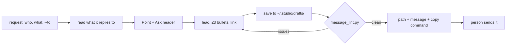

# /message-draft — Architecture Spec

## In Plain Language

Studio already holds its agents to "Write for Humans" when they write docs, code and updates.
The messages a person sends to other people, written with an agent's help, had no such rule.
Those messages are where dense technical detail most often lands on a reader who wasn't in the
room: a reply in a team chat, a PR comment, a note to a collaborator.

`/message-draft` drafts that message and stops. It puts the point and the ask first (the
military's "bottom line up front"), keeps only what supports them, and checks the result with a
small linter before you see it. It saves the draft to a file and hands over the path, because
copying a long message out of a terminal breaks its lines.

It works the same for Slack, Discord, GitHub and plain text such as email. The one hard number
is 2,000 characters, the most one Discord message holds on a standard account. Every draft stays
under it, so any draft can be pasted anywhere.

The design is a port of a Slack-only command its author uses daily, made platform-neutral.

## Architecture at a Glance

## How It Works (Technical)

Two files, both shipped by `init` and `update` like every other command:

- `.claude/commands/message-draft.md`: eight steps the assistant follows. Read the thread being
  answered. Write `Point:` and `Ask:` header lines. Shape the message as a lead, at most three
  bullets and a link, in 150 words or fewer. Cut what repeats, hedges or can't be acted on. Write
  in a person's voice, with an optional `humanizer` second pass when that skill is installed.
  Format for the platform. Save and lint. Hand over the path, the message and a copy command that
  leaves the header out.
- `studio/message_lint.py`: a stdlib script, `python3 message_lint.py <file> --to <platform>`. It
  checks the header, the 2,000-character ceiling, line length, word, bullet and label counts, the
  formatting each platform's paste breaks, a short list of filler phrases, and em-dash habits.
  Code blocks are skipped for the formatting checks. It exits 1 when there is something to fix.
  It imports nothing from Studio, so it runs from `.studio/source/` or `studio/` unchanged.

Drafts go to `~/.studio/drafts/YYYY-MM-DD-<platform>-<who>.txt`, outside every repository, with
`-2`, `-3` and so on added when that name already holds a different message. A
repo's ignore rules can't be relied on: at least one consuming repo doesn't ignore
`.studio/output/`, and a draft can quote private conversation.

## Key Decisions

- **One ceiling for every platform.** Per-platform limits differ by orders of magnitude, and the
  point is brevity, not fitting. 2,000 characters is Discord's limit and is still roughly twice
  the 150-word target, so it only ever catches a draft that should have been two messages.
- **Platform changes formatting, never shape.** The header, the lead, the bullet and word limits
  are the same everywhere. Only what survives the paste differs.
- **`plain` is the default.** It's the one format that is safe to paste anywhere.
- **The linter checks shape, not argument.** It says so on every clean run, and the command
  tells the assistant to reread the lead anyway.
- **A short filler list, carried in Studio.** `humanizer` is a third-party skill that may not be
  installed, so the linter can't depend on it. Its list holds only phrases a person would cut on
  a reread.

## Non-Goals / Cut Scope

- Sending, posting or scheduling anything. The person sends.
- Reading threads through platform APIs. The assistant uses whatever tool the session already
  has, or asks for a paste.
- Judging tone or correctness automatically.

## Risks & Open Questions

- **The filler list will be wrong at the edges.** A word like "robust" is sometimes the right
  word. The linter matches whole words only. When it flags a deliberate choice, the assistant can
  keep it and say why.
- **Discord's limit is 4,000 for paid accounts.** The ceiling deliberately uses the lower one.

## Verification

Linter tests show the checks fire. They can't show that the drafts read better, which is the
point of the command, so this carries a criterion agreed before the build.

- **Pass criterion.** This feature works if and only if, across five real messages the user needs
  to send within the window (at least two for Discord), every draft from `/message-draft` lints
  clean, opens with its point, and is sent with at most light edits, and the user judges at
  least four of the five better than the same request answered in a session where the command
  isn't installed.
- **Baseline.** The same five requests, word for word, in a session started in a directory with
  no Studio install, so neither the command nor the linter can load. The user reads each pair
  without being told which is which.
- **Where the evidence goes.** `specs/message-draft-eval-results.md`. This repository is public:
  record the platform, length, lint result and verdict for each message, never its content or
  recipient.
- **Stop condition.** While that file still says `FILL_ME`, nobody may call this feature working and
  this spec stays `status: approved`. Setting it to `shipped` is the claim, made when the file is
  filled in.

## Build Plan

### 1. `message_draft` — a person can draft a message for any platform and paste it without fixing it first

What gets built: `.claude/commands/message-draft.md`, `studio/message_lint.py` with
`studio/tests/test_message_lint.py`, both registered in `install.py`, and the rows in
`README.md`, `CLAUDE_CODE_USAGE.md`, `ARCHITECTURE.md`, `CLAUDE.md` and `CHANGELOG.md`.

**Acceptance criteria:**
- [ ] `message_lint.py` exits 0 on a draft with a `Point:`/`Ask:` header, a short lead, at most three bullets and no platform-breaking formatting, on every platform, and exits 1 when the header is missing.
- [ ] A message over 2,000 characters is flagged on every platform, naming Discord's limit.
- [ ] `--to slack` flags `**bold**`, `#` headings, dash bullets and `[text](url)` links; `--to github` accepts all of them; `--to discord` flags only tables; `--to plain` flags backticks and `**bold**`.
- [ ] Formatting inside a fenced code block is never flagged.
- [ ] `init` installs the command into `.claude/commands/` and the linter into `.studio/source/`.
- [ ] The command saves drafts under `~/.studio/drafts/`, hands over the absolute path and a copy command that leaves the header out, and never sends anything.

**Out of scope:** the five-message evaluation, which is the Verification above.
