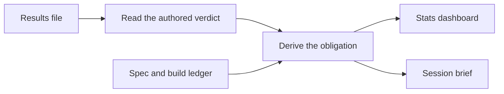

# Let the measured verdict guide the obligation queue

## In Plain Language

The game-design-board experiment recorded “Criterion not met as written.” Studio still tells the maintainer to mark the feature shipped, both in the dashboard and at the start of a session. The queue checks that someone filled in the results file and overlooks what they concluded.

When a completed feature promised verification, the queue should read the author's verdict. A pass clears the way to ship. A failed measurement calls for revising the spec or rerunning the evaluation. Inconclusive or unclear results need follow-up before the queue can recommend shipping.

## Architecture at a Glance

The dashboard lists the queue in priority order. The brief presents the first item. Both use the action derived from the same evidence.

## How It Works (Technical)

At the existing evidence-file read in `studio/run_phase.py`, collect the state of the sibling `<slug>-eval-results.md` and pass it into `studio/obligations.py`. The queue already knows whether verification was promised, whether the unit history is known and whether the work was built. Apply the verdict when those checks would otherwise yield a shipping recommendation.

Read the author's plain or bold declaration under `## Verdict`, up to the next heading of the same or higher level. Match the verdict words case-insensitively. The published template lists every possible verdict on a single instruction line. Ignore that line, examples and mentions elsewhere. Real declarations include **Criterion not met as written.** and **Criterion met**, followed by an explanation. A filled record with conflicting or unrecognizable declarations calls for clarification. Missing, unreadable, whitespace-only and placeholder evidence use the missing-evidence path.

Use one follow-up group in the dashboard. Keep confirmed shipping actions first, followed by evidence follow-up, overdue evidence, then unbuilt units. Put the specific action and evidence path in the obligation so the session brief can use them directly. An evidence correction or rerun should not be described to the reader as requiring an edit to the spec.

## Key Decisions

The existing results file is the source for the verdict. A second frontmatter flag could disagree with the measurement. The queue reports the author's conclusion and leaves the interpretation of the experiment to its author.

## Non-Goals / Cut Scope

Changes to the spec-shipping validator, measurement procedures, public commands and historical evidence files are outside this unit.

## Risks & Open Questions

Older hand-written results may lack a recognizable declaration. In that case the maintainer gets the path and a request to clarify it. Loose phrase matching would accept the template's list of options as a passing result.

## Build Plan

### 1. `evidence_verdict_obligation` — The queue gives the action supported by the recorded measurement

Drive both CLI entry points against a temporary repository with an approved spec and a real writer commit. Change only its evidence between cases. Keep the failed game-design-board verdict and the passing shipped-finish-check verdict as concrete regression examples.

**Acceptance criteria:**

- [ ] With the game-design-board verdict on an otherwise complete spec, `stats` and `check-updates --target` identify the failed result and its file, offer revision or a rerun, and give no instruction to mark that spec shipped. The brief presents the same action when the spec is its top obligation.
- [ ] With the shipped-finish-check verdict, both callers recommend the existing status flip even before the deadline and even though the results file lists every template choice. A completed spec without a verification promise still receives its shipping recommendation.
- [ ] A declared inconclusive result asks the maintainer to resolve the uncertainty. A filled file with only template choices, an unclear or contradictory declaration, or a pass only under another heading asks for clarification. Both callers point to the evidence file. A past deadline adds no blank-evidence reminder for any of these filled records.
- [ ] Missing, unreadable, whitespace-only or placeholder evidence produces only the existing evidence reminder when due and gives no reminder before the deadline. Use the unchanged message-draft results skeleton as a placeholder control.
- [ ] In a queue containing all four kinds, the dashboard reports each item once in the specified order and the brief names the first item. Unfinished, escalated, entirely dropped or empty plans, non-approved specs and unavailable Git history produce no completed-spec follow-up.
