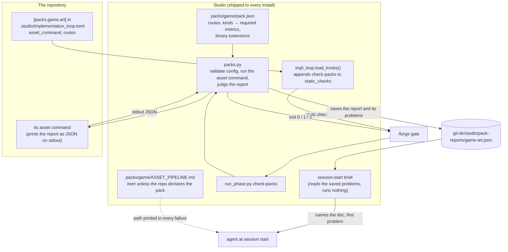

# Packs — Architecture Spec

## In Plain Language

Studio is a general engineering harness: specs, the `/forge` build loop, debates, and the enforcement
layer that turns rules into checks. It is installed in repositories that build games, websites,
trading tools and personal assistants. Some rules only make sense for one kind of project. A game
has art, and art has rules: a model must stay under its triangle budget, its parts must sit flush, a
walk cycle's last frame must match its first, a planted foot must not slide. None of that belongs in a
trading bot's Studio.

A **pack** is a bundle of those domain rules that a repository opts into. Studio ships the pack; a
repository says "I use the game pack" in its own config and fills in the parts only it knows: which
ways of making assets it allows, and the command that measures its assets. Repositories that don't
declare a pack get nothing new, the same way the design-board doc stays inert in a repo with no board.

The split is three layers. **Studio** is the mechanism: it reads the declaration, runs the check and
judges the numbers. **The pack** says what each department must deliver: for the game pack's art
department, which kinds of asset exist and which numbers each kind must report. **The repository**
owns its tech stack: how to measure a mesh in its engine, and what the limits are. Measuring is
specific to the stack. Comparing a number to a limit is not, so Studio does that part once, for every
game.

## Architecture at a Glance



A repository declares the pack with a table in the gate config it already has. When `/forge` loads
its settings, Studio sees the table and adds one command, `check-packs`, to the static checks. That
command runs the repository's own asset command, reads the JSON the command prints, and judges it
against the pack's contract. A non-zero exit fails the unit, the same as a failing linter. Every run
saves the report and every problem the check found inside the git directory, so the next session's
brief can say what the last check found without running anything.

## How It Works (Technical)

### Components

| File | Responsibility |
|---|---|
| `studio/packs/game/pack.json` | The pack's contract, data only. |
| `studio/packs/game/ASSET_PIPELINE.md` | The art department's doc. |
| `studio/packs.py` | Pure validators, one runner with side effects, the session note. Imports nothing from Studio beyond `config_loading` and `impl_loop`. |
| `studio/run_phase.py` | The `check-packs` subcommand, and one more block in the session-start brief. |
| `studio/impl_loop.py` | `load_knobs()`, which appends the pack check to `static_checks`. |
| `studio/install.py` | Ships `packs.py` (in `SOURCE_FILES`) and the pack files (`PACK_JSON_GLOB = "packs/*/pack.json"`, `PACK_DOC_GLOB = "packs/*/*.md"` beside `ROLE_PACK_GLOB`). |

Packs live in their own folder inside Studio. They move to a repository of their own only when a
second pack exists and has shown the interface is generic.

### The pack contract (`pack.json`)

```json
{"name": "game", "doc": "ASSET_PIPELINE.md",
 "departments": {"art": {
   "routes": ["code-built", "generated", "hand-authored"],
   "kinds": {"mesh": ["triangles", "part_gap", "extent"],
             "animation": ["foot_slide", "loop_seam", "below_floor", "stretch"]},
   "binary_assets": {"allowed_by_route": "hand-authored",
     "extensions": [".png", ".jpg", ".jpeg", ".gif", ".webp", ".psd", ".tga", ".bmp", ".exr",
                    ".hdr", ".dds", ".ktx2", ".fbx", ".obj", ".glb", ".gltf", ".blend", ".dae",
                    ".ttf", ".otf", ".woff", ".woff2", ".wav", ".mp3", ".ogg", ".flac", ".aif",
                    ".aiff", ".m4a"]}}}}
```

- **Routes** are the ways an asset gets made. *Code-built* suits anything you could measure with a
  ruler: props, buildings, generators. *Generated* means a model or texture generator, for organic
  shapes. *Hand-authored* means files made in an editor.
- **Kinds** map each asset kind to the metrics its report must carry. v1 ships only the two kinds
  with gathered rules behind them:
  - `mesh`: `triangles` (the budget), `part_gap` (the largest gap between parts that should sit
    flush), `extent` (the largest side of the bounding box, against the measurements written before
    building).
  - `animation`: `foot_slide` (how far a planted foot moves), `loop_seam` (the difference between a
    loop's first and last frame), `below_floor` (how far anything dips under the floor), `stretch`
    (the longest edge in a test pose relative to the rest pose).
- **`allowed_by_route`** names the route that permits tracked binary files. It keeps the word
  "hand-authored" out of `packs.py`.

### The repository's declaration

```toml
# .studio/implementation_loop.toml
[packs.game.art]
asset_command = "node tools/measure-assets.mjs"
routes = ["code-built"]
```

- The sub-table is the declaration: `[packs.game]` means "this repository uses the game pack". There
  is no separate `use` list to fall out of step with it.
- Every pack name must match a shipped `packs/<name>/pack.json`. Every department of a used pack
  needs a non-empty `asset_command` and a non-empty `routes` list that is a subset of the pack's
  routes. Any other key is refused.
- `load_loop_config` already ignores tables it doesn't know, so `[packs]` never becomes a
  `LoopConfig` field. That keeps `test_doc_parity.py` unchanged.

### The report contract

The asset command prints the report as JSON on stdout. Everything else it prints goes to stderr.

```json
{"assets": [{"id": "hero_walk", "kind": "animation", "route": "code-built",
  "metrics": {"foot_slide": {"value": 0.8, "max": 1.0}, "loop_seam": {"value": 0, "max": 0},
              "below_floor": {"value": 0.0, "max": 0.01}, "stretch": {"value": 1.02, "min": 0.98, "max": 1.05}}}]}
```

- `value` is required: a finite int or float, and a bool does not count.
- Each metric needs a `max`, a `min`, or both. The limits live in the repository's own code, so
  nothing is declared twice.
- Metrics beyond the required ones are checked the same way. Unknown keys are ignored.
- The asset command must leave the working tree unchanged, apart from ignored paths.

### `check-packs [--config PATH]`

Runs from the git toplevel of the current directory.

1. Load and validate `[packs]`. If none is declared, exit 0.
2. For each declared department: take a tree snapshot, run `asset_command` through the shell from
   the repository root with no timeout (the same as the gate's test command), capture stdout, and
   take a tree snapshot again.
3. Judge it, and print each problem prefixed `<pack>.<dept>:`, then `See <doc path>`.
4. Save `{"problems": [...], "stdout": "<captured stdout>"}` to
   `<git-dir>/studio/pack-reports/<pack>-<dept>.json`. `problems` is every message step 3 printed for
   this department, the runner's own (exit code, changed tree, tracked binaries) as well as the
   report's, so the session brief can repeat them without re-judging. The git directory is
   per-worktree and never shows up as an untracked file, which `code_comments.finalize` would
   otherwise refuse.

**The tree snapshot** must see content, not just status. The writer's change is uncommitted when the
check runs, so a file can already read ` M` or `??` before the command runs and read the same after
it rewrites the file; comparing two `git status --porcelain` listings would pass that. The snapshot
is therefore the entries of `git status --porcelain=v1 -z --untracked-files=all`, each with a
fingerprint of every path it names: the mode git would record (`100644`, `100755`, or `120000` for a
symlink) and a hash of the file's bytes, or "missing". The mode is there because `chmod +x` on an
already-modified file changes neither its status nor its bytes. `--untracked-files=all` lists each
untracked file instead of collapsing a new directory to one line. The tree changed if an entry
appears, disappears or changes status, or if a path's fingerprint differs; the message names the
first such path. A clean tracked file the command edits shows up as a new entry, so only dirty paths
are ever hashed.
A dirty submodule is listed as one directory, so its fingerprint is its `HEAD` plus its own snapshot,
taken the same way. Otherwise a file rewritten or committed inside an already-dirty submodule would
leave its line in the parent's status unchanged and pass.
Ignored paths are never listed, so writing under them passes.

Exit **0** when clean (`game.art: 12 assets within budget`, or `game.art: 0 assets`), **1** on any
problem, **2** when it could not check at all: a bad `[packs]` table, or not a git tree.

| Case | Message |
|---|---|
| command exits non-zero | `asset command exited 3: <cmd>` (output not read) |
| stdout is not JSON, or empty | `the report is not valid JSON: <error>; output began: <first 80 characters>` |
| the command changed the tree | `the asset command changed <path>; it must leave the working tree unchanged` |
| no `assets` list | `the report needs an "assets" list` |
| missing or repeated id | `asset #3 has no id` / `asset id "x" appears twice` |
| unknown kind | `x: kind "texture" is not one the game pack knows (animation, mesh)` |
| route not allowed | `x: route "hand-authored" is not in this repository's routes (code-built)` |
| missing metric | `x: kind animation needs metric loop_seam, which the report does not have` |
| bad value or limit | `x: metric foot_slide has no numeric value` / `has no max or min` / `min 3 is above max 1` |
| out of bounds | `x: metric foot_slide is 1.4, above its max 1.0` / `below its min` |
| tracked binary | `assets/hero.png is a binary asset git would commit, but no allowed route permits one (hand-authored)`, first 10 files, then `and N more` |

**The code-only rule** runs only when the pack's `allowed_by_route` is missing from the repository's
routes. Its paths come from `git ls-files --cached --others --exclude-standard -z`. `--others` is
needed because the portable host runs checks before committing the writer's change, so a new `.png`
is not tracked yet. Paths that no longer exist on disk are dropped, so the unit that deletes a binary
can pass. Extensions are compared lower-cased, so `.PNG` is caught.

### At the `/forge` gate

`impl_loop.load_knobs(path=None) -> dict` calls `runtime_knobs(load_loop_config(path))`, resolves the
config file, and, when `[packs]` declares a pack, appends one command to `static_checks`:
`"<python>" "<studio>/run_phase.py" check-packs --config "<config>"`. Paths are double-quoted the way
the hook command is, and an unquotable path is refused by the existing `explain_unquotable_path`.
Both existing call sites (`impl_loop.py` and `forge.py`) switch to `load_knobs`. The file's own
`static_checks` stays exactly as the repository wrote it, so editing the file cannot turn the pack
check off.

An invalid `[packs]` table raises `LoopConfigError`, so every `impl_loop.py` call exits 1 naming the
config file and the shipped packs, before any agent starts.

**Who decides the verdict.** State this limit word for word in `ASSET_PIPELINE.md`:

> Studio code runs `check-packs` only on the portable host, and only on the writer's change. On the
> native workflow the verdict is the writer's own report, and a missing report passes. On both
> paths, changes the editor makes are not re-checked.

On the portable host (`run_phase.py forge`), the host runs every static check without a `{paths}`
token itself and leaves the writer's change uncommitted when one fails. The writer prompt also names
every static check, so the writer runs `check-packs` too and sees the doc path in its failures. On
that host the asset command therefore runs twice per writer pass; accept it.

Enforcement-layer unit 6 (`forge_post_loop_check`) runs on the final tree after the editor. Adding a
`packs-failed` problem to its `--check` closes both gaps above. That is filed as an issue when this
spec is approved, not built here.

### At session start

`packs.session_note(target) -> str` runs as its own `try` block in `_do_check_updates`, after the
unfinished-work block. It reads `[packs]` and the saved results, finds the git directory with
`git rev-parse --absolute-git-dir` (5-second timeout), and runs nothing else.

- No `[packs]`: it says nothing.
- A pack declared: `This repository uses Studio's game pack. Read <doc path> before building or
  changing an asset.` This is the only pointer that reaches an agent before it builds, and the
  measurements-first rule only works if it is read first.
- A saved result whose `problems` is not empty, or a malformed `[packs]` table, adds
  `N pack problem(s); first: <msg>.` The count is the saved `problems` list, so a command that
  exited non-zero, changed the tree or left a tracked binary is reported too, not only a bad report.
- Any exception is swallowed. The session always continues, and the update notice and the
  unfinished-work sentence are never lost.

### `ASSET_PIPELINE.md`

It opens with an inert line, the way `docs/DESIGN_BOARD.md` does: it applies only when the
repository's `.studio/implementation_loop.toml` has a `[packs.game]` table. It covers the three
routes and which one may track binary files; measurements and budget written before an asset is
built (code cannot check the order, so this stays prose); the report contract, exactly as above; the
three-clause limit; the "leave the tree unchanged" rule; and the look pass. In the look pass a person
is the final judge. Agents capture images with `[gate] observe_command` and show them. There is no
sign-off field, because an agent could write one itself. The doc ends with a `[packs]` example ready
to paste.

### The enforced-rules row

```python
EnforcedRule(
    rule="An asset report that breaks its pack's contract fails `check-packs`.",
    stated_in="studio/packs/game/ASSET_PIPELINE.md",
    enforcer="studio/packs.py::report_problems",
    proof="studio/tests/test_packs.py::test_metric_above_its_max_fails",
)
```

The rule says `check-packs`, not `/forge`, because of the limit above. `NOT_YET_ENFORCED_COUNT` is
unchanged.

### Dependencies

`config_loading.tomllib`; the portable host's static-check loop (`forge_host.mjs`); the writer
prompt's list of static checks; `project_config_root`; `_do_check_updates`; git. Nothing here waits
on an unbuilt enforcement-layer unit.

## Key Decisions

- **A pack is a new concept, separate from role packs, and a repository can use more than one.** Role
  packs stay exactly as they are: one per repository, a list of debate personas. Extending them would
  have changed every role pack file and allowed only one pack per repository. *(Pre-flight, the user's
  call.)*
- **The repository measures and Studio judges.** The asset command prints numbers with their limits;
  Studio checks the route, the required metrics and the bounds. The alternative, Studio checking only
  the wiring, would have had every game re-implement the same comparisons. *(Pre-flight, the user's
  call.)*
- **A failing check fails the `/forge` unit, and never blocks a commit or a push.** The gate is where
  Studio already blocks. Blocking at git would have run the asset command on every commit and tied
  this to the unbuilt guard. *(Pre-flight, the user's call.)*
- **The declaration lives in `.studio/implementation_loop.toml`**, the file `/forge` already loads.
  `observe_command` was added there the same way. A separate `packs.toml` lost once debate roles were
  cut, since its only other reader is the session brief.
- **Declaring a pack turns the check on.** The check is appended to the loaded settings, not written
  into the file, so deleting a line cannot quietly drop it.
- **The report arrives on stdout.** A file path handed over in an environment variable needed a
  variable in the repository's contract, a delete-before-run step and a "wrote no report" failure, all
  to keep a file fresh. Stdout is fresh by construction. A startup banner from a headless engine fails
  loudly, and the message quotes it.
- **Two asset kinds, not four.** Texture and audio were cut: no gathered rule asks for any of their
  numbers, and a required metric nobody asked for makes every repository measure it or fail. Adding a
  kind is one line in `pack.json` once a real rule exists. The binary-extension list still covers
  images, fonts and audio files for the code-only rule.
- **The code-only rule stays in v1, with the repository's own routes list.** It is the one check Studio
  can make with no stack knowledge at all. The depth contrarian's first pass cut it; it was reinstated
  because it was part of the request.
- **The session brief keeps a standing doc line, and drops the "no report yet" line.** The brief's own
  rule is that a nudge with no news gets skipped. The doc line is standing context an agent needs
  before it builds, in a repository that opted in.
- **Shipped as data.** No pack-specific Python. A rule that needs logic waits until a second pack shows
  one.

## Non-Goals / Cut Scope

- Pack debate roles (`roles_add`). `art` is already in the core role pack, and `+role` tokens only come
  from the command line.
- Stale-report detection at session start. It needed per-repository source globs nobody declared.
- A `schema` version field, and an `op`/`eq` limit form.
- Departments other than art, and kinds other than mesh and animation.
- A setup-wizard step for `[packs]`. The doc gives the TOML.
- Running the asset command at session start.
- Blocking commits or pushes.
- A look-pass sign-off field.
- Re-checking the editor's changes, or the native workflow's verdict. That is the unit-6 amendment.
- Moving `docs/DESIGN_BOARD.md` or `docs/DESIGN_LEDGER.md` into the pack. Every installed
  `CLAUDE.md` points at the board doc's current path.

## Risks & Open Questions

- **The enforcement limit is real.** Until the unit-6 amendment lands, the native workflow trusts the
  writer and nobody re-checks the editor. The limit is stated rather than hidden, and the enforced-rules
  row claims only `check-packs`.
- **A repository can report weak limits.** The limits are the repository's by decision. Only review
  catches a budget set to infinity.
- **The asset command runs twice on the portable host**, once by the writer and once by the host. With a
  slow headless engine that doubles the slowest step.
- **The metric names are a first guess** at the gathered rules: `part_gap`, `extent`, `stretch`. They
  are cheap to change before the first repository adopts the pack and costly after.
- **The doc line appears every session** in a repository that declares the pack. If people start
  skipping it, the fix is to drop it in favour of the doc path in failures alone.
- **A `/forge` writer gets no session-start context.** It meets the doc through the failure message,
  which the writer prompt's static checks reach on both hosts.

## Build Plan

### 1. `pack_contract_validates_reports` — a repository that declares the game pack can run `check-packs` and get a pass or a failure it can act on

What gets built: `studio/packs/game/pack.json`, `studio/packs/game/ASSET_PIPELINE.md`,
`studio/packs.py`, the `check-packs` subcommand, the install globs, the `ENFORCED` row, and
`studio/tests/test_packs.py`.

**Acceptance criteria:**
- [ ] `pack.json` declares `mesh` and `animation` only, and the suite checks, for every shipped pack, that its doc exists, every kind has at least one metric, and `allowed_by_route` is one of its routes.
- [ ] `report_problems` returns exactly the message in the failure table for each row, and `[]` for a clean report and for `{"assets": []}`.
- [ ] `check-packs` reads the report from the asset command's stdout, saves it with every problem it printed under `<git-dir>/studio/pack-reports/`, exits 0, 1 or 2 as specified, fails output that isn't JSON with its first 80 characters quoted, and fails a command that changes the working tree, naming the path.
- [ ] With the writer's change already in the tree, a command that appends to an already-modified tracked file fails naming that file, a command that rewrites an existing untracked, unignored file fails naming that file, a command that only sets the executable bit on an already-modified tracked file fails naming that file, and a command that writes only under an ignored path passes.
- [ ] A command that prints a clean report but exits non-zero saves a result whose `problems` holds the exit-code message.
- [ ] With the hand-authored route not allowed, an untracked, unignored `.PNG` fails, an ignored one passes, and a tracked `.png` deleted in the worktree passes.
- [ ] `install` ships `packs.py` and both pack files into a temporary target, and the new `ENFORCED` row passes `test_enforced_rules.py`.

**Out of scope:** the `/forge` gate, the session brief, any kind beyond mesh and animation.

### 2. `forge_gate_runs_pack_check` — declaring a pack makes every `/forge` unit run `check-packs`, with no line in `static_checks`

What gets built: `impl_loop.load_knobs()`, both call sites switched to it, `[packs]` validation raising
`LoopConfigError`, a portable-host test, and the limit and tree-unchanged lines in `ASSET_PIPELINE.md`.

**Acceptance criteria:**
- [ ] The knobs JSON from `impl_loop.py`, and the unit `forge.py` builds, carry the file's `static_checks` unchanged with no `[packs]`, and that list plus exactly one double-quoted `check-packs --config` command when a pack is declared.
- [ ] `LoopConfig` gains no field, and `test_doc_parity.py` passes unchanged.
- [ ] An unknown pack, a route outside the pack's routes, or a missing `asset_command` makes `impl_loop.py` exit 1, with or without `--branch`, naming the config file and the shipped packs.
- [ ] A portable-host test whose pack command exits 1 sets `static_ok` to false and leaves the writer's change uncommitted.
- [ ] `ASSET_PIPELINE.md` carries the three-clause limit from this spec word for word, and says the asset command must leave the working tree unchanged.

**Out of scope:** re-checking the editor's changes; the native workflow's verdict; the unit-6 amendment.

### 3. `session_brief_reports_packs` — a session in a pack repository starts knowing where the doc is and what the last report found

What gets built: `packs.session_note()` and its block in `_do_check_updates`, with tests in the style
of the existing update-check tests.

**Acceptance criteria:**
- [ ] With no `[packs]`, `check-updates` prints nothing new.
- [ ] With a pack declared, the brief names the doc by a path that opens from the project root, and adds nothing else when the saved result has no problems or is missing.
- [ ] A saved result with problems, including one from a command that exited non-zero, or a malformed `[packs]` table, adds the problem count and the first problem.
- [ ] A malformed `[packs]` table or saved result never removes the update notice or the unfinished-work sentence, and `check-updates` exits 0.
- [ ] `session_note` runs no command other than `git rev-parse`.

**Out of scope:** running the asset command; stale detection; a "no report yet" sentence.
