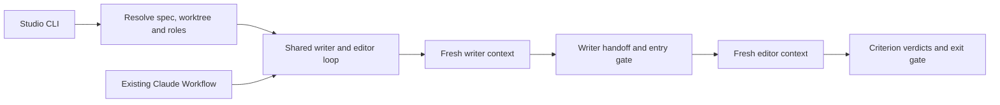

# Forge with independently selectable writer and editor runtimes

## In Plain Language

A developer with Codex should be able to build a Studio unit and have a fresh editor grade it, even on a machine without Claude. A developer using Claude should be able to do the same. Either can ask one runtime to write and the other to review.

Each role can use its runtime's default model or an explicit model pin. Studio shows what the developer requested, what actually ran, and which checks passed. An ordinary build can finish even when the runtime omits model metadata. Someone who requests a pin can tell whether Studio verified it.

## Architecture at a Glance

The portable command supplies a runtime for each role. The loop owns the sequence and gates. An adapter starts a fresh role, gathers its structured result, and reports execution details. A failed writer gate stops dispatch to the editor.

## How It Works (Technical)

**Entry and selection.** Expose `forge` through Studio's existing `run_phase.py` CLI in both source and installed projects. For example, `python studio/run_phase.py forge --runtime codex --spec demo --unit build_demo` runs two fresh Codex roles. Adding `--editor-runtime claude --editor-model opus` changes just the reviewer. Support the symmetric writer overrides. On the portable entry point each role defaults to the base runtime and that runtime's own default model. Keep the current Claude slash command's defaults for existing calls and route explicit portable selections to the shared command. `--plan` displays the branch, verbatim criteria, runtimes and pins without editing the tree or contacting either provider. Check only the executables needed for enabled roles.

Preserve the existing spec preflight. An explicitly requested but missing spec, ambiguous unit or empty criteria list stops before a role starts. A draft spec requires explicit acknowledgement. A deliberate title-only build can proceed with its grade against the title.

**One loop.** Keep the prompts, handoff schemas, stage sequence and gate predicates in canonical JavaScript. The CLI invokes a Node host. Generate the self-contained Claude Workflow from the same source where its runtime requires an import-free script. Check regeneration and historical prompt, schema and gate-source fingerprints in CI. Reuse Studio's existing config and worktree checks. Preserve legacy branch behavior, optional checks, escalation, flagged delivery, concern records and criterion-by-criterion evidence. Ship the CLI, its host and their dependencies through Studio's installer and updater.

**Worktree and recovery.** Acquire one exclusive run per worktree and record the branch and full base SHA. Each portable role edits in its own context in that worktree. The portable host owns Git commits and recovery, including in linked worktrees. Its role prompts and permissions must support that division. Verify branch, HEAD and handoff identity before each checkpoint. Run the configured test command in the worktree at the writer and editor gates. An editor failure can restore a verified writer checkpoint only when the host can attribute the affected changes to its run. Preserve ambiguous edits and report an incomplete run with the last verified SHA. Never clear unrelated untracked files. Reuse an equivalent shipped test gate if the enforcement-layer work lands first.

**Model provenance.** Launch fresh threads or processes and pass the editor the writer's handoff, diff and the unit's criteria. Codex's app-server protocol is a candidate transport: the installed version's schema exposes the selected model and provider on thread start, rerouting events, and a structured-output schema on turn start. Claude's structured stream exposes model information on assistant turns. Validate both transports with real runs. Record requested runtime and pin, actual runtime, observed model IDs or unknown, rerouting and completion for each role and attempt. Only accept observations correlated with the role's own execution. An unavailable runtime, denied permission or unusable handoff identifies the failed role. An explicit pin that cannot be confirmed, including an unexplained substitution, leaves the run incomplete. Preserve prior attempts and store only the execution fields needed for this record.

Treat a thread-start selection as the requested routing until the adapter has evidence from the completed role or a validated selection-and-reroute contract for that transport. An initial model name alone cannot prove which model served a turn. An alias needs a provider-confirmed relationship to the observed identifier. A helper agent's model is evidence only for that helper.

## Key Decisions

The first unit delivers the requested Codex-only build and preserves existing Claude callers. The second adds a portable Claude adapter and makes the cross-provider combinations usable. A fake adapter can prove dispatch and failure handling. A live CLI build is needed to prove each provider can actually edit, pass its handoff, and finish in a real worktree.

The existing Claude editor benchmark keeps its historical profile and fingerprint. The portable build records model identity independently. Score comparisons across profiles can be designed when someone has a measurement question.

## Non-Goals / Cut Scope

Provider account setup, a model catalog, new benchmark scores, historical run migration, and a general-purpose plugin framework are outside this change.

## Risks & Open Questions

CLI versions differ in their model and permission metadata. A model alias may lack authoritative resolution. A linked worktree may keep Git metadata outside the role's writable directory. Exercise both provider routes before claiming support and make any unsupported version or permission failure visible at the affected stage.

## Build Plan

### 1. `codex_forges_a_graded_unit` — Build and grade one Studio unit on a Codex-only machine

**Acceptance criteria:**

- [ ] A real invocation in a disposable repository with Claude unavailable produces a tested writer checkpoint, a separate Codex editor session and evidence-backed grades for the approved criteria. A missing or failed grade flags the result.
- [ ] In both source and installed layouts, `--plan` resolves the spec and reports both role selections without provider calls or filesystem changes. The Codex-only run supports separate model pins, records requested and observed identities independently, and accepts missing identity for an unpinned role.
- [ ] The shared loop and the generated Claude Workflow produce the same gate decisions on recorded success, rejection, escalation, disabled-editor and failed-edit cases. Golden pre-change editor prompts, schemas, default benchmark model and gate fingerprints still match.
- [ ] A failing configured test prevents a clean delivery even if a role reports success. Missing Codex, a malformed handoff, and an unverifiable explicit pin each report the affected stage. A thread created without a completed model turn cannot verify a pin. Writer failure, including a failed writer pin, never starts the editor.
- [ ] In a linked worktree the portable host can commit passing changes and recover from an editor failure to a verified writer checkpoint. Concurrent runs, branch movement, an unexpected commit or ambiguous edits cause a visible refusal or incomplete run, preserving unrelated files.

### 2. `forge_selects_each_runtime` — Choose Claude or Codex independently for each stage of the same build

**Acceptance criteria:**

- [ ] With Codex unavailable, a real Claude-only portable run produces a tested commit and a separate editor's criterion verdicts. An existing Claude slash invocation retains its writer selection and default editor behavior.
- [ ] In both mixed directions, each role is dispatched through the chosen adapter with its own pin and fresh context. Its handoff reaches the same gates. Exercise all four ordered combinations with controlled adapters and at least one mixed pairing on real runtimes.
- [ ] A missing or unauthorized selected runtime, conflicting model identity, or reroute incompatible with an explicit pin identifies the affected role and preserves the last verified checkpoint. Changing one role's selection leaves the other role's selection intact.
- [ ] The current attempt records both roles' requested and observed execution details, including unknowns and skipped stages. Retries cannot inherit a previous attempt's model evidence. Credential and transcript sentinels from test streams never appear in that record.
