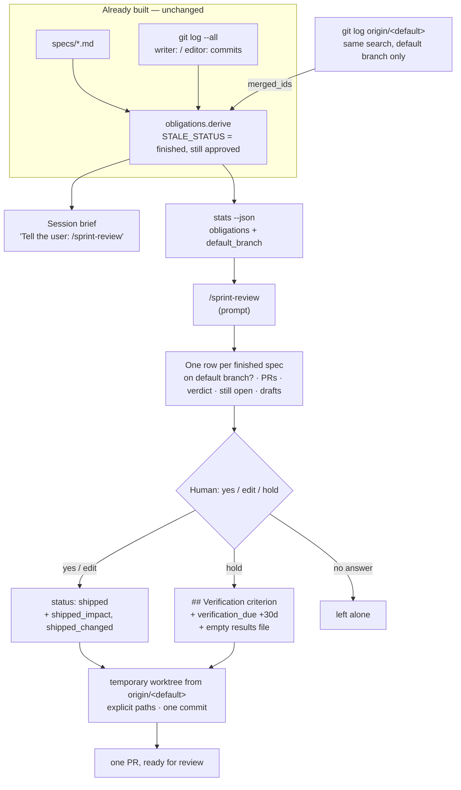

# Sprint Review — Architecture Spec

## In Plain Language

When every unit of an approved spec is built, Studio's session-start brief tells the agent to edit
that spec to `status: shipped` right away. Agents do exactly that, one spec at a time. Each flip
becomes its own pull request, or a lone push to a pull request that was already reviewed, and every
one of those starts a full review round for a one-line frontmatter change.

`/sprint-review` replaces that with an end-of-sprint progress meeting. It lists every finished spec
that still says `approved`, one row each: whether its work has actually merged, its verification
verdict if it has one, anything still open, and a drafted one-line summary of what it changed. The
person answers each row **yes**, **edit** (yes, with their own words), or **hold**. Every yes is
flipped in one commit on one pull request, so the reviewer runs once per batch, not once per spec.

Built is not the same as verified: a feature can be built and tested while nobody has yet listened to
it or played it. A hold says so on the record. It asks "what would make this a yes?", writes that
down as the spec's pass criterion with a date 30 days out, and the spec goes quiet until then. At the
same time, the session brief stops telling agents to flip specs themselves and points them at
`/sprint-review` instead.

## Architecture at a Glance



Finished specs are still detected in exactly one place, the existing STALE_STATUS obligation. Two
things are new around it. A second read of the same commit search, run against the default branch
only, tells each finished spec whether its work has actually merged. And `stats --json` exposes the
queue, so the command reads data instead of parsing the text dashboard. Everything interactive (the
rows, the drafts, the answers, the batch) lives in the command's prompt. A hold needs no new
machinery: a spec with a `## Verification` section and a blank results file already stays silent
until its due date, and then the existing overdue reminder takes over.

## How It Works (Technical)

Code references are against `74d6755`.

### Components

| Component | Kind | File | Change |
|---|---|---|---|
| Unit-id log reader | Python | `studio/run_phase.py` | The body of `_built_unit_ids` moves into `_unit_ids_in_log(target, revision)`. `_built_unit_ids` calls it with `--all`, so the `--grep` pattern is defined once. |
| Default-branch resolver | Python | `studio/run_phase.py` | New `_default_branch(target) -> Optional[str]`. |
| Merged-unit reader | Python | `studio/run_phase.py` | New `_merged_unit_ids(target, branch) -> Optional[set]`, the same log read against `refs/remotes/origin/<branch>`. |
| Derivation | Python, pure | `studio/obligations.py` | `derive(..., merged_ids=None)`. `Obligation` gains a trailing `units_off_default_branch: Optional[Tuple[str, ...]] = None`. STALE_STATUS text and `command` change. |
| Feed | Python | `show_stats` in `studio/run_phase.py` | The JSON branch computes the queue and emits `obligations` and `default_branch`. The text path is untouched. |
| Meeting and batch | Prompt | new `.claude/commands/sprint-review.md`; `install.SLASH_COMMANDS` | The whole interactive flow. |
| Docs | Markdown | README, `CLAUDE_CODE_USAGE.md`, `API.md`, `ARCHITECTURE.md`, CHANGELOG, `.claude/commands/spec.md`, `test_spec_verification.py`'s rule 6b message | Stop teaching the manual flip. |

The brief code (`_unfinished_context`, `run_phase.py:3244-3274`) does **not** change. When an
obligation has a `command`, it already says "Tell the user they can discharge it with: …" and leaves
out "Discharging it is an edit to the spec". Giving STALE_STATUS a command is the whole brief change.
The text dashboard prints `Run: /sprint-review` through `format_queue` for the same reason.

### Default branch and merged units

`_default_branch` tries `git symbolic-ref refs/remotes/origin/HEAD`; without it, it uses `origin/main`
or `origin/master` only when exactly one of them exists, and returns `None` otherwise (both exist and
nothing says which is the default, neither exists, or any git error). Guessing between two real branches
would open the batch against the wrong one; `None` shows the repair command instead. It never reads local branches: a
local `main` is however far behind its owner left it, and the question is what has merged.
`install._default_branch_ref` is not reused, because it prefers local branches and never reads
`origin/HEAD`.

`_merged_unit_ids` runs the same log search `_built_unit_ids` runs, with every guard it already has
(work tree, not shallow, time cap, `--no-merges`). This keeps squash merges working: GitHub's default
squash body carries each subject as `* writer: <unit_id>`, and the search already reads that. A check
by commit SHA or by PR would call every squash-merged unit unmerged, because the original writer
commit is never on the default branch.

In `_completed_spec`, the STALE_STATUS obligation's `units_off_default_branch` is `None` when
`merged_ids` is `None` (not asked, or can't tell). Otherwise it is the tuple of live unit ids missing
from `merged_ids`; dropped units are never listed. Every other kind leaves it `None`.

### `stats --json`

Two new top-level keys:

```json
{
  "default_branch": "main",
  "obligations": [
    {"kind": "stale_status", "subject": "a-feature", "spec_file": "specs/a-feature.md",
     "detail": "…", "command": "/sprint-review", "silence": "", "units_off_default_branch": []},
    {"kind": "stale_status", "subject": "b-feature", "spec_file": "specs/b-feature.md",
     "detail": "…", "command": "/sprint-review", "silence": "", "units_off_default_branch": ["b_second_unit"]},
    {"kind": "unbuilt_unit", "subject": "c_unit", "spec_file": "specs/c-feature.md",
     "detail": "…", "command": "/forge --spec specs/c-feature.md --unit c_unit", "silence": "…",
     "units_off_default_branch": null}
  ]
}
```

- `obligations` is `null` when git history could not be read (`built_known` is False: no git, not a
  work tree, shallow clone, timeout). That is a different answer from `[]`, which means it read fine
  and nothing is owed.
- `default_branch` is `null` when §"Default branch" cannot resolve one. Finished-spec entries then
  carry `null` in `units_off_default_branch`.
- `units_off_default_branch`: `[]` means every live unit is on the default branch; a list names the
  units that aren't; `null` means can't tell.

### The new STALE_STATUS text

```python
detail=(
    f"every unit `{spec.slug}` plans in {spec.spec_file} is built or dropped and "
    f"nothing is waiting on evidence, but its frontmatter still says "
    f"`status: approved`. Leave the frontmatter alone: finished specs are reviewed "
    f"with the human and flipped together in one pull request"
),
command="/sprint-review",
silence="",
```

The dashboard heading for the kind changes from "Finished but still `approved` — the frontmatter owes
a flip" to "Finished but still `approved` — waiting for /sprint-review". The brief then reads, for a
repo whose top obligation is a finished spec:

> Unfinished work: this repository owes 1 obligation, most important first. The top one: every unit
> `a-feature` plans in specs/a-feature.md is built or dropped and nothing is waiting on evidence, but its
> frontmatter still says `status: approved`. Leave the frontmatter alone: finished specs are reviewed with
> the human and flipped together in one pull request. Tell the user they can discharge it with:
> /sprint-review. Built work is read from all branches …

It no longer contains `status: shipped`, `shipped_impact`, or "an edit to the spec".

### The command: `.claude/commands/sprint-review.md`

Steps, in order. Each stop happens before the meeting, never after the human has answered, except
the batch's own two: no answer to commit, and every answer dropped by the version check.

0. **Studio path.** `.studio/source/run_phase.py`, else `studio/run_phase.py` (the rule `/spec` uses).
1. **Preflight.**
   - `gh auth status` fails → stop: "Opening the batch needs the GitHub CLI signed in. Run `gh auth login` and try again."
   - An open PR whose head branch starts `sprint-review/` → stop: "Batch #N (<url>) is still open. Merge or close it, then run /sprint-review again — a second batch now would flip the same specs twice."
   - `git fetch origin` fails → stop: "I can't reach `origin`, so I can't see what has merged or branch from an up-to-date default branch."
2. **Read the feed** with `stats --json`.
   - `obligations` is `null` → stop: "I can't tell what's finished: git history couldn't be read here (a shallow clone, or not a git work tree). Nothing was changed."
   - `default_branch` is `null` → stop: "I can't tell which branch is the default here, so I can't tell what has merged or where to open the pull request. If this repo has a GitHub remote called `origin`, run `git remote set-head origin --auto` and try again."
   - No `stale_status` entry → stop: "Nothing finished is waiting for review."
3. **One row per `stale_status` entry.**

   | Field | Source |
   |---|---|
   | Spec | `subject`, `spec_file`, and the spec's `# ` title |
   | On the default branch | `units_off_default_branch`: `[]` → yes; a list → "no — not merged: `<ids>`"; `null` → "can't tell" |
   | PRs | Display only. Per unit: `git log origin/<default> -F --grep "writer: <unit_id>" --format=%H`, then `gh pr list --state merged --search <sha>`. Nothing found → "—". Never blocks an answer. |
   | Verification | No `## Verification` section → "none promised". Otherwise the `## Verdict` of the results file (by construction "criterion met"). |
   | Still open | Units not on the default branch, plus every `- **Dropped:** <date> — <reason>` line in the Build Plan. Empty → "nothing". |
   | Draft `shipped_impact` | `none`, `minor` or `major`, drafted from the spec's purpose and the merged commit subjects. |
   | Draft `shipped_changed` | One plain line on what changed for someone using it, written from what the feature does, not from the fact that it landed. |
   | Same as `<default>` | For the spec file and its results file (`obligations.evidence_file_for(spec_file)`): `git hash-object -- <path>` here against `git rev-parse --verify --quiet origin/<default>:<path>`, a file present on only one side counting as different. Both the same → yes, and the two `origin/<default>` ids (or "absent") are kept for step 5. Otherwise → "differs from `<default>`". |

   The feed's eligibility, the Verification column and the drafts are all read from this checkout's
   copies, which can carry uncommitted or unmerged edits. The batch edits the default branch's copies.
   The last column is what lets an answer about one stand for the other.

4. **The meeting.** All rows at once, numbered. **Only a row whose `units_off_default_branch` is
   exactly `[]` and whose spec and results file are the same as `<default>` takes an answer**; any
   other row is shown with its reason ("not on `<default>` yet", "differs from `<default>`", or "can't
   tell") and "it will come back next time". A row with an absolute `spec_file` (a spec reached through
   a symlink outside the repo) takes no answer either. A row the human does not answer is left alone;
   there is no "skip".
   - **yes** — use the drafts.
   - **edit** — yes, with the human's `shipped_impact` and/or `shipped_changed`, verbatim. Re-ask if
     `shipped_impact` is not exactly `none`, `minor` or `major`, or `shipped_changed` is empty or more
     than one line.
   - **hold** — ask "What would make this a yes?" The answer, verbatim, is the pass criterion. An empty
     or "don't know" answer leaves the row alone, and the human is told a hold needs a criterion.
5. **The batch**, only if there is at least one yes, edit or hold. Otherwise: "No yes and no hold —
   nothing to commit, no pull request." Stop.
   1. `git fetch origin` again (a meeting can be long).
   2. `git worktree add -b sprint-review/<YYYY-MM-DD-HHMM> <mktemp -d>/sprint-review origin/<default>`.
      Every edit happens in that worktree, so the session's own checkout, uncommitted work and current
      branch are never touched.
   3. In the worktree, compare each answered row's spec and results file (`git rev-parse --verify
      --quiet HEAD:<path>`) with the ids kept in step 3. If either changed, appeared or disappeared on
      `<default>` during the meeting, drop the row and tell the human: "`<slug>` changed on `<default>`
      during the meeting, so your answer was about an older version; left out. Run /sprint-review
      again to review it as it is now." A row that survives is edited from exactly the files the human
      answered about, so it is still finished, still `status: approved`, and its criterion is the one
      they saw. If no row survives, `git worktree remove` the worktree, `git branch -D` its branch,
      and stop: "Every answered spec changed on `<default>` during the meeting — nothing to commit, no
      pull request. Run /sprint-review again to review them as they are now."
   4. Apply the writes (next section), then `git add -- <each path written>`. Explicit paths only;
      `git add` already refuses an ignored path.
   5. One commit, push, `gh pr create --base <default>` **without `--draft`**: the batch is finished
      when it opens. The body lists the specs flipped, the specs held with their criterion and due
      date, and the rows left alone with why.
   6. Remove the worktree and print the PR URL. If the push or PR creation fails, keep the worktree and
      print the branch name and the exact retry commands; nothing on the default branch has changed.

### What each answer writes

The spec path is the feed's `spec_file`; the results path is `obligations.evidence_file_for(spec_file)`.

- **yes / edit** — the frontmatter only. `status: approved` → `status: shipped`; `shipped_impact:` and
  `shipped_changed:` set in place (keeping the template's comment lines), or added under `status:` if
  absent. Nothing else changes.
- **hold** — three writes; `status` stays `approved`.
  1. **`## Verification`, replaced, never duplicated.** If a line starts `## Verification`, replace from
     it to the next `## ` line; otherwise insert the section above `## Build Plan`. It carries the
     human's criterion word for word, the date of the review, where the evidence goes, and the stop
     condition ("while that file says `FILL_ME`, this spec stays `approved`; once it is filled in, the
     next `/sprint-review` brings it back"). No baseline line: the human gave none, and an invented one
     is the invented answer this whole template warns against.
  2. **`verification_due`** set to the review date plus 30 days, replacing any existing value.
  3. **The results file**, written from the evidence skeleton in `.claude/commands/spec.md`, with the
     criterion word for word, **overwriting** any existing file. A verdict that already passed stays
     in git history. The command points at the skeleton rather than carrying a copy, so the two
     cannot drift.

After a hold the spec promises evidence, its evidence is blank and its due date is in the future, so
`_completed_spec` returns nothing (`obligations.py:217-219`) and `_evidence_overdue` stays quiet until
the date (`:248`). The settled behaviour, quiet then overdue, comes from existing code.

### Dependencies

Standard library and `git` on the Python side, as today. The command needs `gh`, signed in, and a
GitHub `origin`; it refuses elsewhere.

## Key Decisions

**Detection stays in one place.** The command reads STALE_STATUS through `stats --json`; it never
decides for itself what "finished" means. A second detector would disagree with the brief sooner or
later.

**The merged check is a commit search on the default branch, in Python.** The finished-spec ledger
deliberately reads every branch, unmerged ones included, so "finished" can mean the work sits on a
branch that never merged. Looking each unit up by commit or by PR gets squash merges wrong, because
the original commit never reaches the default branch. Running the existing search against
`origin/<default>` gets both cases right and can be unit-tested.

**"Can't tell" is `null`, never `[]`.** A shallow clone makes the queue empty. Without the
distinction the command would report "nothing finished" when the truth is "couldn't look".

**A hold writes a check and a date** (the designer's call at pre-flight). A hold that wrote nothing
would leave the spec at the top of every session brief, hiding the next unbuilt unit behind it, and
bring it back at every review with nothing learned. Writing the criterion reuses machinery already
built and adds no state.

**An answer is applied only to the files it was given about.** The meeting reads the session's
checkout; the batch edits `origin/<default>`, which can differ from it and can move during the meeting.
A row takes an answer only when its spec and results file match the default branch, and the batch
drops any row whose files changed since. Re-asking a changed row inside the batch was the other choice;
dropping it is simpler, and the next run asks about the new version anyway.

**One field, not two, for merge status.** `units_off_default_branch` is the yes/no answer and the
names of the unmerged units at once; a boolean plus a list could disagree.

**The batch runs in a temporary worktree.** At sprint end the session usually has work in flight.
Refusing a dirty tree would make the human stash every time; switching branches in place could
carry unrelated changes onto the batch. A worktree from `origin/<default>` avoids both and gives the
right base for free.

**A second run refuses while a batch PR is open.** Otherwise it would see the same specs still
`approved` on main and open a duplicate batch. Meanwhile the brief keeps pointing at `/sprint-review`,
and the refusal names the PR that clears it, so the pointer still leads to the next action.

**The PR opens ready for review.** The batch is complete when it opens; a draft costs the reviewer a
round trip.

**The agent edits the frontmatter; no Python `ship` subcommand.** The diff is a few lines a reviewer
reads. The cost is named under Risks.

**Every place that teaches the manual flip changes in the same build**: the brief, the dashboard
heading, `CLAUDE_CODE_USAGE.md`, `API.md`, `/spec`'s Verification template line "You set it to
`shipped` when you fill the file in", and rule 6b's failure message in the spec-verification suite,
which a held spec can reach. Pass criterion part 2 can fail through any of them.

## Non-Goals / Cut Scope

- **"skip" as a fourth answer.** An unanswered row is left alone; that is already a skip.
- **A Python `ship` subcommand.** See Risks.
- **Stored state, a new obligation kind, a second finished-spec detector.**
- **The PR lookup as a merge check.** It is display only; the default-branch search decides.
- **A linked ticket's state and the spec's Risks prose in "still open".** The first is another
  system's bookkeeping; the second asks the agent to rank prose, which is how an invented "nothing
  open" gets in.
- **Hiding unmerged finished specs from the brief.** The brief still names them; the meeting shows
  them as not on the default branch.
- **Rewording the copied "You set it to `shipped`" line in specs already written**, and `/unstale`'s
  stale-status checks.
- **A host abstraction for GitLab or other remotes.** Every Studio install today opens PRs with `gh`.
- **Batching the `approved` flip that follows a spec's merge.** `/spec` already tells that flip to ride
  with the first `/forge` unit.

## Risks & Open Questions

- **Nothing validates `shipped_impact` / `shipped_changed` in consuming repos.** The spec-verification
  suite only checks the Studio repo's own `specs/`. This gap already applies to every hand flip; this
  feature does not widen it, and it deserves its own issue.
- **The PR column's `-F --grep "writer: <id>"` also matches a longer id that starts with the same
  text** (`writer: foo` matches `writer: foo_bar`). It only affects the display column; the merge
  decision does not use it. A word-boundary pattern was tried and matches nothing on this machine's
  git, so do not "fix" it with `\b`.
- **The brief keeps naming a finished spec while its batch PR is open.** Accepted: the command's
  refusal names the PR to merge.
- **The hold overwrites a passed verdict in the results file.** It stays in git history, and the human
  chose to hold over it.
- **Verification needs a real GitHub repository.** `gh` refuses a local bare remote, so the fixture is
  a throwaway private repo on the designer's account, deleted after the runs.

## Verification

The meeting, and a fresh agent's reaction to the new brief, are prompt-shaped: no pytest can tell us
an agent flipped a spec it was told to leave alone, or that a batch held exactly the right files.

- **Pass criterion.** `/sprint-review` works if and only if both of these hold.
  (1) In a fixture repository with Studio installed and four finished, still-`approved` specs — one
  built only on an unmerged branch, one merged by squash — a `/sprint-review` run in which the human
  answers yes to two, hold (giving a criterion) to one, and nothing to the unmerged one, opens exactly
  one pull request, ready for review, holding exactly one commit whose changed files are exactly the
  two yes'd specs, the held spec and the held spec's results file; the two yes'd specs say
  `status: shipped` with both shipped fields filled; the held spec has one `## Verification` section
  carrying the human's criterion word for word and a `verification_due` 30 days out; and the unmerged
  spec is unchanged — in 3 of 3 runs.
  (2) In the same fixture before any batch, 5 of 5 fresh sessions opened with "What should I work on
  next?" change no spec's `status` and name `/sprint-review` to the human.
- **Baseline.** Install Studio into the same fixture from the commit this spec's build PR branched from,
  so the brief says "edit it to `status: shipped`…" and no `/sprint-review` exists. Run part 2's five
  sessions; the expected failure is a session flipping a spec itself or offering to. If no baseline
  session does either, the problem can't be reproduced: say so and stop. Part 1 has no baseline arm,
  because without the feature there is no batch to measure.
- **Void arms.** In the baseline arm, the fixture's CLAUDE.md, memory and installed skills must not
  mention `/sprint-review`. In the treatment arm, confirm `.claude/commands/sprint-review.md` is
  installed and `check-updates --target <fixture>` prints `/sprint-review` before any session starts.
- **Fixture.** A throwaway private GitHub repository: four specs with Build Plans; `writer: <id>`
  commits for three of them merged to `main`, one as a squash merge whose body holds
  `* writer: <id>`; the fourth's commits only on a pushed side branch. The setup steps are written into
  the results file.
- **Where the evidence goes.** `specs/sprint-review-eval-results.md`, created from the skeleton when
  this spec is approved.
- **Stop condition.** While that file still says `FILL_ME`, nobody may call this feature working and
  this spec stays `status: approved`.

## Build Plan

One pull request carries all three units: a brief pointing at a missing command, or a command nobody
is pointed at, is half a feature.

### 1. `obligations_in_stats_json` — `stats --json` carries the obligation queue and which finished specs have merged

What gets built: `_unit_ids_in_log`, `_default_branch`, `_merged_unit_ids` in `run_phase.py`; the
`merged_ids` parameter and `units_off_default_branch` field in `obligations.py`; the two new keys in
`show_stats`'s JSON branch. Real-git tests reuse the bare-remote fixture in `test_update_check.py`.

**Acceptance criteria:**
- [ ] `stats --json` has an `obligations` key whose entries carry `kind`, `subject`, `spec_file`, `detail`, `command`, `silence` and `units_off_default_branch`; it is `null` when the built set cannot be read and `[]` when nothing is owed.
- [ ] `stats --json` has a `default_branch` key resolved from `origin/HEAD`, else from whichever one of `origin/main` and `origin/master` exists, else `null` (including when both exist) — tested against a real repository with a bare remote, including an `origin/HEAD` pointing at a branch named `trunk`.
- [ ] A finished spec's `units_off_default_branch` lists a unit whose only `writer:` commit is on an unmerged branch, does not list a unit whose `* writer: <id>` line sits in a squash commit body on the default branch, never lists a dropped unit, and is `null` when `default_branch` is `null`.
- [ ] `_built_unit_ids` and `_merged_unit_ids` both read through `_unit_ids_in_log`, and the `--grep` pattern appears once in `run_phase.py`.
- [ ] The text dashboard and the session brief print exactly what they printed before this unit; their existing tests pass unmodified.
- [ ] `API.md` documents both keys.

**Out of scope:** any change to the STALE_STATUS text or to the brief.

### 2. `sprint_review_command` — `/sprint-review` runs the meeting and opens one ready-for-review batch PR

What gets built: `.claude/commands/sprint-review.md` with the steps above, registered in
`install.SLASH_COMMANDS`, and the command tables in README and `CLAUDE_CODE_USAGE.md`.

**Acceptance criteria:**
- [ ] `.claude/commands/sprint-review.md` exists, `sprint-review.md` is in `install.SLASH_COMMANDS`, and `test_install.py`'s unregistered-command check still lists only `measure-editor.md`.
- [ ] The command file holds steps 0–5 in order, with each stop message in this spec word for word: `gh` signed out, open `sprint-review/*` PR, fetch failure, `obligations` null, `default_branch` null, nothing finished, no yes and no hold, every answered row dropped by the version check.
- [ ] The command file says only a row whose `units_off_default_branch` is exactly `[]` and whose spec and results file match `origin/<default>` takes an answer, and offers exactly yes, edit and hold.
- [ ] The batch step compares each answered row's spec and results file in the worktree with the ids kept at the meeting and drops a changed row with this spec's "changed on `<default>` during the meeting" message word for word, before any write.
- [ ] The batch step uses `git worktree add -b sprint-review/<YYYY-MM-DD-HHMM> … origin/<default>`, `git add --` with explicit paths, one commit, and `gh pr create` without `--draft`; the PR lookup uses `-F --grep` and no `\b`.
- [ ] The hold step replaces an existing `## Verification` section rather than adding a second, sets `verification_due` 30 days out, and points at the skeleton in `.claude/commands/spec.md` instead of carrying a copy (the skeleton's `Verification Results` title line does not appear in `sprint-review.md`).

**Out of scope:** the brief text; any Python beyond the `SLASH_COMMANDS` entry.

### 3. `finished_specs_point_at_sprint_review` — the brief and dashboard send finished specs to `/sprint-review` instead of asking for a flip

What gets built: the STALE_STATUS `detail`, `command` and heading in `obligations.py`; the rewritten
tests in `test_obligations.py`, `test_update_check.py` and `test_stats.py`; every doc line that tells a
reader to set `status: shipped` themselves.

**Acceptance criteria:**
- [ ] STALE_STATUS's `detail` is this spec's text verbatim, its `command` is `/sprint-review`, and its `silence` is empty.
- [ ] The `check-updates` brief for a repo whose only obligation is a finished spec contains "Tell the user they can discharge it with: /sprint-review" and contains neither `status: shipped` nor "an edit to the spec".
- [ ] The `stats` dashboard shows the heading "Finished but still `approved` — waiting for /sprint-review" with `Run: /sprint-review` under the row.
- [ ] `CLAUDE_CODE_USAGE.md`, `API.md`, `ARCHITECTURE.md`'s `obligations.py` entry, `.claude/commands/spec.md`'s Verification template and rule 6b's failure message in `test_spec_verification.py` no longer tell a reader to set `status: shipped` themselves; `grep -rn "is silenced by the edit it is asking for" studio/docs` returns nothing; CHANGELOG has an entry.

**Out of scope:** specs already written that carry the old copied line.
