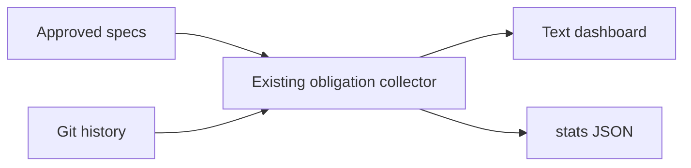

# Read outstanding Studio obligations from stats JSON

## In Plain Language

The Studio dashboard tells a maintainer which specs need attention, what to do about each one, and which to handle first. A script running `stats --json` loses that list. Give it the same work queue and actions a person sees in the terminal.

A script deciding whether it can report “all clear” needs to know whether Studio could read the repository history. An empty list means Studio checked and found nothing owed. A JSON `null` means the history needed to answer was unavailable.

## Architecture at a Glance

Both outputs consume the queue from the same collection step. The collector also supplies the ledger that records whether Git history was readable.

## How It Works (Technical)

In `studio/run_phase.py`, `show_stats` obtains the queue and ledger from `_obligations_and_ledger` before selecting the output format. The text dashboard uses `_mentioned_unit_ids()` for its separate audit of built units missing from specs. Only the text path needs that scan.

Add a top-level `obligations` key to the JSON response. When `ledger.built_known` is true, serialize the existing records from `studio/obligations.py` in their returned order. The six public string fields are `kind`, `subject`, `spec_file`, `detail`, `command` and `silence`. Preserve repository-relative paths and empty action strings. When `built_known` is false, emit JSON `null`.

## Key Decisions

The existing collector owns priority and action text. Sharing it keeps scripts and the terminal in agreement when those rules change. A nullable array lets a script distinguish an unreadable history from a known empty queue with one field. The queue describes the whole repository, so choosing a phase filters run statistics and leaves the queue intact.

## Non-Goals / Cut Scope

The text-only audit, new obligation kinds, filters, and changes to how Studio recognizes completed work are outside this unit.

## Risks & Open Questions

JSON callers will pay the cost of reading approved specs and Git history. The existing collector decides which history it can use, including its treatment of shallow clones. Consumers must handle `null` before iterating over the array.

## Build Plan

### 1. `stats_json_obligations` — A script can read what Studio says this repository owes

Exercise the public CLI with temporary repositories and document the response in `studio/docs/API.md`. Give two specs unbuilt units whose subject order conflicts with their spec-file order, and list two units within one file in reverse subject order. A sort that drops either tie-breaker then produces a different result.

**Acceptance criteria:**

- [ ] In a full repository with stale status, overdue evidence and unbuilt units, `stats --json` returns those obligations in dashboard order, including ties ordered by spec file and subject. Each object carries the six documented string fields and the dashboard's action values, including the exact forge command for an unbuilt unit.
- [ ] With readable history and no obligations, the response contains `"obligations": []`. With an approved unit in a directory outside Git, or in a shallow clone, it contains `"obligations": null`.
- [ ] Selecting a phase that has no runs leaves the repository's obligation array identical to its unfiltered value while the run counts reflect the filter.
- [ ] For a fixture with deterministic run data, removing only `obligations` from the CLI response reproduces the complete pre-feature JSON object. The existing text dashboard still reports the same queue and ledger audit.
