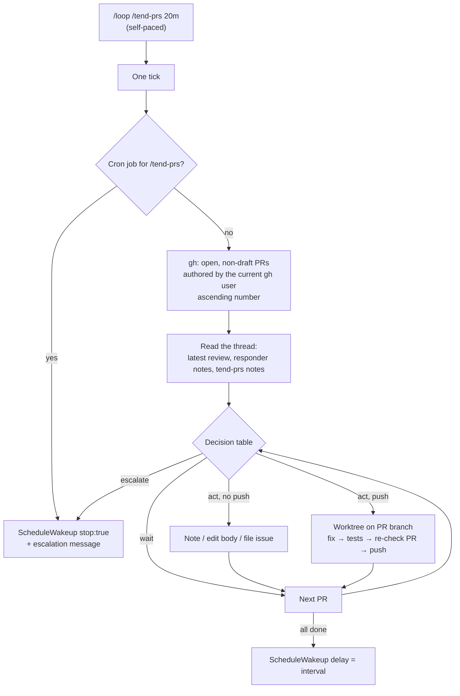

# Tend PRs — Architecture Spec

## In Plain Language

Pull requests here go through an agentic review loop. A reviewer posts APPROVED or REJECTED, with
"Must fix" and "Consider" items. A responder then fixes what it can and posts a note on each item.
Work stalls on what's left over. The responder declines anything it judges a human call ("needs your
call"). It won't edit a PR description. In some repos it leaves its patch somewhere private for a
person to apply. Every leftover waits for someone to read the thread, and the same items come back
round after round. One recent PR went through ten reviews, nine of them APPROVED, stuck on three
leftovers that needed no code change at all.

`/tend-prs` is one pass over the open PRs in the repo the session is working in. Run it under
Claude Code's `/loop`, and every so often the session wakes up and clears the leftovers:

- it fixes a rejected review nobody answered;
- it works through the Considers on an approved one;
- it applies a proposed patch that checks out;
- it makes the calls it would recommend nine times out of ten, then carries them out (edits the
  description, files the follow-up issue).

When something looks wrong, it stops the loop and tells the person in the session why. It never
merges.

It is shipped to every Studio install, and each install runs it on its own repo.

## Architecture at a Glance

Each tick is stateless. The PR thread is its only memory: the reviews, the responder's notes and the
tick's own `tend-prs:` notes. A tick ends in exactly one of two ways. It schedules the next tick, or
it stops the loop and prints why.

## How It Works (Technical)

**Components.**
- `.claude/commands/tend-prs.md` holds the whole feature. It has eight sections, in order:
  1. What this is.
  2. Arguments.
  3. Recognizing the actors.
  4. Tick start.
  5. Decision table.
  6. Escalate and stop.
  7. Push hygiene.
  8. Ending the tick.
- `studio/install.py`: `tend-prs.md` is added to `SLASH_COMMANDS`, so `init` and `update` ship it.
- Docs: a row in the command tables of `README.md` and `studio/docs/CLAUDE_CODE_USAGE.md`, and a
  short "Tending PRs" note in the usage doc.

No Python runtime, no state file, no new dependency.

**Loop form: self-paced only.** The documented form is `/loop /tend-prs [interval]`. There is no
leading interval, so `/loop` runs self-paced. The tick reads its own argument (default `20m`,
clamped to 60–3600 s):
- **To continue,** it calls `ScheduleWakeup` with that delay.
- **To escalate,** it calls `ScheduleWakeup` with `stop: true`, then prints the escalation as its
  last message. No later tick exists to act while the human reads it.
- **Guard against the fixed-interval form.** `/loop 20m /tend-prs` builds a cron job that a tick
  can't stop by skipping a wakeup. So the first thing a tick does is run `CronList`. If any job's
  prompt contains `/tend-prs`, the tick deletes it with `CronDelete` and escalates with "run it as
  `/loop /tend-prs 20m`".

**Recognizing the actors.** By comment format, never by account name, because every actor may post
as the same account:
- **A review** is a PR review from the reviews API. It starts with `APPROVED` or `REJECTED` and has
  Must fix and Consider sections. The head it read is the review's `commit.oid`, not a SHA parsed
  out of its body.
- **A responder note** answers a review with a disposition per item (`addressed`, or `declined`
  with a reason). `NO-ACTION` and `NEEDS-HUMAN` first lines are responder notes too.
- **A tender note** starts with `tend-prs:`, carries no verdict line and no @-mention (either could
  re-trigger the pipeline), and names the head SHA it acted on.

Reviews and notes come from two sources: reviews from the reviews API, responder and tender notes
from the PR's issue comments.

**Tick start.** After the cron guard, the tick lists open, non-draft PRs authored by the current
`gh` user (`gh pr list --author @me`). A PR from anyone else's account is never visited, so the
tick never escalates on a contributor's unreviewed PR and never pushes to a contributor's branch.

**Order.** PRs are visited in ascending number. One escalation ends the tick, so a later PR waits
for the next loop.

**Decision table.** The grace period is 30 minutes from the review.

| # | Situation | Action | Push? |
|---|---|---|---|
| 1 | The latest review's `commit.oid` differs from the PR head | Wait: a review is still owed. If the head commit is older than the grace period, escalate for this PR: nothing reviewed the new head. | No |
| 2 | The review is younger than the grace period, and no responder note answers it | Wait | No |
| 3 | The PR has no review, and it is older than the grace period | Escalate for this PR: nothing is reviewing here. | — |
| 4 | REJECTED, with no responder answer after the grace period | Fix the Must fix items only. Run the tests and push. Post a note quoting each Must fix addressed. | Yes |
| 5 | REJECTED after a tender push, and a Must fix that the tender's note quoted is back | Escalate | — |
| 6 | REJECTED, the responder answered, and items are still open | Handle each open item under rows 4, 8 or 9 | Must fix only |
| 7 | APPROVED with Considers that no note answers, after the grace period | Post a disposition for each Consider: accept, or decline with a reason. If no `tend-prs: consider-push` note exists on the PR, push the accepted ones as one commit and post that note. If one exists, post the dispositions only, as "deferred to a follow-up" or "declined". | Once per PR |
| 8 | A "needs your call" item the tender would decide 90/10, a stale PR body, or a follow-up nobody filed | Post the decision as a note, then carry it out without pushing: edit the body, or file the issue and link it. On REJECTED, fold it into the row 4 push only if a Must fix depends on it. | No |
| 9 | A "needs your call" item with no 90/10 answer | Escalate | — |
| 10 | A responder note points at a proposed patch | Fetch it the way the repo's `CLAUDE.md` says. Read the diff against the review item it answers. Apply it only if it does what that item asks, applies cleanly, and the tests pass. On REJECTED it is the row 4 push; on APPROVED it is the row 7 push and uses up the single `consider-push` allowance. If the repo names no way to fetch it, escalate. | Rows 4 or 7 |
| 11 | APPROVED, and every item has an answer | Nothing to do | No |

**Escalate and stop** on any of these:
- the tests go red after the tender's change (leave the worktree as it is, don't push);
- row 1 after the grace period, or row 3, 5 or 9;
- the PR closes between checkout and push;
- `gh` or `git push` fails, or a patch can't be fetched;
- no test command is found;
- the cron guard fires.

If the PR's head moves between checkout and push, that is not an escalation. Usually it is
the responder pushing just after the grace period. The tick discards its change, pushes nothing,
and moves on; the next tick sees the new head under row 1.

No open PRs is not an escalation: reschedule.

**Push hygiene.**
1. Use one worktree per PR branch, at `.scratch/tend-prs/<pr>`, reused across ticks. Never use the
   session's own checkout.
2. `git fetch`, reset the worktree to the PR head, and record that head.
3. Find the test command the way `/forge` does: infer it from the repo's marker files first
   (`pyproject.toml`, `package.json`, `Cargo.toml`), and only if none matches, fall back to the
   `test_command` key from the repo's `impl_loop.py`. Don't hard-code a config path for that
   fallback: the Studio source repo keeps its config under `studio/.studio/`, unlike a consuming
   repo. If no test command is found, escalate.
4. Right before pushing, run `gh pr view`. Check that the PR is open, its head ref is the worktree's
   branch, and the remote head still equals the recorded head.
5. Push to that branch only. No force-push, no merge, no new PR, no push to another PR's branch.

**Dependencies.** `gh` with write access; Claude Code's `/loop`, `ScheduleWakeup`, `CronList` and
`CronDelete`; a `/forge` test command in the repo.

## Key Decisions

- **One prompt file, with the thread as memory.** Every fact a tick needs is already in the PR
  thread, so a state file would only be a second copy that drifts.
- **On an APPROVED PR, land row 8 decisions without pushing.** Each push to a PR starts another
  review round. A verdict never blocks a merge, so on an APPROVED PR a push buys nothing but another
  round. Body edits, notes and filed issues don't trigger a review. In the ten-round example, the
  extra rounds came from pushes made after the PR was already APPROVED. The only push allowed on
  APPROVED is the single Consider push (row 7); a row-10 patch on APPROVED is that push, not one on
  top of it.
- **One Consider push per PR. After that, answer without pushing; don't escalate.** An earlier draft
  escalated on the second round of Considers. The reviewer posts Considers on nearly every round, so
  that draft would have stopped the loop on almost every approved PR, which is the stall this
  feature exists to remove. Must-fix pushes are not capped. They stop only when a Must fix the
  tender addressed comes back.
- **The self-paced loop only.** It is the only form a tick can end by itself. The cron guard turns
  the other form into a loud stop rather than a second supported mode.
- **The shipped file names no private tool.** How to fetch a proposed patch comes from the repo's
  own `CLAUDE.md`. The command stays generic, and the private pipeline's tooling never ships in a
  public install.
- **"Nothing reviews here" is decided per PR, after the grace period.** An earlier draft checked the
  whole repo and would have stopped every loop started right after a PR opened.

## Non-Goals / Cut Scope

- **Never merges and never opens a PR.**
- **Doesn't watch other repos,** or PRs authored by other people's accounts.
- **Doesn't stop to say a PR is ready for merge.** The reviewer's APPROVED already says that.
- **Rejected:** the `triage:skip` handling, a repo-wide "no reviewer" check, a fixed round cap, and
  support for the fixed-interval loop.
- **No bridge-doc edit.** Neither bridge template lists individual commands; `init` installs the
  full set.

## Risks & Open Questions

- **Is the 90/10 judgment good enough?** A wrong call executed (a body edit, a filed issue) is cheap
  to undo but still visible. The Verification eval measures this on its fixture only.
- **Two sessions running the loop on one repo** could both act on the same item. The tender notes
  make it visible but don't prevent it.
- **Does `/loop` read a trailing argument as its own interval?** Assumed no: only a leading
  interval counts. If it does, the cron guard stops the loop loudly on its first tick. Either way,
  the build checks it by running the documented form and confirming `CronList` is empty.
- **The 30-minute grace period is a guess** at how long the responder takes.
- **Must-fix pushes are uncapped.** Row 5 only fires when a Must fix the tender's note quoted comes
  back. If the reviewer rewords the item, or keeps finding new Must fixes in the tender's own
  pushes, the loop keeps pushing.

## Verification

- **Pass criterion.** The feature works if and only if, on a fixture repo with three open PRs, one
  tick of `/loop /tend-prs 1m`, started at least 30 minutes after the fixture was seeded, produces
  all of the following:
  - **PR A** (lowest number; REJECTED, one Must fix, no responder answer): exactly one push, with
    the tests green and a note quoting that Must fix.
  - **PR B** (APPROVED; one 90/10 "needs your call" about a stale body and an unfiled follow-up):
    the body edited and one issue filed and linked, with no push.
  - **PR C** (highest number; APPROVED; one call with no 90/10 answer): an escalation naming C that
    ends with `stop: true`.

  No second tick runs, and nothing is merged.
- **Baseline.** The same fixture, re-seeded, and the same `/loop … 1m`, but with the human's own
  paragraph asking for this behavior as the prompt in place of the command file. Does an unaided
  session reach the same three outcomes in one tick? The seeding script resets the branches and
  posts the reviews and notes from the user's account. That works because the command recognizes
  actors by comment format.
- **Where the evidence goes.** `specs/tend-prs-eval-results.md`, created when this spec is
  approved. The fixture repo is named by its role only.
- **Stop condition.** While that file still says `FILL_ME`, nobody may call this feature working,
  and this spec stays `approved`.

## Build Plan

### 1. `tend_prs_command` — a self-paced `/loop` tick that moves a repo's open PRs forward and stops itself to escalate

The command file, its registration, the docs rows and a content test.

**Acceptance criteria:**
- [ ] `.claude/commands/tend-prs.md` exists with the eight sections named in "How It Works", in that order.
- [ ] `install.SLASH_COMMANDS` contains `tend-prs.md`, and the existing command-registration tests in `studio/tests/test_install.py` pass.
- [ ] A new test asserts the command file contains `ScheduleWakeup`, `stop: true`, `CronList`, `CronDelete`, and a sentence saying it never merges.
- [ ] The Tick start section lists only open, non-draft PRs authored by the current `gh` user, and the content test asserts the command file contains `--author @me`.
- [ ] A new test reads a gitignored `.private/` list of forbidden names, when present, and asserts none appears in the command file; it skips when the list is absent, so it is a local-only guard and never runs in CI.
- [ ] The `/tend-prs` rows in `README.md` and `studio/docs/CLAUDE_CODE_USAGE.md` show only the `/loop /tend-prs [interval]` form.

**Out of scope:** running the Verification eval. That happens after the build, against the fixture.
