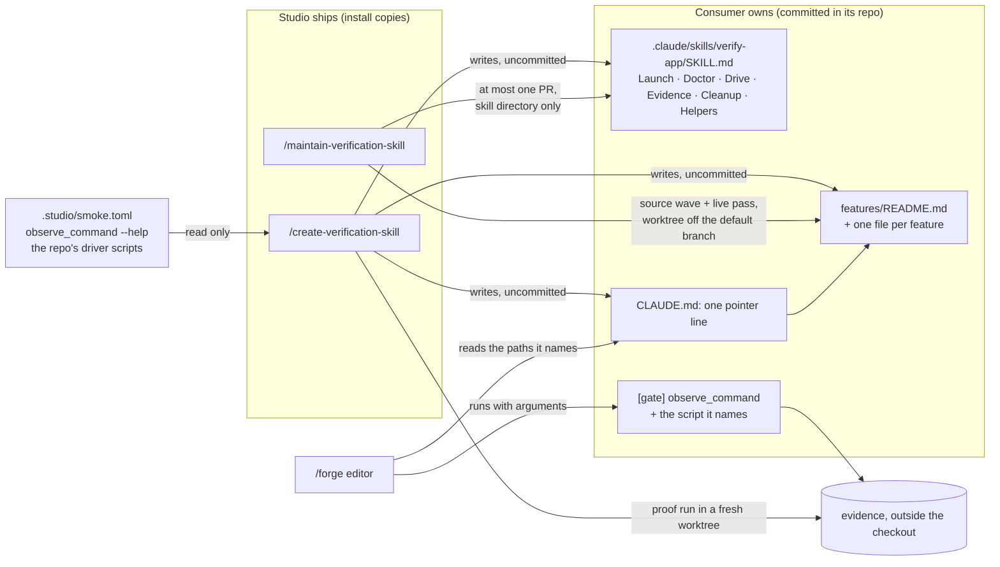

# Verification Skills — Architecture Spec

## In Plain Language

The `/forge` editor grades each acceptance criterion from the diff, the tests and, when a repo sets
`observe_command`, a capture of the running product. What it lacks is the repo's know-how: how to
start the product, reach a feature the way a user would, and record proof. When it doesn't know, it
grades `unverifiable`. In the first adopter, a three.js browser game, every `unverifiable` grade on
record is about audio. In the main drivable one, the editor wrote that recording needed a real Chrome
it did not have. That was false: the game's own recorder already runs headless Chromium with audio
muted. The driver existed, and the editor didn't know the recipe.

This feature ships two Studio commands, adapted on purpose from Lauren Tan's pstack skills
`create-verification-skill` and `maintain-verification-skill` (MIT, Copyright (c) 2026 Lauren Tan).
The first studies the repo and writes a **verification skill** into it: a short document saying how
to launch the product, check it is healthy, drive it, capture evidence and clean up. Beside it goes a
**feature map**, one file per user-facing feature, saying how to reach and drive that feature. The
command proves the skill by running it once, end to end, before handing it over. The second command
keeps the map honest as the product changes: it reads the source for every feature, drives every
feature live, and opens at most one pull request of proven corrections. It runs by hand, or daily on
a schedule the docs describe.

The skill belongs to the consuming repo, which commits and owns it. Studio never writes there after
the first run. Agents find it through one line in the repo's own `CLAUDE.md` that names the files
to read. Studio's `/forge` prompts don't change.

## Architecture at a Glance



The left box is all Studio installs: two command files. Everything in the right box lives in the
consuming repo. `/create-verification-skill` reads what the repo already has (its smoke config, its
observe command, its own driver scripts) and changes none of it. It writes the skill, the feature
map and the pointer line, proves them in a fresh worktree, and leaves the files uncommitted for a
person to review. Evidence always lands outside the checkout, so removing a worktree can't eat it.
`/maintain-verification-skill` works from a fresh worktree of the repository's default branch, read from `origin/HEAD` and never assumed to be `main`. It reads every feature
from source, drives every feature live, and ships corrections to the skill directory as at most one
PR. A `/forge` editor reaches the map through the pointer line, and drives features through the
observe command the editor prompt already names.

## How It Works (Technical)

### Components

| Component | Change | Responsibility |
|---|---|---|
| `.claude/commands/create-verification-skill.md` | new | pstack's create steps, mapped to Claude Code, with the Studio steps marked below. Ends with the attribution line and the full MIT notice. |
| `.claude/commands/maintain-verification-skill.md` | new | pstack's maintain pass, outcomes and edit scope, mapped to Claude Code, with the Studio steps marked below. Same notice. |
| `studio/install.py` | edit | Both names join `SLASH_COMMANDS`, so `install` and `update` copy them like every other command. |
| `studio/tests/test_verification_commands.py` | new | Tests 3, 4 and 5 below. |
| `README.md`, `studio/docs/CLAUDE_CODE_USAGE.md` | edit | A row each in the command tables; the scheduling recipe in `CLAUDE_CODE_USAGE.md`. |

Both command files carry `disable-model-invocation: true`, as pstack's do and as
`.claude/commands/measure-editor.md` does. An agent can't start a pass that opens PRs on its own,
and `claude -p "/<name>"` still starts one headless. The Cursor names in pstack (`.cursor/skills/`,
`AskQuestion`, `Task`, `.mdc`) are mapped the way pstack's own Claude Code adapter maps them
(`docs/harness/claude-code.md`). The generated skill lives at `.claude/skills/verify-<app>/`.

### The generator: `/create-verification-skill`

Each step is pstack's, kept word for word where it applies. **[S]** marks a Studio change.

0. **[S] Locate.** If `.claude/skills/verify-*/` exists, stop and point at
   `/maintain-verification-skill`. A second run must never overwrite a map someone has maintained.
1. **Interview the repo, not the user** (pstack §1: Surface, Run, Drive, Observe, Isolate; "fix that
   first (or report it precisely)"; scaffolding marked and removed at cleanup). **[S] Seeds, read
   only:** `.studio/smoke.toml [smoke]` (`setup`, `build`, `launch`, `ready_probe`/`ready_log` and
   `teardown` become candidates for Launch, readiness and Cleanup; `golden_path` entries become
   candidate features); `[gate] observe_command`, run with `--help`, which becomes the preferred
   entry for Drive and Evidence wherever it covers a feature; and any driver script `CLAUDE.md` or
   the package scripts name. This is pstack's "existing harnesses first", pointed at Studio's
   config. There are no stack special cases.
2. **Generate `SKILL.md`** (pstack §2: frontmatter, then Launch, Doctor, Drive, Evidence, Cleanup and
   Helpers, each with its rule). **[S] Additions:** Evidence goes outside the checkout and every
   capture is printed as an absolute path, matching the observe contract
   (`specs/forge-observe-command.md`). Launch must work from a fresh `git worktree`, dependency
   install included, because that is where a `/forge --work-dir` editor stands. Doctor rejects a
   software renderer when the product needs a GPU.
3. **Seed the feature map** (pstack §3): `features/README.md` with the index, baseline
   preconditions, driving conventions and proof reporting, then 3-5 feature files with exactly the
   four H2s `Sub-features`, `How to get to it (user POV)`, `Driving it with <harness>` and `Gotchas`.
   "Never weaken the journey to make it pass." The command file states this shape itself, because
   pstack's `references/feature-map-example/` folder is not vendored.
4. **[S] Wire it up.** Add one line to the project's own part of `CLAUDE.md` (`AGENTS.md` when there
   is no `CLAUDE.md`), outside the `<!-- STUDIO:CODING_PRINCIPLES:BEGIN/END -->` block, because
   `update` rewrites everything between those markers. The line names `SKILL.md` and
   `features/README.md` by path, as files to Read before verifying anything a user sees, hears or
   runs. When the file has a commands block, the line goes there.
5. **Prove once** (pstack §4: launch, doctor, drive ONE mapped feature, capture, clean up, confirm
   the evidence still exists; run cleanup after every failed iteration; list what a stand-in did
   that the real target won't). **[S]** Prove in `git worktree add --detach <scratch>/verify-proof
   HEAD` with the new files copied in, remove that worktree afterwards, then run `ls -l` on every
   evidence path.
6. **[S] No commit.** The files stay uncommitted, for the person to review and land as one PR.

pstack's §5 (offer the maintenance loop) becomes the hand-off reply's last line. The reply has a
fixed shape, so a person can act on it without opening a file:

```
Verify skill: .claude/skills/verify-<app>/  (uncommitted, N files)
Proved: yes | NO: <step that failed> — <error line>
Feature driven: features/<file>.md via <entry point>
Evidence after cleanup: <absolute path>  <bytes>   (one line per file, from ls -l)
Stand-in gaps: none | <setup steps the proof's stand-in did that the real target will not>
Map: <n> features (<names>); not yet driven: <names>
Wired: CLAUDE.md line <n> | not wired: <why>
Next: review and land as one PR; keep it honest with /maintain-verification-skill (schedule: CLAUDE_CODE_USAGE.md).
```

A failed proof opens with `Proved: NO` and the files stay a draft. A repo that can't drive itself
(Unity with no licence or headless driver, a docs-only repo) ends there, with the reason.

### The maintenance pass: `/maintain-verification-skill`

pstack's outcomes (`clean`, `changed`, `blocked`) and edit scope (the skill's own directory only,
never product code) are kept word for word.

0. **Locate** (pstack step 0). Candidates are `.claude/skills/verify-*/`. Several: ask, or end
   `blocked` when headless. None: stop and point at `/create-verification-skill`. **[S]** Run in
   `git worktree add --detach <scratch>/verify-maintain-<date> origin/<default>` after `git fetch
   origin`, where `<default>` is the branch `origin/HEAD` names (ending `blocked` if nothing names one), never in the person's checkout, and remove that worktree at the end. Step 0 makes no
   `gh` call.
1. **Index hygiene** (pstack).
2. **Source wave** (pstack). **[S]** One `Agent` per feature file with `subagent_type: "Explore"`
   and "do not edit files" in its brief. Afterwards `git status --porcelain` must be empty. This is
   pstack's adapter mapping for `readonly: true`.
3. **Reconcile** (pstack, including "require a concrete source path before calling one missing").
4. **Live pass** (pstack: required even when the source looks clean; the skill's Launch decides the
   launch model; the three invariants; `verified-unreachable` only with a named prerequisite;
   re-drive every harness fix; final teardown last).
5. **Triage** (pstack): doc drift and harness gaps are fixed; product gaps are reported and kept out
   of the PR.
6. **Ship or stop.**
   - **changed:** **[S]** stage everything with `git add -A`, then every path in `git diff
     --cached --name-only origin/<default>` must sit inside the skill's directory, untracked files
     included, or the outcome is `blocked: <path> is outside edit scope`. **[S]** If an
     open PR's head branch starts with `verify/maintain-` (`gh pr list --state open --search "head:verify/maintain-"
     --limit 1000 --json number,headRefName`, searched by prefix so no page cap hides one), the outcome is `blocked: earlier maintenance PR #N is still open`. The
     full coverage and the product-gap report are still in the reply; only the second PR is
     withheld. Otherwise: re-read every changed file, push one branch `verify/maintain-<YYYY-MM-DD>`
     and open one PR into `<default>`, ready for review. Its body lists the features covered, each
     correction beside the drive that proved it, and any product gaps (reported, not fixed).
   - **clean:** no branch, no PR.
   - **blocked:** no PR, and the reply says exactly what blocked it.

   **[S]** The last line is always `OUTCOME: clean|changed|blocked — <one line>`, so a scheduled
   log can be grepped. Run notes stay in scratch and are never committed (pstack).

### Scheduling

`CLAUDE_CODE_USAGE.md` documents two ways to run the pass, daily as the owner set (pstack's guide
says at least once a day):

- **By hand:** `/maintain-verification-skill`.
- **Local daily on macOS, for a product that needs the local GPU or display.** A per-user
  LaunchAgent in `~/Library/LaunchAgents/`, never a LaunchDaemon: a daemon runs outside the login
  session, with no WindowServer, no Metal and no access to the login keychain, so `claude` and `gh`
  auth fail too. The plist sets:
  - `StartCalendarInterval` for the daily time;
  - `WorkingDirectory` to the repo root;
  - `EnvironmentVariables` → `PATH` including `/opt/homebrew/bin`, because launchd starts jobs with
    `/usr/bin:/bin:/usr/sbin:/sbin` and `claude`, `node` and `gh` live in Homebrew's prefix;
  - `ProgramArguments` for `claude -p "/maintain-verification-skill" --setting-sources project
    --settings <absolute path to the scheduler's settings file> --permission-mode auto`;
  - `StandardOutPath` and `StandardErrorPath` to a log outside the checkout.

  The scheduler's allow rules (its Launch and Drive commands, `git push`, `gh pr list`, `gh pr
  create`) go in a dedicated settings file outside the checkout, beside the log, which only the
  plist passes with `--settings`. Not in `.claude/settings.local.json`: every session in the repo
  loads that file, and `--setting-sources` only picks which sources load, so it would grant push and
  PR rights to all of them. `--setting-sources project` keeps the owner's local and user rules out
  of the scheduled run; `--settings` applies whatever the sources are.
  **Run-time note:** launchd runs a missed job when the machine wakes, coalescing missed runs into
  one. On a Mac that sleeps overnight, the pass (a worktree, a dependency install, a dev server,
  headless Chromium on the GPU) would start as the owner sits down to work. Schedule it for a time
  the machine is awake and idle, or pair it with `pmset repeat wake` a few minutes earlier.

### How agents find the skill

Probed on 2026-11-25 with Claude Code 2.1.332, using the flags `studio/forge_claude.mjs` passes to
headless roles:

| Channel | Headless `--runtime claude` role | Native Workflow `agent()` role (default `/forge`) | Agent-tool subagent, interactive |
|---|---|---|---|
| Project skill in `.claude/skills/` | **No.** `--disable-slash-commands` and a tool list without `Skill` hide it. Without those flags the same agent lists it. | Not verified | Yes |
| Project `CLAUDE.md` | **Yes** in a trusted checkout. **No** in an untrusted scratch folder, with or without the flags. | Not verified; transcripts can't settle it, because they don't record the system prompt | Yes |
| `observe_command <args>` in Bash | Allowed only with no arguments: Studio issue #280 | Session permissions | Session permissions |

So the pointer names **file paths to Read**, never a skill to invoke, and works whether or not
skills load. The editor prompt already sends the editor to the repo's docs ("with the arguments this
repo's docs give", `.claude/workflows/implementation-loop.js`), so it needs no edit. A consumer can
add a fallback that survives a missing `CLAUDE.md`: its observe entry's `--help` names the map's
path, and the editor prompt always names the observe command. Skill registration is a bonus for
interactive sessions.

### The first adopter (consumer-owned, outside Studio's build)

The owner chose a three.js browser game (decision 2). Its name, unit ids, commits and criterion
text stay in its own repository; this spec and the results file paraphrase them, because Studio is
public. Its checkout sits on a demo branch with uncommitted files, so this work happens in a
worktree off its default branch.

**Adoption depends on #280's fix.** The headless runtime allows `observe_command` only as an exact
rule (`studio/forge_host.mjs`, turned into `Bash(<command>)` by `studio/forge_claude.mjs`), while
the writer and editor prompts (`studio/forge_loop.mjs`) and the observe spec require arguments. The
fix is a separate bug PR in Studio: a second entry, `observe_command + ' *'`, and a test. The
adopter picks it up through its Studio update. No tracked `.claude/settings.json` rule goes into the
adopter as a workaround.

1. **#280 is fixed and merged in Studio.**
2. **The adopter updates Studio** in its own PR (its snapshot dates from 2026-11-18), which brings
   the #280 fix and the two new commands.
3. **It writes an observe entry**: a thin wrapper with two subcommands, `shot` over its screenshot
   script and `listen` over its audio recorder. It forces output under `$TMPDIR/<app>-observe/<short
   sha>-<time>/`, prints every file as an absolute path, and its `--help` names the feature map's
   path. A wrapper, because the screenshot script defaults inside the checkout and prints relative
   paths, and because every historical gap is audio, which only the recorder reaches.
4. **It sets `[gate] observe_command`** to that wrapper. Today its gate holds only `test_command`.
5. **It runs `/create-verification-skill`** in the worktree. The pointer line goes into its
   `CLAUDE.md` commands block, outside the Studio sentinels, and the same change says editors
   capture through the observe entry, not the in-checkout screenshot habit documented beside it.
6. **It lands as one PR**, merged by a human.
7. **R and M run** (see Verification), **then maintenance is scheduled** with the LaunchAgent above.

### Licence

Each command file ends with "Adapted from `<skill>` in pstack by Lauren Tan
(`harness/pstack/claude-code/skills/<skill>/` in `cursor/plugins`)" and the full MIT notice:
"Copyright (c) 2026 Lauren Tan" plus the permission text from pstack's `LICENSE`. The notice travels
inside the file because the file is what installs into every consumer. The unlicensed
`verification-skill-example` repository was structural inspiration only. No text from it is used or
quoted, here or in the command files.

### Dependencies

`[gate] observe_command` (`specs/forge-observe-command.md`) and its arguments contract; the
installer's `SLASH_COMMANDS` copy loop; `/forge --work-dir` worktrees; `gh` for the maintenance PR;
Studio issue #280 for the first adopter.

## Key Decisions

- **The maintenance pass ships in v1** (owner, decision 1), hand-run, with a documented daily
  schedule. It needs no scheduler: pstack's maintain skill is `disable-model-invocation: true` and
  runs by hand.
- **The first adopter is the three.js game** (owner, decision 2). It has the richest driver and the
  only record of `unverifiable` grades. It needs `observe_command` set and captures moved outside
  the checkout first.
- **Keep pstack's design; diverge only on evidence, and say so.** Owner's rule for this spec. Every
  pstack step, outcome, rule and the edit scope are kept. The changes:

  | Change | pstack says | Why |
  |---|---|---|
  | Find the skill through a `CLAUDE.md` pointer naming paths, not by invoking `/verify-<app>` | Its guide says to use `/verify-<app>` | **Evidence it fails here:** forge's headless flags hide every project skill (probed, table above) |
  | Evidence outside the checkout, as absolute paths | "in a location the skill names" | The observe contract requires it, and a worktree removal eats anything inside |
  | Launch and the proof run from a fresh worktree | Launch from an empty data dir; list a stand-in's extra steps | Her rules applied to `/forge --work-dir`; the worktree is the real target, not a stand-in |
  | Maintain runs in a worktree off the default branch | Silent on where it runs | The adopter's checkout is on a demo branch with uncommitted files |
  | The hand-off points at a schedule | "Suggest a cadence only if they ask" | Owner's decision 1; her guide says run it at least daily |
  | Refuse when a `verify-*` skill exists; headless with several candidates ends `blocked` | Silent; "ask" | Additions. A second run would overwrite a maintained map; a headless run can't ask |
  | `git diff --cached --name-only` scope gate; `OUTCOME:` line | Edit scope as a rule; outcome stated | Enforce her rules in a form a scheduled log can check |
  | No commit from the generator; the maintenance PR opens ready for review into the default branch | Silent | Studio's git rules |

- **The open-PR check sits in step 6, not step 0.** The advocate's first draft blocked at step 0,
  which skipped pstack's required live pass and with it the product-regression report. pstack's own
  definition covers the case at the end: `blocked` means "a proven fix could not ship safely". A
  repo with an unreviewed maintenance PR is blocked from shipping corrections and still watched.
  It also keeps `gh` out of step 0, which M needs.
- **No checker and no `proof.json`.** Cut by the contrarian. Once the evidence file is deleted
  nobody can recompute its hash, "doctor passed" is a boolean the agent typed, and nothing would
  ever run the check. Its staleness rule fired the wrong way: an app change left it green over a
  stale map, and a one-line gotcha fix turned it red. pstack ships no checker. The proof is the run,
  and the hand-off reply reports it.
- **No edit to the `/forge` editor prompt.** It already defers to the repo's docs.
  `editor_results.py` fingerprints the whole rendered prompt, so any edit forces a re-measurement,
  and it would collide with PR #279, which rewrites the editor's job.
- **Seed from `/smoke`, don't merge with it.** Only one consumer has a `smoke.toml`, and it has no
  launch keys, so there are no two launch recipes to drift apart.
- **No stack special cases.** A Unity refusal keyed on `ProjectSettings/` would misfire on a mixed
  repo with `unity/` beside `web/`. pstack already covers it: a skill that was never executed "is a
  draft, not a deliverable", so a repo that can't drive itself fails the proof honestly.
- **Command names stay pstack's** (assumed, advocate's P1). The generated skill's last step names
  the maintain command, and matching names keep the MIT source traceable.
- **#280 is fixed upstream, and adoption waits for it** rather than carrying a tracked workaround.
  The workaround would put a rule for a Studio bug into the adopter's tracked settings and leave
  cruft once the fix lands.

## Non-Goals / Cut Scope

- **No `check-verify` subcommand, no `proof.json`, no staleness check.** See Key Decisions.
- **No change to `/forge` prompts, `/smoke` or `/studio-setup`**, and no new config key. A setup
  step would ask for a command the person can just type.
- **Studio never writes under a consumer's `.claude/skills/`.** The installer copies only listed
  commands and workflows; the generator writes there once, uncommitted.
- **No cloud `/schedule` recipe.** Cut by the contrarian: no adopter can use it and nobody has
  proved one has the repo's dependencies, `gh` auth or a browser. Add it the day a consumer whose
  Launch works on a Linux box with no GPU adopts.
- **No install test for the new commands** (advocate's test scenario 1, deleted).
  `TestCommandRegistration.test_every_source_command_is_registered` already fails when a command
  file exists but its name is missing from `SLASH_COMMANDS`.
- **No test that `update` leaves `.claude/skills/` alone** (scenario 2, cut). `_retired_claude_files`
  returns only manifest keys, and the manifest records only files the installer wrote. No unit here
  touches that sweep.
- **Not the #280 fix itself.** That is a separate bug PR.
- **Not a measurement of PR reviewers.** They benefit only when they run in a checkout of the
  consumer, where the pointer loads. Logged for a later spec.

## Risks & Open Questions

- **Native Workflow roles loading `CLAUDE.md` is unverified,** and transcripts can't settle it. Default
  `/forge` runs that way. F checks whether a Read of a feature file happened, however the editor got
  there, and records which channel it took, so a failure says which link broke.
- **`CLAUDE.md` didn't load in an untrusted scratch folder** (workspace trust or the `/private/tmp`
  path; the flags are ruled out). The adopter's `/forge` worktrees live under its own
  `.claude/worktrees/` and probably inherit trust (unverified). Assumed: R runs in that same
  location and measures it, and the observe `--help` fallback covers the gap.
- **F will probably need its date moved.** It depends on a real `/forge` unit touching a mapped
  feature inside the window, while the adopter is on demo and trailer work. The rule stands: no
  qualifying unit is a fail unless the owner moves the date on the record.
- **R is a weak statistic.** With 3 runs per arm and 2-of-3 thresholds, an editor flipping a coin
  passes one case about one time in eight. The second positive case narrows that, if its commits can
  be recovered.
- **A repo can sit `blocked` for days** while a maintenance PR waits. That is the intended nudge,
  and the daily pass still reports coverage and product gaps.
- **Whether a locked or sleeping Mac falls back to a software renderer is unverified.** Doctor's
  renderer check turns it into `blocked` either way, not a false `clean`.
- **Every unit criterion checks what a file says, not what an agent does.** That is the ceiling for
  a prompt-shaped unit. R, F and M carry the behaviour.

## Verification

Tests can show what the command files say. They cannot show that a generated map gets an editor to
drive a feature it couldn't grade before, or that the maintenance pass finds drift. So this feature
carries a criterion agreed before the build.

- **Pass criterion.** This feature works if and only if R, F and M all hold:
  - **R: replay, both arms real.** Build two branches in the adopter from the base of the
    phone-speaker unit, plus the observe adoption (steps 3-4). Only the treatment arm gets the verify
    skill and the pointer line. The unit's writer diff goes on top of each, so the editor's
    `base..writer` diff is exactly the unit's. Render the editor prompt with
    `node .claude/workflows/tests/editor-prompt.mjs render`, criteria verbatim from the unit's editor
    record, and run it headless with forge's flags 3 times per arm, passing `--allowedTools
    'Bash(<observe_command> *)'` on the command line. `--disable-slash-commands` stays on, so only
    the pointer channel is tested: the worst case. R holds when the treatment arm grades the
    phone-speaker criterion `pass` or `fail` in at least 2 of 3 runs, with evidence naming an
    absolute capture path a feature-map recipe wrote at that commit, and the control arm grades it
    `unverifiable` in at least 2 of 3. If the remote phone-sounds unit's base and writer commits
    can be recovered from the adopter's worktrees, it is a second positive case with the same arms,
    runs and thresholds. If they can't, the results file says so. **Negative case:** a
    treatment-arm replay of the designer-decision criterion grades it `unverifiable` in at least 2
    of 3. If the control arm also verifies a positive case, R fails: the observe entry did the work,
    not the map, and the results file says that.
  - **F: real use.** By `verification_due`, at least one real adopter `/forge` editor transcript, not
    a replay, opens one of its `features/*.md` and cites, in a `pass` or `fail` verdict, an
    absolute capture path that file's recipe wrote. Checked from the adopter's transcripts under
    `~/.claude/projects/`. For each qualifying transcript the results file records whether the
    editor reached the map through the `CLAUDE.md` pointer or through `observe --help`, judged by
    which Read or Bash call came first. No qualifying unit by the due date is a fail unless the
    owner moves the date on the record.
  - **M: maintenance finds planted drift.** `git clone --bare` the adopter into scratch, clone that
    bare repo, commit one wrong recipe command (an old URL parameter name) to the clone's `main`,
    and push it to the bare origin. Hand-run `/maintain-verification-skill` from the clone. M holds
    when the reply names that feature as drift, the fix touches only the skill directory, the fix
    was re-driven live, and the outcome is `blocked` at step 6, because `gh` can't reach a
    non-GitHub origin.
- **Baseline.** Measured 2026-11-25, read-only, in the adopter: 32 editor records (29
  `impl--*--editor.json`, 3 bare `editor.json`) hold 3 unique `unverifiable` verdicts, all audio.
  (1) The phone-speaker dropout criterion: drivable, missed on the false belief above. (2) The remote
  phone-sounds criterion, whose record lost its evidence: drivable through the same recorder. A
  transcript-only "no recording exists" case is very likely this same verdict, so it isn't counted
  twice. (3) The designer-decision criterion: not drivable, and it must stay `unverifiable`. Editors
  reading a feature map: 0, because none exists. The control arm of R reproduces the baseline on
  demand.
- **Where the evidence goes.** `specs/verify-skill-eval-results.md`, created from the skeleton when
  this spec is approved, listing the 3 baseline cases. It paraphrases the adopter's unit ids,
  commits and criterion text, which stay in the adopter's repository.
- **Stop condition.** While that file still says `FILL_ME`, nobody may call this feature working and
  this spec stays `status: approved`. Setting it to `shipped` is the claim, made when the file is
  filled in.

## Build Plan

Both units land in one PR: they are one feature, and the generator's hand-off names the maintain
command.

### 1. `create_verification_skill` — a person can run `/create-verification-skill` in a consuming repo and get a proved verification skill and feature map

What gets built: the command file, its `SLASH_COMMANDS` entry, the three new tests, and the doc rows.

**Acceptance criteria:**
- [ ] `.claude/commands/create-verification-skill.md` exists, is listed in `SLASH_COMMANDS`, has `disable-model-invocation: true` in its frontmatter, and `test_command_descriptions.py` passes with it included.
- [ ] Its body keeps pstack §1-§4: the five interview questions (Surface, Run, Drive, Observe, Isolate); the Launch, Doctor, Drive, Evidence, Cleanup and Helpers sections with their rules; the four feature H2s `Sub-features`, `How to get to it (user POV)`, `Driving it with <harness>` and `Gotchas` verbatim; and prove-once with evidence confirmed after cleanup. It targets `.claude/skills/verify-<app>/`.
- [ ] It carries the Studio steps: it refuses when `.claude/skills/verify-*/` exists; seeds read-only from `.studio/smoke.toml` and `[gate] observe_command`; keeps evidence outside the checkout as absolute paths; proves in a fresh `git worktree`; writes one `CLAUDE.md` pointer line naming `SKILL.md` and `features/README.md` outside the `STUDIO:CODING_PRINCIPLES` sentinels; does not commit; and contains the hand-off reply template word for word.
- [ ] The file ends with the attribution line naming pstack and Lauren Tan and the full MIT notice, and `studio/tests/test_verification_commands.py` checks every verification command file for "Copyright (c) 2026 Lauren Tan" and the MIT permission sentence, for `disable-model-invocation: true`, and for the absence of `.cursor/`, `AskQuestion`, `.mdc` and `Task` as a tool name; each test fails under its mutation (notice deleted, frontmatter line removed, pstack's `.cursor/` path pasted back).
- [ ] `README.md` and the "Utility Slash Commands" table in `CLAUDE_CODE_USAGE.md` each have a row saying when to use it, and the full suite is green.

**Out of scope:** the maintenance command, the scheduling recipe, the #280 fix, and anything in a consuming repo.

### 2. `maintain_verification_skill` — a person can run `/maintain-verification-skill` by hand or daily, and get at most one PR of proven map corrections

Depends on unit 1's test file and doc rows.

**Acceptance criteria:**
- [ ] `.claude/commands/maintain-verification-skill.md` exists, is listed in `SLASH_COMMANDS`, has `disable-model-invocation: true`, passes `test_command_descriptions.py`, and is covered by every test in `test_verification_commands.py`.
- [ ] Its body keeps pstack's outcomes `clean`, `changed` and `blocked` with their definitions word for word, the edit scope, and steps 0-6, including the live pass "Required even when source looks clean", the three invariants and the `verified-unreachable` rule.
- [ ] Step 0 locates `.claude/skills/verify-*/`, ends `blocked` with several candidates when headless, runs the pass in a fresh worktree off the default branch `origin/HEAD` names (never assumed to be `main`) after `git fetch origin`, removes it at the end, and makes no `gh` call. The source wave uses `Explore` agents told "do not edit files" and requires an empty `git status --porcelain` afterwards.
- [ ] Step 6 stages everything with `git add -A` and ends `blocked` when `git diff --cached --name-only origin/<default>` names a path outside the skill directory, so a new untracked file counts, and ends `blocked` after full coverage and the product-gap report while a PR whose head branch starts with `verify/maintain-` is open. Otherwise it pushes one `verify/maintain-<YYYY-MM-DD>` branch and opens one ready-for-review PR into the default branch. Every run's last line is `OUTCOME: clean|changed|blocked — <one line>`.
- [ ] `CLAUDE_CODE_USAGE.md` documents the hand-run and the local daily recipe: a per-user LaunchAgent in `~/Library/LaunchAgents/` with `StartCalendarInterval`, `WorkingDirectory` at the repo root, `PATH` including `/opt/homebrew/bin`, the `claude -p` line, logs outside the checkout, `--setting-sources project` with `--settings` naming a dedicated file outside the checkout that holds the scheduler's `git push` and `gh pr` allow rules (never `.claude/settings.local.json`, which every session in the repo loads), and the run-time note on wake. It has no cloud `/schedule` recipe, and `README.md` has a row for the command.

**Out of scope:** a scheduler inside Studio, the cloud `/schedule` path, R, F and M (the owner runs those in the adopter), and the adopter's observe entry.
